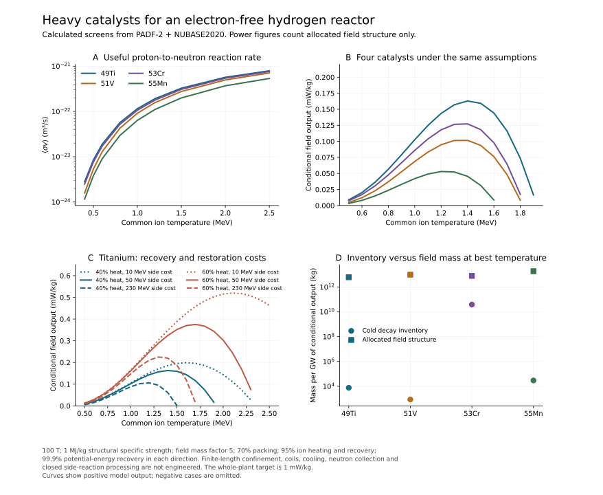

# Catalysts beyond carbon ✨

Research checkpoint, 29 October 2026. This extends the accelerator branch with a broad nuclear-data survey and an explicit two-species confinement calculation. It establishes conditional energy margins and relative rankings. A complete reactor, a closed side-reaction factory and a future date remain to be selected.

## Why the catalyst matters

A proton-to-neutron catalyst can perform the slow weak conversion away from the hot reaction region. For titanium-49 the main reactions are

\[
p+{}^{49}\mathrm{Ti}\rightarrow{}^{49}\mathrm{V}+n,
\qquad Q=-1.3842\ \mathrm{MeV},
\]

followed by electron capture after the vanadium has been extracted, cooled and given electrons. Its neutral-atom half-life is 330 days and its atomic decay energy is 0.60181 MeV. Titanium-49 returns to the reaction region. The net operation consumes a proton and an electron, produces a neutron and a neutrino, and requires the neutron–hydrogen mass difference plus the escaping neutrino energy.

The neutron is captured on hydrogen to make deuterium. A separate closed deuterium-burning network supplies helium and returns its internally produced neutrons to deuterium manufacture. Two externally generated neutrons are needed per helium nucleus. This uses the same closed D-cycle ledger as `NONNEUTRAL-BEAMS.md`.

For the electron-capture candidates, the present calculation assigns the entire atomic decay Q to the neutrino. This slightly understates recoverable heat because atomic relaxation and some nuclear cascades release photons or electrons. The resulting titanium main-cycle heat is about 25.53 MeV per helium nucleus. Electron capture requires the cold external inventory: neutral-atom decay rates cannot be applied to fully stripped ions in the trap.

The hot plasma contains protons and fully stripped catalyst ions at a common Maxwellian temperature. Ion–ion thermalization conserves their heat. Its main nuclear process is endothermic neutron production. The deuterium plant and decay inventory release the remainder of the cycle energy outside the trap.

## Data and candidate selection

The archived April 23, 2026 PADF-2 ZIP contains 61 target evaluations from carbon to niobium. `catalyst_catalog.py` selects stable ground-state targets whose useful ground-state daughter has a single reported beta-plus/electron-capture return in NUBASE2020. Forty-four targets pass this initial filter. Additional daughter isomers are listed separately. The filter does not establish a closed reaction network or select a practical catalyst.

`catalyst-catalog.json` preserves masses, decay classification, thresholds, source hashes and thermal integrals. `catalyst-pn-curves.json.gz` preserves the 44 selected evaluations in a compact parsed format. The original ZIP is archived under `beam-data/` for reproducibility. Some comment headers contain Latin-1 characters; the parser reads those bytes without changing the numerical ENDF fields.

The leading heavy candidates in the present screen are:

| Target | Returning daughter | Neutral daughter half-life | (p,n) Q, MeV | Thermal reaction coefficient at 1 MeV, m³/s |
|---|---|---:|---:|---:|
| Ti-49 | V-49 | 330 d | −1.3842 | 1.1524 × 10⁻²² |
| V-51 | Cr-51 | 27.7015 d | −1.5347 | 9.1489 × 10⁻²³ |
| Cr-53 | Mn-53 | 3.7 My | −1.3797 | 1.0649 × 10⁻²² |
| Mn-55 | Fe-55 | 2.7562 y | −1.0135 | 6.3675 × 10⁻²³ |

For comparison, the C-13 coefficient at the same temperature is 2.5966 × 10⁻²³ m³/s. Titanium has a substantially smaller inelastic and destructive-channel burden in this evaluation. Its higher charge and mass change both the density limit and the spatial overlap, so the reaction coefficient alone does not determine power per kilogram.

PADF-2 provides independently evaluated production cross sections. They cannot generally be interpreted as mutually exclusive reaction probabilities. For example, some vanadium cases predict slightly fewer inclusive neutrons than useful daughter nuclei. Ground-state and isomer production may have different cumulative conventions. Such inconsistencies are exposed in the JSON rather than silently repaired.

The titanium evaluation cites Kennett et al., *Nuclear Physics A* 344, 351 (1980), DOI [10.1016/0375-9474(80)90683-1](https://doi.org/10.1016/0375-9474(80)90683-1), and Johnson et al., *Physical Review* 109, 1243 (1958), among its measurements. The DOI/title metadata and evaluation bibliography were verified. The original Kennett numerical tables were not independently retrieved: publisher access returned HTTP 403. The low-energy measurement range indexed in the nuclear-reference compilation reaches 3.25 MeV; the thermal calculation also depends on higher-energy evaluation data. That extrapolation deserves an independent data check.

## Energy and confinement model

`catalyst_thermal.py` closes the principal (p,n), weak-decay and deuterium-burn cycle. It counts the reaction-selected pair energy, neutron kinetic energy, daughter kinetic energy and inelastic radiation. An unknown prompt daughter gamma cascade is bracketed by allocating a chosen fraction of the available relative energy to photons. The baseline uses zero cascade energy and assigns half the reaction-weighted relative energy to each inelastic event. These are explicit spectral assumptions.

Every other heavy residual is assigned a specified net restoration cost. The tested costs are 10, 50 and 230 MeV per residual. They include the entire side process, its reaction/injection losses and restoration; no additional nuclear-energy credit is taken for it. This is a sensitivity parameter, not a demonstrated restoration process or a rigorous bound. Inclusive/cumulative production correlations can affect the residual sum.

The generic carbon calculation treats its large C-12 production as a side cost. It must not replace the dedicated carbon model, which explicitly closes the dominant (p,d) route using neutron capture.

`catalyst_penning.py` generalizes the earlier rotating Poisson–Boltzmann model to arbitrary catalyst charge Z and nuclear mass M. It solves proton and catalyst density profiles in a long conducting cylinder with a uniform imposed magnetic field. The calculation includes rotation, a full-Maxwellian-tail estimate of wall loss, potential-energy circulation and vacuum ion Larmor radiation. It assumes prompt removal of products and reinjection of the restored ions.

The reference assumptions are 100 T, 95% ion-heating efficiency, 95% direct ion-energy recovery, 40% heat conversion, 99.9% potential-energy recovery in each direction, full escape of the vacuum Larmor estimate, and 50 MeV per side residual. The field-mass allocation is five times field energy divided by a structural specific strength of 1 MJ/kg, with 70% packing. It includes the empty field volume out to the conducting wall. It does not specify an actual conductor, finite-length end system, radiation shield or cryostat.

Each of the four targets was scanned over 280 central-density, composition and rotation combinations at 1 MeV. There were 164 decaying solutions and 116 density blowups per target on this grid. This is a coarse search, not a global optimum. The same selected dimensionless profile is then used for the temperature and efficiency sensitivity.

For titanium at 1 MeV, the selected profile gives:

- Radius 2.072 cm and 5.807 × 10⁹ useful reactions per metre per second.
- Main-cycle surplus before trap costs: 5.651 MeV per useful reaction.
- Mean removed pair rotation energy: 12.06 MeV; its conversion penalty is 1.135 MeV.
- Potential energy circulated: 81.23 MeV per reaction; the assumed recovery loses 0.130 MeV.
- Wall and vacuum-radiation penalties: 0.109 and 0.055 MeV respectively.
- Remaining conditional surplus: 4.222 MeV per reaction.
- Allocated field mass: 38.33 kg per metre; conditional field output: 0.1025 mW/kg.
- Axis-to-wall potential 3.885 MV and wall electric field 95.6 MV/m.

These values leave finite-length confinement, electron contamination, isotope-selective extraction, heating/conversion hardware, and the deuterium reactor unresolved. The equilibrium is an ideal closed thermal state; its stability does not prove stability under extraction, end fields or asymmetric boundaries. The fastest listed wall rotation is a diagnostic of the nonrelativistic approximation. The physically populated region must be checked before extending to larger temperatures or radii.

## Temperature and efficiency results

The temperature sweep with 40% heat conversion and 50 MeV side cost gives:

| Catalyst | Best tested ion temperature, MeV | Conditional net MeV per useful reaction | Field output, mW/kg |
|---|---:|---:|---:|
| Ti-49 | 1.4 | 2.754 | 0.1629 |
| V-51 | 1.4 | 2.117 | 0.1015 |
| Cr-53 | 1.4 | 2.396 | 0.1272 |
| Mn-55 | 1.2 | 2.437 | 0.0530 |

Titanium reaches 0.3754 mW/kg at 1.7 MeV with 60% heat conversion and the same 50 MeV side cost. At 60% heat conversion, the 10 and 230 MeV side-cost cases peak at 0.5198 and 0.2254 mW/kg respectively. These are field-only conditional values. Their positive energy margins justify further investigation; they do not yet meet the complete-plant requirement.

The mass allocation scales linearly with assumed structural specific strength at fixed field and geometry. For example, 5.54 MJ/kg would multiply the field-only figures by 5.54. [Shi et al. (2023)](https://doi.org/10.1021/acs.nanolett.3c02707) report that specific strength for a carbon-nanotube fibre, together with 8 GPa tensile strength. This is a specimen-level breaking-strength result. A reactor allowance must separately establish working stress, large-scale defects, joints, radiation damage, conductor mass, service life and redundancy. The field pressure at 100 T is about 3.98 GPa. Increasing B while retaining the same mass multiplier is an extrapolation requiring a magnet design.

The optimizer maximizes signed output per allocated mass. When all candidates have negative output, it can enlarge the wall radius to dilute the negative value with extra mass. Such negative optima have no useful engineering interpretation. They are retained in the JSON and omitted from the positive-output figure.

## Cold inventories and remaining process work

A long decay time does not by itself make the mass budget impossible. The steady inventory is useful reaction rate times mean lifetime times daughter mass. In the best 40% cases, V-49 requires about 7.6 tonnes per GW of conditional output, while Mn-53 requires roughly 3 × 10¹⁰ kg/GW. The latter is still smaller than the reference field allocation, but the required radioactive seed and its manufacturing energy must be included explicitly. Manufacturing that seed in advance establishes activity immediately; waiting millions of years is one startup method, not a mandatory physical delay. The later [recycling audit](CATALYST-RECYCLING.md) instead sends rare Mn53 side products through further proton reactions. Storage, isotope recovery and initial loading remain part of the budget. None of these numbers permits applying the neutral half-life in the hot stripped-ion region.

The principal titanium side products at 1 MeV are V-50, Ti-48 and Sc-46. At higher temperature Ti-48 and V-48 production grows. Some of these admit much more specific loops than a generic restoration charge:

- Ti-48 can recapture a neutron and return to Ti-49. The production table combines (p,d) and (p,pn)-type routes, so outgoing neutrons and deuterons must be reconciled first.
- V-48 decays to Ti-48; adding neutron capture can return Ti-49 while leaving one useful neutron from a (p,2n) event. Its neutrino and gamma ledger differs from the main V-49 loop.
- V-50 from proton capture can undergo (p,2p) to Ti-49. The mass-derived Q is −7.9482 MeV. PADF-2 gives useful residual-production cross sections of 0.00305 barn at 15 MeV, 0.02628 at 20 MeV and 0.0413 at 30 MeV. Competing channels are substantial, so a single inverse reaction is insufficient to establish a factory.
- Sc-46 can in principle be processed through the inverse alpha-induced channel; its beta decay and isomers must be included.

A detailed isotope network may improve or worsen the present cost parameter. It needs electron-free hot reaction data, cold neutron captures, realistic product extraction and repeated side-reaction branching. Neutron collection, parasitic captures and the separate D reactor remain part of the whole plant.

Lithium remains another open candidate. The TUNL `1976SE05.xls` file is a **Li-7(p,n)** dataset, despite an earlier mistaken reading of its index context. It reports a digitized peak near 0.578 barn at 2.259 MeV. The separate Taskaev 2022 (p,alpha) measurement provides destruction data through about 2.0 MeV and discusses disagreement with older evaluations. These records have been read, but no closed lithium reactor calculation is claimed here.

## Validation and reproduction

`validate_catalysts.py` checks 352 thermal integrals against independent incomplete-gamma expressions: maximum relative difference 8.22 × 10⁻⁹. The generalized equilibrium reproduces the original carbon implementation to 6.22 × 10⁻¹⁵ absolute error. Independent charge integration, tighter solver tolerances, the charge/mass separation identity and field/strength scaling tests pass. The closed main-cycle energy residual is below 2.7 × 10⁻¹² MeV across the tested temperature and gamma brackets. These checks validate the stated arithmetic and equations, not the omitted hardware or nuclear side network.

Run `catalyst_catalog.py`, `catalyst_thermal.py`, `catalyst_penning.py --target 49Ti` (also `51V`, `53Cr`, `55Mn`), `catalyst_sensitivity.py`, `validate_catalysts.py`, then `plot_catalysts.py`. Dependencies match the existing research environment. The original PADF ZIP and parsed gzip data are included; numerical outputs do not require a live web service.
