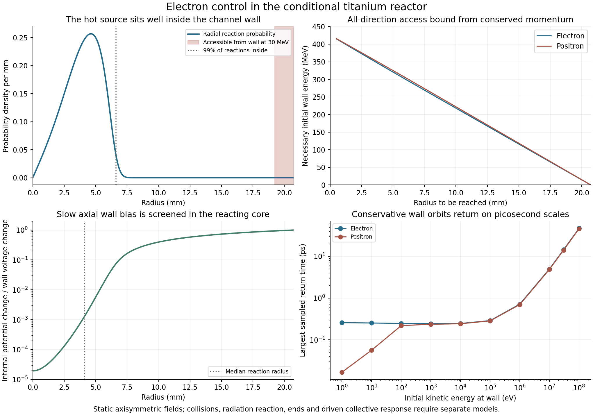

# Electron exclusion and axial clearing response ✨

The reference geometry provides strong magnetic insulation between the channel wall and the reacting plasma. In its prescribed static fields, a wall electron needs at least **287 MeV** to reach the radius containing 99% of the titanium reactions. Ordinary wall secondaries therefore do not automatically become core electrons. Electrons and positrons created inside the plasma still need a separate removal system.

A second calculation narrows the options for that system. The ions strongly screen a slowly applied axial wall voltage. At the median titanium reaction radius, only **0.127%** of a small wall-voltage change appears in the plasma. A weak wall gradient cannot be assigned directly to the electrons as an unscreened clearing field.

These results develop the [end-transport checkpoint](END-TRANSPORT.md). They leave the **1.474 mW/kg plant allocation conditional**. This checkpoint does not yet insert an electron birth rate, residence distribution or additional electron-control load into that allocation.



## The wall and reacting core are well separated

The main channel has a wall radius of **20.73 mm**, a field of **137.15 T** and an axis-to-wall potential of **13.94 MV**. Half its pn reactions occur inside 4.10 mm, 99% inside 6.62 mm, and 99.9% inside 7.10 mm. The positive-ion distribution falls steeply outside that region. The modeled proton density at the wall is only about 4.2e4/m3.

`electron_wall_orbits.py` uses the existing Poisson–Boltzmann potential with a Hermite interpolant that preserves its electric field. The wall is assigned zero potential. For a lepton of charge q, the prescribed static, axisymmetric fields conserve

```
H = gamma*m_e*c^2 + q*phi(r)
P_theta = r*p_theta + q*B*r^2/2
p_z = constant.
```

At a candidate radius, energy fixes the available momentum and canonical angular momentum fixes its azimuthal component. A radial trajectory exists only where the remaining squared radial momentum is nonnegative. This calculation includes relativistic kinematics; it does not replace the 137 T field with a nonrelativistic orbit approximation for energetic electrons.

An all-direction necessary condition follows by maximizing the favorable initial azimuthal momentum. If R is the wall radius, p0 the initial momentum and p(r) the momentum allowed by the local potential, then

```
R*p0 + r*p(r) >= e*B*(R^2-r^2)/2.
```

The initial energy must also allow nonnegative kinetic energy at r. Solving these conditions gives a lower bound on the wall energy needed to reach that radius. Any intervening orbital barrier can make actual access harder. For the reference profile, nearly tangent trajectories just above the bound do reach the tested radii.

| Processor | Wall radius | Radius containing 99% of pn reactions | Necessary wall-electron energy to reach it |
|---|---:|---:|---:|
| Ti49 | 20.73 mm | 6.62 mm | 287.3 MeV |
| V51 | 22.62 mm | 6.75 mm | 323.3 MeV |
| Cr52 | 20.73 mm | 4.81 mm | 325.4 MeV |
| Mn53 | 20.73 mm | 4.95 mm | 322.6 MeV |
| Mn55 | 20.73 mm | 4.86 mm | 324.4 MeV |

For titanium's 99.9% reaction radius, the electron threshold is 277.4 MeV. Positrons have a slightly larger threshold because entering the positive plasma potential costs them kinetic energy: 291.9 MeV for the 99% radius.

## Wall return in the ideal fields

Inverting the access condition bounds the penetration depth over all initial directions:

| Initial wall energy | Electron depth bound | Positron depth bound |
|---|---:|---:|
| 1 eV | 0.295 micrometre | 2.46 nanometres |
| 1 MeV | 69.90 micrometres | 68.45 micrometres |
| 30 MeV | 1.499 mm | 1.469 mm |
| 100 MeV | 4.937 mm | 4.842 mm |

A separate set of 2560 trajectories samples ten energies from 1 eV to 100 MeV, both charge signs, eight inward directions and sixteen tangential azimuths. The angular samples follow a Lambert emission distribution. Every sampled conservative trajectory returns to the wall. Largest sampled return times range from about 0.26 ps for low-energy electrons to 47 ps at 100 MeV. At 30 MeV the largest sampled axial displacement before return is 3.23 mm, compared with the 20.24 km active channel length. These sampled maxima are distinguished in the data from the all-direction energy bound.

The zero-initial-energy planar crossed-field limit gives an electron penetration depth

```
d = 2*m_e*E_wall/(e*B^2) = 0.2455 micrometre
```

and a gyroperiod of 0.2605 ps. It provides a mathematical check on the cylindrical calculation. Actual emission at a material surface also involves its electronic states, image forces and microscopic geometry.

An independent full Lorentz integration agrees with the invariant calculation. Its largest tested relative penetration discrepancy is 2.3e-9. A perturbative Lienard-radiation integral along those orbits gives a largest tested fractional energy change of about 2.2e-5 at 100 MeV, and 2.1e-6 at 30 MeV. This supports the conservative orbit as a first-bounce approximation. Small mean radiation corrections do not prove that every nearly tangent emitted particle is recaptured: rare radiation, scattering or surface interactions can change that outcome.

The useful design result is the large radial separation and magnetic access barrier. Extending it to an operating wall requires its emission spectrum, roughness and field enhancement, surface reflection, radiation-induced gas release, end geometry, asymmetric fields and any emitted charge layer. Particles retained near the wall must be followed through later collisions and axial escape. The calculation also leaves a separate route for radiation or residual gas to create leptons directly inside the core.

## A static wall gradient is screened

For a slowly varying axial bias, the confined ions can redistribute. At fixed temperature, common rotation and global chemical potentials, a small potential change gives

```
delta n_s = -n_s*q_s*delta_phi/(kT).
```

Linearizing Poisson's equation then gives a positive susceptibility proportional to the sum of squared charges. In the existing dimensionless radial coordinate x, the two-species response y satisfies

```
y'' + y'/x = (h + Z^2*c)*y
y'(0) = 0
y(x_wall) = 1.
```

Here h and c are the saved dimensionless proton and catalyst densities. The local potential perturbation is y times the wall perturbation. An axial wall bias that is odd about the channel midpoint preserves total particle numbers to first order. The calculation describes the equilibrated response; fast drive requires a frequency-dependent kinetic treatment.

For the titanium channel:

| Location | Internal change / wall change | Internal change for a 1 kV wall change |
|---|---:|---:|
| Axis | 1.938e-5 | 0.0194 V |
| 10% reaction radius | 6.623e-5 | 0.0662 V |
| Median reaction radius | 1.269e-3 | 1.269 V |
| 90% reaction radius | 0.02168 | 21.68 V |
| 99% reaction radius | 0.07557 | 75.57 V |

The reaction-weighted response is 0.007273. The auxiliary processors also screen the bias; their reaction-weighted responses range from about 0.0060 to 0.0227 in this selected family.

Two independent comparisons support this result. A constant-density response agrees with the analytic modified-Bessel solution. Perturbing the full nonlinear equilibria through their central densities reproduces the linear response, with a maximum relative difference below 3.9e-5 over the tested processors, positions and perturbation sizes.

For orientation, a collisionless particle in an interval of length L under constant acceleration a has a maximum absorbing-boundary crossing time of 2*sqrt(2L/a). A full unscreened 1 kV drop over the active length would give about 4.32 ms for electrons. At the median reaction radius, the screened field changes that bound to **0.121 s**; at the 10% reaction radius it becomes **0.530 s**. These are bounds on particular slow collisionless trajectories, not predicted mean residence times. Coulomb scattering, radiation, the birth velocity distribution and finite end fields must determine the actual distribution.

## Electrons born inside the plasma

The next model must count direct internal births separately from particles emitted at a wall. Relevant sources include residual-gas ionization, pair production by nuclear photons, internal nuclear pair conversion, decay before product extraction, and injection leakage. The saved TENDL spectrum moments describe photons, nucleons, light nuclei and heavy recoils; they do not supply an explicit internal-pair-conversion rate.

The electron cooling and transport equations also need care. The nonrelativistic perpendicular cyclotron-energy damping time at the reference field is **137 microseconds**. Collisions can continually transfer ion thermal and rotational energy into the lepton population while it radiates. A small instantaneous electron fraction alone does not determine that power loss.

The [NRL Plasma Formulary (2023)](https://homepage.physics.uiowa.edu/~ghowes/teach/phys4731/resources/NRL_Plasma_Formulary_2023.pdf), pages 31–35, gives test-particle slowing, diffusion and thermal-exchange coefficients for a Maxwellian background. Its Coulomb-logarithm discussion identifies limits when a gyroradius falls below the screening scale. Those limits matter here. [Baalrud and Lafleur (2021)](https://doi.org/10.1063/5.0054113) show that strong magnetization can change collisional friction and conductivity; their result is a reason to calculate the applicable response, rather than transfer an unmagnetized coefficient unchanged to this dilute-electron, positive-ion source.

Collective response is a separate requirement. [Peurrung, Notte and Fajans (1993)](https://doi.org/10.1103/PhysRevLett.70.295) observed an instability when a small ion population contaminated an electron trap. The charge and mass ordering differs here, so that experiment supplies no reactor growth rate. It does establish that low minority abundance alone is insufficient evidence of stable confinement.

Positrons require their own removal path. The positive end electrodes attract electrons and repel positrons. Positrons born inside the source may remain trapped after their transverse energy radiates away. Their stationary inventory needs explicit selective transport or annihilation, with the energy and equipment costs of that process. Their wall-origin access bound does not remove the internal-birth problem.

## What follows from this checkpoint

The wall-access calculation reduces a specific concern: a MeV wall secondary does not freely enter the reacting core in the ideal geometry. The static-bias calculation rejects using the full applied wall gradient as an immediate clearing field. Neither result supplies the electron abundance assumed by an operating fusion design.

Next, derive the bulk birth rates and evolve a dilute electron/positron distribution in the actual fields, including collisions, pitch-angle scattering, cyclotron radiation, bremsstrahlung, atomic charge exchange and the finite collectors. Track ion energy and angular-momentum transfer as well as recovered electrical energy. Any extra coherent voltage circulation must be included in converter capacity, not only in its net dissipated load. The resulting costs can then be compared with the existing 1.117 MeV-per-primary extra electrical margin.

## Reproduction

Run `electron_wall_orbits.py`, `axial_bias_screen.py`, `validate_electron_wall.py`, `validate_axial_bias.py` and `plot_electron_control.py` after the saved network plant. The scripts accept explicit input and output paths. The wall model has **72 checks**, covering relativistic Lorentz comparisons, conserved quantities, exact circular orbits, the cold crossed-field limit, potential-grid refinement and accessibility near the energy threshold. The bias response has **35 checks**, covering constant-density solutions, nonlinear equilibrium differences and the collisionless interval bound. Hashes and run times are recorded in `electron-control-manifest.json`. These checks validate the specified mathematical screens; the driven kinetic and surface models remain to be built.
