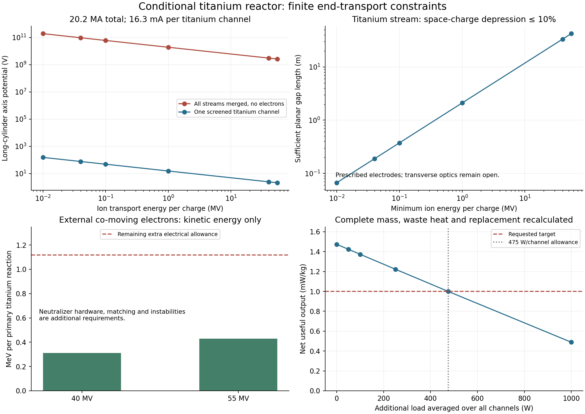

# Protium reactor end transport and recovery ✨

The explicit titanium-network candidate can carry its calculated outgoing current through individually screened channels without a large space-charge penalty. A common unneutralized beam would develop gigavolt potentials. The calculation therefore favors retaining electrostatic separation through the collectors, or adding electrons outside the hot reactor before combining streams.

This resolves one transport question in the [1.474 mW/kg reference allocation](NETWORK-PLANT.md). Selective removal of nuclear products, injection, electron control and the energy-recovery equipment still require a driven design. The new calculation leaves the reference allocation conditional; it supplies current, gap and loss limits for that work.



## The outgoing current

`end_transport_screen.py` enumerates every charged product in the same exclusive TENDL reaction network used by the plant. Inelastic events that retain the original proton and target remain in the plasma. For each isotope-changing event, the outgoing charge equals the original proton-plus-target charge. Summing the fifteen active processors gives **30.19765 elementary charges per primary titanium pn event**.

At the reference reaction rate, the outgoing current is **20.197 MA**, divided among **1.573 billion channels**. A main titanium channel carries **16.30 mA**, or **12.07 A/m2** if the beam fills its 20.73 mm radius. These are the isotope-changing product streams. Wall recycling, ordinary leakage and incoming fuel have separate currents and energy accounts.

The transport screen assigns each species a specified kinetic energy per charge U. Its speed follows relativistic kinematics. It conservatively assigns each channel's entire product current to one exit. Splitting it between two exits would reduce each end's current. Transverse distributions, angular momentum and real extraction spectra must be supplied by the eventual optics model.

## Preserve the channel screens

For a long uniform beam of radius a inside a conducting cylinder of radius b, its axis-to-wall potential is

```
lambda = sum I_s / v_s
phi_axis = lambda / (4*pi*epsilon0) * [1 + 2*ln(b/a)].
```

The tabulated case has a = b, the smallest potential in this uniform-beam family. Shrinking the beam within the same wall increases the logarithmic contribution.

| Kinetic energy per charge | All outgoing streams merged | One titanium channel |
|---|---:|---:|
| 10 kV | 190.5 GV | 153.8 V |
| 40 kV | 95.25 GV | 76.90 V |
| 1 MV | 19.06 GV | 15.38 V |
| 40 MV | 3.058 GV | 2.468 V |
| 55 MV | 2.622 GV | 2.117 V |

The merged-column numbers diagnose the need for additional charge management. Maintaining the prescribed beam speeds while assembling those positive-charge potentials requires substantial electrostatic work and a different transport solution. Enlarging the beam and its wall together does not change this ideal long-cylinder potential: line charge determines it. Finite aspect ratio and magnetic forces require their own treatment.

At 40 MV per charge, up to about 16,200 identical titanium channels could share one ideal long beam before its potential reaches 40 kV. Near a collector at 40 kV remaining energy per charge, limiting the potential to 10% permits only about 52 such streams. Keeping the original screens is therefore especially useful during deceleration. These counts describe the uniform-cylinder screen, rather than a validated merging arrangement.

## Finite collector gaps

A finite electrode gap can be checked without treating it as an infinitely long beam. Let j be the total positive current density, U the lowest kinetic energy per charge in the corresponding vacuum electrode field, and beta = 0.1 the permitted space-charge reduction. If every species remains faster than v_min at energy per charge (1-beta)U, the charge density is at most j/v_min. The one-dimensional Poisson bound is

```
delta_phi <= j*d^2 / (8*epsilon0*v_min)
d <= sqrt(8*epsilon0*v_min*beta*U/j).
```

Here d is the electrode spacing. The bound supplies a positive-energy transmitted solution under prescribed electrode potentials. It includes every represented charged product when choosing the minimum speed, including trace tritium. It leaves transverse focusing, grid interception, surface emission and the manufacture of the electrodes open.

For the titanium channel, sufficient spacings are **6.67 cm at 10 kV**, **18.88 cm at 40 kV**, **2.11 m at 1 MV**, and **33.41 m at 40 MV**. These are conservative electrostatic spacings, not choices for the final hardware or a claim that a long gap remains planar.

An independent nonlinear boundary-value calculation uses the actual current of every product species, with its speed reduced by the calculated potential. Across all fifteen processors and six energies, the peak potential reduction is **8.07–8.37%**, below the specified 10%. Its equations are

```
phi'' = -sum_s j_s/[epsilon0*v_s(U-phi)]
phi(0) = phi(d) = 0.
```

Equal boundary energies at the minimum U give a conservative comparison for a decelerating gap whose vacuum kinetic energy stays above U. A separate exact first integral of the nonrelativistic, single-species problem checks the numerical solver. This establishes the scope of the electrostatic bound; it does not establish a collector efficiency.

## Neutralization outside the hot source

Electrons moving with an ion stream cancel both its charge and its directed current. An ion of charge Z needs Z co-moving electrons. At equal velocity, the electron kinetic energy is the ion kinetic energy multiplied by the electron-to-ion mass ratio. Summed over the network, the ideal electron kinetic requirement is:

| Ion kinetic energy per charge | Electron kinetic energy per primary event | Plant output if charged as additional unrecovered electricity |
|---|---:|---:|
| 40 MV | 0.31184 MeV | 1.340 mW/kg |
| 55 MV | 0.42878 MeV | 1.291 mW/kg |

The sensitivity charges that entire kinetic energy as an additional electrical load and recalculates converter capacity, waste heat, radiator mass and replacement. It assigns no electron-energy recovery credit. Injector losses, phase-space matching, electron collection, instability suppression and neutralizer hardware remain to be added. Different ion velocities would require several electron populations or another matching scheme; kinetic stability cannot be inferred from the energy sum.

These electrons belong outside the electron-poor hot source. Electrons accidentally born inside it follow a different potential landscape and may acquire tens of MeV on their way to the positive end electrodes. Their production and clearing must be modeled separately. The neutralization calculation supplies no assumed electron residence time inside the reactor.

## Product selection is the unresolved step

An open end releases the thermal proton reservoir much faster than nuclear reactions consume it. Integrating a Maxwell distribution gives the initial two-end flux per channel

```
Gamma_H = 2*N_H_per_length*sqrt(kT/(2*pi*m_H)).
```

For the titanium channel this is **3.399 million escaping protons per useful pn event** if both ends are continuously open. A gate duty of **2.94e-7** already releases one proton per event in the initial-flux approximation. The closed 25 kT barrier reduces the corresponding Maxwell-tail count to **4.72e-5 per event**. Real finite opening transients would need a kinetic calculation.

The mean titanium consumption time is about **302 seconds**. A prescribed 1 ms vanadium residence would give a daughter-to-titanium number ratio of **3.31e-6**. This small fraction helps limit contamination, but it also makes selective excitation demanding. The residence time is a diagnostic assumption, not an achieved extraction time. A slower extraction scheme must recompute daughter inventory and secondary nuclear reactions.

Ion-cyclotron separation is a physical starting point. [Dawson et al. (1976)](https://doi.org/10.1103/PhysRevLett.37.1547) demonstrated selective ion-cyclotron acceleration of several isotopes in laboratory plasmas; the [authors' experimental account](https://www.physics.ucla.edu/plasma-exp/research/IsotopeSeparation/index.html) describes collecting the selectively heated ions. The source here is a hot, dense, nonneutral mixture of protons and highly charged ions. Its response must include the self-consistent electric field and the stored fuel's motion.

In particular, [Affolter et al. (2014)](https://doi.org/10.1016/j.physleta.2014.06.015) measured collective and space-charge shifts of cyclotron modes in multispecies nonneutral ion plasmas. Their shifts depend on rotation and species concentration. A vacuum charge-to-mass frequency difference therefore does not establish clean selection in this reactor. Their cold, slowly rotating experimental regime also does not supply a quantitative response model for the present MeV plasma.

An acceptable design must calculate unwanted heating of the much larger target population, product residence, emittance and energy spread, RF operating losses and the recovery of the added coherent energy. Selective radial extraction may offer another geometry, but its torque and energy accounts require the same care.

## Recovery evidence and the available loss budget

Experiments support highly efficient coherent energy transfer. [Gulliford et al. (2020)](https://arxiv.org/abs/2010.14983) measured a 99.4% one-turn beam-loading power balance in CBETA. [Sakai et al. (2024)](https://arxiv.org/abs/2408.13478) reported approximately 1 mA electron operation in the KEK cERL with main-linac recovery consistent with 100.0% within about 0.04%. Their measurement compares RF power with and without beam; injector energy is outside that recovered balance. These measurements support the possibility of very small coherent transfer losses. They leave wall-plug power, cooling and the conversion of a broad hot-ion distribution to be counted separately.

The older plasma-converter evidence measures another part of the problem. [Barr, Moir and Kinney (1977)](https://doi.org/10.1088/0029-5515/17/5/012) reported 86.5 ± 1.5% in a low-density, 22-stage electrostatic experiment, with decreasing efficiency as space charge increased. Neither this experiment nor electron-linac recovery qualifies the assumed 95% hot-ion conversion and 99.9% coherent transfer in the present plant.

The reference has **747.2 GW of extra electrical allowance**, or **475.0 W averaged over every channel**, before net output falls to 1 mW/kg. This is beyond the already allocated **173.7 GW for extraction**, **86.86 GW for atomic preparation**, and **291.6 GW for general auxiliaries**. A design should replace the relevant allowance with its actual costs and add any excess; it must not silently count the same equipment or power twice.

| Additional average load per channel | Recalculated net output |
|---|---:|
| 0 W | 1.474 mW/kg |
| 50 W | 1.423 mW/kg |
| 100 W | 1.373 mW/kg |
| 250 W | 1.223 mW/kg |
| 475 W | 1.000 mW/kg |
| 1000 W | 0.489 mW/kg |

A high beam-recovery percentage can coexist with excessive empty-cavity, drive or cooling power. Each of those costs has to fit this absolute budget, together with unwanted target heating and electron control. The reference also remains conditional on its high-field conductor, structural properties, radiation transport and lifetime assumptions.

## Reproduction and next calculation

Run `end_transport_screen.py`, `end_transport_budget.py`, `validate_end_transport.py` and `plot_end_transport.py` after the saved network-plant chain. The scripts accept paths for independent scratch reproduction. All **179 checks** pass: reaction charge accounting, independent Gauss-law integration, relativistic electron energy, nonlinear mixed-ion gap solutions, an exact single-species comparison, grid refinement, Maxwell-flux integration and complete-plant load sensitivities. Input and output hashes are recorded in `end-transport-manifest.json`.

The next useful calculation is a driven product-selection and electron-control model. Start with the actual radial fields, daughter birth distribution and finite axial potentials. Compute electron/positron births, wall reimpact versus trapping, clearing trajectories and energy circulation. A weak longitudinal potential gradient is worth testing as a way to avoid an assumed clearing time; its effect on ion density must be included. Then calculate selective response and target heating, rather than assigning an RF efficiency to an unspecified extractor.
