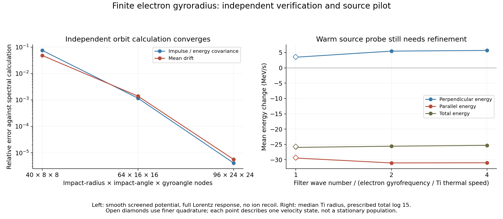

# Independent finite-gyroradius encounters and source matching ✨

The helical spectral operator from the [previous checkpoint](GUIDING-CENTER-COLLISIONS.md) now agrees with an independent real-space calculation. Full Lorentz perturbations through a smooth screened ion field reproduce the spectral diffusion and mean force to better than 1e-5 relative in the tested cases, including ion recoil. This verifies the intermediate encounter response under the stated uniform-field, straight-background-orbit assumptions.

Applying the operator to one warm source state reveals a numerical resolution issue. Finer quadrature changes perpendicular heating by 2.7%. The retained source runs are preliminary; they supply no revised stationary population, escape time or plant load.



## Same potential, independent calculations

The spectral calculation uses the interaction amplitude

```
V(k) = -4 pi K / (k² + kappa²) * exp[-k²/(2 kcut²)].
```

Its real-space form is

```
V(r) = -K exp[kappa²/(2 kcut²)]/(2r)
       * {exp(-kappa r) erfc[(kappa/kcut-r kcut)/sqrt(2)]
          - exp(kappa r) erfc[(kappa/kcut+r kcut)/sqrt(2)]}.
```

Stable complementary-error-function expressions and a small-radius series provide the potential, force and force gradient. Independent inverse Fourier quadrature checks all three, including the origin and the series boundary. Squaring the Fourier amplitude gives exactly the Gaussian filter in the earlier spectral covariance.

`finite_gyro_encounters.py` follows first- and second-order changes to a full electron helix. The ion starts on a straight orbit; first-order recoil changes the relative trajectory. The second-order force is the force gradient acting on that first-order relative displacement. Each calculation integrates over impact radius, impact angle and initial electron gyroangle. It keeps the force impulse separately from the magnetically rotated velocity response.

Let I1 and I2 be the first- and second-order electric impulses divided by electron mass. Let P1 and P2 be the corresponding changes of perpendicular kinetic energy per electron mass; P2 includes the quadratic first-order velocity term. For relative guiding-center velocity w and mass ratio eta, the encounter identities are

```
w dot I1 + P1 = 0
w dot I2 + P2 + [I1_z² + eta |I1|²]/2 = 0.
```

The finite interval and ODE tolerance give normalized residuals below 4e-8 in the two refined ensembles. Both retain 96 impact-radius nodes, 24 impact angles and 24 gyroangles. They use mass ratios 0 and 0.1, with opposite magnetic-field signs. The mass ratio 0.1 is a verification parameter; the ion's free magnetic turning is omitted in both compared models.

The independent monoenergetic-ion spectral calculation integrates its resonance delta function over the polar wavevector angle. It retains force impulses in all three directions and perpendicular energy. State derivatives and ion-recoil derivatives give the mean force. Its covariance and mean energy satisfy the same work identities.

Refining the orbit integration from 40 × 8 × 8 through 64 × 16 × 16 to 96 × 24 × 24 reduces both covariance and mean-force errors monotonically. All **39 checks** pass, including the inverse Fourier field, the two spectral/orbit comparisons and their energy identities. The earlier 71 distant-limit and 28 spectral-limit checks remain archived separately.

## Matching the close and distant contributions

The source pilot holds the total unmagnetized logarithm at 15, matching the previous diagnostic transport benchmark. It replaces a filtered part with the helical response:

```
matched = unmagnetized total - unmagnetized filtered + helical filtered.
```

Equivalently, it adds a positive short-range unmagnetized contribution to the positive helical filtered contribution. The spectral filter is shared between proton and titanium collisions. The total logarithm, static screening and straight background orbits remain prescribed; successful matching within this model would not establish those source assumptions.

The median source radius has field 137.149 T. A warm test state has total kinetic energy 3.468 keV, with two thirds perpendicular and one third parallel. This is one state, selected from the earlier mean-energy scale. It does not represent a velocity distribution.

At filter wave number kcut = Omega_e/vth,Ti:

| Mean energy change | Initial quadrature | Finer quadrature |
|---|---:|---:|
| Perpendicular | +3.474 MeV/s | +3.568 MeV/s |
| Parallel | -29.451 MeV/s | -29.328 MeV/s |
| Total | -25.977 MeV/s | -25.760 MeV/s |

The initial quadrature uses 96 radial, 64 polar and 64 azimuthal wavevector nodes; the finer calculation uses 160, 128 and 96. The perpendicular difference is 2.64% relative to the finer result, or 2.71% relative to the coarser result. The total differs by 0.84% relative to the finer result. The source's electron speed exceeds titanium's thermal speed substantially, creating narrow angular resonances.

At twice and four times the filter wave number, the initial quadrature gives total rates -25.583 and -25.301 MeV/s. Both numerical integration and short/long matching are changing across these cases. These values therefore do not yet establish a converged coefficient. The unmagnetized total at the same velocity state gives +1.340 MeV/s, demonstrating why the magnetic response cannot be supplied by a single heating multiplier.

For an initially stationary electron, the matched rate is about 2309 MeV/s, versus 3091 MeV/s in the unmagnetized total. Parallel impulse heating agrees with its field-independent cold limit; the reduction is transverse. This instantaneous cold rate must not be multiplied by a millisecond residence. The full distribution includes rapid heating out of the cold state, energy exchange at higher speeds, radiation and escape.

All retained matched covariance matrices are positive semidefinite, their species sums close, and the complementary short logarithms remain positive. The pilot analysis records **24 data and cold-limit checks**. These checks do not certify numerical source convergence.

## Next calculation

Resolve the angular resonance more efficiently before building a source coefficient table. A useful change of quadrature aligns the polar wavevector direction with the relative guiding-center velocity w = (0,-U,vz). Then the Gaussian resonance depends on w mu + n Omega/k. Integrating in that Gaussian argument can concentrate nodes where the ion distribution contributes. The Bessel amplitude and physical force projections still depend on the azimuth; their resolution and the radial oscillations must also be checked.

Once the resolved coefficients converge as the filter is moved, incorporate the correlated radial/parallel/perpendicular tensor into electron transport. The previous unmagnetized escape results remain a comparison, rather than a plant prediction. Dynamic screening, ion turning, source gradients, physical lepton births, finite collectors and positron removal remain subsequent source tests.

Reproduce the orbit files with `finite_gyro_encounters.py --nb 40 --nphi 8 --ngyro 8`, then 64/16/16 and 96/24/24; repeat 96/24/24 with `--eta .1 --omega 1`. Generate monoenergetic spectral references with `finite_gyro_beam_spectrum.py` and `--eta .1`. Run `validate_finite_gyro_encounters.py` against those files. The matching pilot uses `matched_helical_screen.py` with `--cut 1`, 2 or 4, `--cold` for cold states, and the saved quadrature flags for refinement. All scripts accept `--outdir`; the matching script also accepts `--root` for source inputs. Finally run `finite_gyro_pilot_analysis.py` and `plot_finite_gyro_encounters.py`. The figure was visually inspected. Code, data and input hashes are recorded in the checkpoint manifest.
