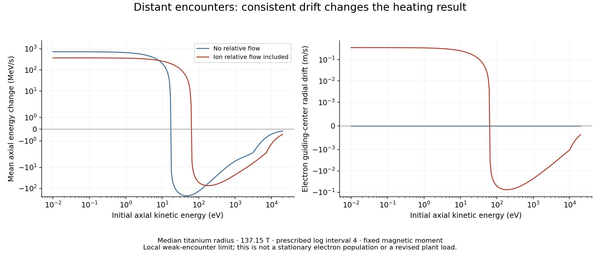

# Finite-energy distant collisions and a helical response prototype ✨

The distant-encounter calculation now retains both diffusion and mean force for a moving electron. Its magnetic moment stays fixed: parallel impulses change axial kinetic energy, while transverse impulses displace the guiding center. Independent two-body perturbation calculations verify the mean force and the energy transferred to the ion. A separate spectral prototype extends the calculation through finite electron gyroradius; it passes initial mathematical limits and still needs source-specific matching and independent finite-orbit verification.

These calculations develop the collision operator needed by the [electron escape model](LEPTON-ESCAPE.md). The complete plant allocation remains 1.474 mW/kg under its saved assumptions. This checkpoint supplies no new electron birth rate, residence time or electrical load.



## Distant weak encounters

Use the local electric-drift frame with uniform B along z. The ions have a Maxwellian velocity distribution with mean U along y and temperature Ti. Ti denotes energy in the equations below. Write the electron's signed gyrofrequency as omega = q_e B / m_e. Its guiding-center coordinates obey

```
X = x + vy/omega,   Y = y - vx/omega
dX = Iy/omega,      dY = -Ix/omega,      dvz = Iz,
```

where I is the integrated electric force divided by electron mass. Distant encounters conserve perpendicular kinetic energy at this order. The ion trajectory is straight at zeroth order; its first-order recoil supplies the polarization term in the mean force.

For a fixed logarithmic interval, integration of the impulse covariance over a Maxwellian ion bath gives a familiar axisymmetric tensor,

```
Dij = Dt delta_ij + (Dp - Dt) wi wj / w²,
w = (0, -U, vz).
```

Dp and Dt have the same analytic functions as the unmagnetized Maxwellian force covariance. Their physical meaning here is impulse covariance. The electron's transverse kinetic velocity does not receive that covariance in the adiabatic limit. The state diffusion tensor for (X,Y,vz) is

```
Ds = [[Dyy/omega², 0, Dyz/omega],
      [0, Dxx/omega², 0],
      [Dyz/omega, 0, Dzz]].
```

The consistent Ito drift contains a divergence term and a bath-polarization term. For each ion species,

```
Ay = 0.5 dDyz/dvz + m_e U Dp / (2 Ti)
Az = 0.5 dDzz/dvz - m_e vz Dp / (2 Ti).
```

The state drift is (Ay/omega,0,Az), summed over species. At U = 0, the nonrelativistic operator has a stationary one-dimensional electron Maxwellian at Ti. Following electrons all the way to the source's 1.6 MeV ion temperature would require relativistic kinetics; this is a mathematical equilibrium check. More generally, it satisfies local fluctuation/polarization balance for the formal density proportional to exp[-m_e(vz²/2 - U omega X)/Ti]. That identity tests the operator; the actual rotating source has its own spatial profile and boundaries.

The mean axial energy change is

```
d<E_parallel>/dt = m_e (vz Az + Dzz/2).
```

Keeping only Dzz/2 would discard the work of the mean force. The error can change the sign of the answer.

## Independent encounter verification

`guiding_center_encounters.py` follows first- and second-order perturbations of a single encounter with the smooth screened potential -epsilon exp(-R)/R, R² = r² + 0.1², in dimensionless units. It integrates a plane of impact parameters and azimuths. The second-order impulse is obtained directly from the force gradient acting on the first-order relative displacement, avoiding subtraction of nearly equal full trajectories.

For mass ratio eta = m_e/m_i and relative velocity w, the independent energy identity is

```
w dot I2 + [I1_z² + eta |I1|²]/2 = 0.
```

This includes ion recoil and the absence of perpendicular electron heating in the guiding-center limit. Three tests use eta = 0 or 0.1 and both magnetic-field signs. Integrated mean-force errors are below 3.2e-8 relative; covariance errors are below 1.0e-8. Individual encounter energy errors are below 2.0e-10 in the stated normalized measure. The finite interval and quadrature errors are included in those residuals.

The remaining checks integrate the Maxwellian force covariance directly, differentiate its coefficients independently, recover the full unmagnetized NRL slowing force from its divergence plus polarization, test positive diffusion and local balance, and recover the earlier cold parallel force-pulse rate. A nine-term low-speed series fixes cancellation in the error-function expression and its derivative. All **71 checks** pass.

## What the finite-energy result changes

For the median titanium radius, the reference field is 137.149 T and ion relative flow is -6.003 million m/s. Prescribe a distant logarithmic interval of 4 as a diagnostic scale. Its value is not a matched physical cutoff. Both species contribute:

| Initial axial electron energy | Consistent axial energy change | Diffusion term alone |
|---|---:|---:|
| 0 eV | +375.03 MeV/s | +375.03 MeV/s |
| 100 eV | -51.12 MeV/s | +156.22 MeV/s |
| 1 keV | -22.63 MeV/s | +15.36 MeV/s |
| 3 keV | -6.50 MeV/s | +3.64 MeV/s |
| 10 keV | -1.25 MeV/s | +0.64 MeV/s |

The sign changes near 62.74 eV with relative flow, or 16.98 eV without it. This does not imply that a warm population as a whole cools. Such a population continually samples low parallel speeds, where the positive contribution is large. For a prescribed Gaussian axial distribution with temperature 2.312 keV, the averaged contribution is +11.34 MeV/s with flow, or +4.33 MeV/s without flow. The corresponding mean electron radial drift with flow is outward at 10.50 mm/s. These Gaussian distributions are probes of the operator, rather than calculated stationary populations.

Finite perpendicular energy, close encounters, radiation and boundaries determine the actual distribution. Adding this contribution to an unchanged full-log unmagnetized operator would double count encounters.

## Continuous finite-gyroradius prototype

`finite_gyro_spectrum.py` uses the Fourier spectrum of weak ion electric fields sampled along an electron helix. It includes all retained cyclotron harmonics. The prescribed ion paths remain straight, the plasma is homogeneous, and screening is a fixed Yukawa factor. A smooth high-wave-number filter makes an independently adjustable long-range contribution.

Use coordinates s = omega X, vz and e = vperp²/2. Their phase-space Jacobian is constant. Set Omega = |omega|, rho = vperp/Omega, and define

```
mu = kz/k,    ny = ky/k,
Q_n = mu vz + n Omega/k - ny U,
a_n = (ny, mu, n Omega/k),
W(k) = k^4 / (k² + kappa²)² * exp[-(k/kcut)²].
```

For one species, let G0 = 4 pi n_i [Z_i e²/(4 pi epsilon0)]²/m_e² and vth² = 2 Ti/m_i. The impulse/state covariance is

```
D = G0/(pi^(3/2) vth)
    integral d(ln k) dmu dphi W(k)
    sum_n J_n(k rho sqrt(1-mu²))² exp[-Q_n²/vth²] a_n a_n^T.
```

The mean drift is half the state divergence of D plus

```
A_polarization = -m_e/(2 Ti) D dot (-U, vz, 1).
```

Derivatives of the Gaussian resonance and Bessel amplitude supply the divergence. At e = 0, the explicit n = 0 and n = ±1 limits retain perpendicular heating while its energy diffusion vanishes. This avoids a division by zero or an artificial absorbing boundary at zero perpendicular energy.

With kappa = 1 and kcut = 4, the spectral logarithm is 0.77631117. The dimensionless test suite verifies the distant guiding-center limit, the approach to the gyro-averaged straight-orbit tensor, analytic state derivatives against finite differences, quadrature refinement, covariance positivity and the cold-perpendicular boundary. All **28 initial checks** pass. These are mathematical checks of the spectral prototype; an independent finite-gyro two-body ensemble comparison remains required.

The matching strategy is to retain the analytic unmagnetized short-range contribution for the complement of the spectral filter and add the helical long-range contribution. Equivalently, subtract the unmagnetized filtered tensor from a common total and add the helical filtered tensor. The filter's position must be varied until the result converges; positive total covariance and the energy ledger must be retained. A sharp arbitrary allocation of logarithmic units is unnecessary.

## Remaining source qualifications

The next work is to validate the finite-gyro response independently, apply it to the source's unequal ion/electron speeds, and demonstrate matching convergence. Narrow angular resonances can require more quadrature points than the current dimensionless tests. Then update electron transport with the full correlated state tensor and physically supplied birth/collection distributions.

Dynamic dielectric screening, ion turning, radial gradients, slow nonlinear encounters and repeated interactions remain source-specific issues. The local scale table in [Magnetized encounters](MAGNETIZED-ENCOUNTERS.md) identifies where the straight/homogeneous approximation is weakest. Positive end barriers still require a separate positron-removal design. No revised reactor performance or breakthrough date follows from the present collision limits.

[Brizard's primary 2004 treatment](https://arxiv.org/pdf/physics/0405052) supplies the general phase-space transformation and divergence framework. Its section III also distinguishes a transformed collision operator from the physical coefficients appropriate to magnetized encounters. The numerical coefficients and encounter checks above are this investigation's calculations, not rates imported from that paper. [Ichimaru and Rosenbluth (1970)](https://doi.org/10.1063/1.1692864) provide an earlier fluctuation/dielectric approach; only its primary abstract and metadata have been inspected here.

Reproduce with `guiding_center_collisions.py --root <research-directory> --outdir <output-directory>`, `validate_guiding_center.py --outdir <output-directory>`, `validate_finite_gyro.py --outdir <output-directory>`, then `plot_guiding_center.py --outdir <output-directory>`. Dependencies are in the research README. The figure was visually inspected. Inputs, code and output hashes are recorded in `guiding-center-manifest.json`.
