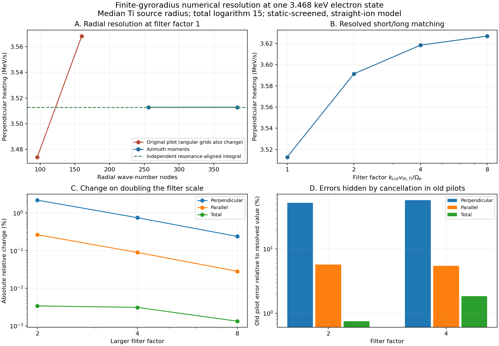

# Resolved helical collision quadrature ✨

Two differently arranged integrals now agree on the representative warm-electron source state. Separate radial and polar refinement identifies the previous pilot's main error: the radial wave-number grid did not resolve the Bessel oscillations. At filter factor 2, that pilot overestimated perpendicular heating by about 52%, while errors in the two energy components partly canceled in the total. The old source pilots remain an audit trail; use the resolved values below for this state.

The specified weak, statically screened collision model is now numerically tractable. Its source assumptions, stationary electron distribution and reactor load still require physical assessment. The conditional whole-plant allocation remains unchanged.



## Two integration coordinates

The original [spectral operator](GUIDING-CENTER-COLLISIONS.md) integrates wave-number magnitude, magnetic-axis polar angle and azimuth. Its resonance is

```
Q = mu vz + n Omega/k - ny U,
```

where `mu = kz/k`, `ny = ky/k`, and the Gaussian ion weight is `exp[-Q²/vth²]`. The independent [full-Lorentz encounter calculation](FINITE-GYRO-ENCOUNTERS.md) has already checked this physical kernel for a monoenergetic ion background.

`aligned_helical_spectrum.py` instead aligns the polar direction with `w = (0,-U,vz)`. Its integration variable `t = Q/vth` resolves the ion Gaussian directly. Physical wavevector projections and Bessel amplitudes are evaluated at each transformed direction. The drift still differentiates the physical fixed-wavevector integrand; it does not differentiate a moving quadrature grid. The seven-thermal-speed Gaussian cutoff and the finite wave-number interval are recorded numerical truncations.

`moment_helical_spectrum.py` retains the magnetic-axis polar direction and writes its azimuthal integral as three Gaussian moments:

```
I_j(a,b) = integral_0^(2 pi) sin(phi)^j exp[-(a-b sin(phi))²/vth²] dphi,
a = mu vz + n Omega/k,
b = U sqrt(1-mu²),
j = 0, 1, 2.
```

These three moments supply all tensor entries and their analytic divergence. Their numerical evaluation uses Chebyshev nodes; `nphi` denotes distinct nodes, equivalent to twice as many ordinary periodic azimuth nodes. Positive and negative electron cyclotron harmonics are paired by wavevector inversion. The Bessel derivative follows `J_n' = n J_n/x - J_(n+1)`. Both routes retain bath polarization and the Ito divergence drift. The recurrence and derivative identities are given in [DLMF §10.6](https://dlmf.nist.gov/10.6).

At factor 1, the aligned 128/64/64 integration agrees with magnetic-axis moments at 384/192/32 to better than 1e-7 relative in the separate energy rates, radial drift and dimensionally normalized tensor. Raising the polar count from 64 to 192 at 256 radial nodes changes nothing significant. Raising the radial count from 256 to 384 removes a 1.53e-5 relative error in perpendicular heating. At factor 2, 512 and 768 radial nodes agree to numerical precision. Factor 4 agrees between 1024 and 1536 radial nodes; factor 8 agrees between 2048/384/32 and 3072/512/48.

## A bounded-memory evaluation

Directly storing every Bessel order becomes expensive at larger filter wave number. `fast_bessel_grid.py` evaluates integer orders using forward recurrence only where the argument exceeds the order. It uses SciPy's Bessel function in the transition and evanescent regions, following the stability distinction in [DLMF §10.74](https://dlmf.nist.gov/10.74).

For real `0 < x < n`, the generating-function contour gives

```
|J_n(x)| <= exp[sqrt(n²-x²) - n acosh(n/x)].
```

This follows by choosing contour radius `(n + sqrt(n²-x²))/x` in the [generating function](https://dlmf.nist.gov/10.12). Values whose absolute bound is below `exp(-30)` are set to zero. Tests span arguments from zero through 1000, orders through 1100, and both sides of the order/argument transition. They compare against direct special-function evaluation and check both `J_0² + 2 sum J_n² = 1` and `2 sum n² J_n² = x²/2`.

`streaming_helical_spectrum.py` retains two consecutive Bessel orders and the three azimuthal moments. It also omits a wave-number row when the entire ion resonance is more than seven thermal speeds away. These are small numerical tail truncations; they introduce no new collision physics. The cold perpendicular-energy limit retains the nonzero derivatives of the first harmonics.

The factor-2 source evaluation takes about 5.1 seconds in streaming form, compared with 30.4 seconds using the full direct Bessel table. At factor 4, the streaming calculation takes 35.8 seconds despite using 50% more radial nodes than the 366-second direct-table calculation. These are observed wall times in this environment, rather than hardware-independent benchmarks. The retained backend passes the same 28 limiting-operator, divergence, cold-boundary, polarization and covariance checks as the original prototype.

## Resolved matching at the warm probe

The state is at the median titanium reaction radius, with effective field 137.149 T and electron kinetic energy 3467.60505 eV. Two thirds of that energy is perpendicular and one third parallel. Source density, relative azimuthal flow and temperature are unchanged from the earlier checkpoint. The prescribed total Coulomb logarithm is 15.

Matching adds the filtered helical contribution to an unmagnetized contribution with the positive complementary logarithm. The common filter is `kcut = factor * Omega_e/vth,Ti`.

| Filter factor | Perpendicular rate, MeV/s | Parallel rate, MeV/s | Total rate, MeV/s | Electron radial drift, mm/s |
|---|---:|---:|---:|---:|
| 1 | +3.512814 | -29.290552 | -25.777738 | -26.29744 |
| 2 | +3.591389 | -29.368253 | -25.776864 | -26.29550 |
| 4 | +3.618456 | -29.394524 | -25.776068 | -26.29430 |
| 8 | +3.627076 | -29.402802 | -25.775725 | -26.29382 |

Doubling the filter from 4 to 8 changes perpendicular heating by 0.238%, parallel heating by 0.0282%, total energy change by 0.00133% and radial drift by 0.00183%. The tensor also remains positive. These differences quantify matching sensitivity at this one state; they do not prove a uniform error bound over velocity space or an exact infinite-filter limit.

The negative total rate means this particular electron state cools through collisions under the specified model. The negative radial drift means inward motion at this state. Neither sign describes a population average. The previous unmagnetized population had a different distribution and mean outward drift; its residence and radiative cost cannot be updated by a scalar heating factor.

## Reproduction and next physical checks

Run `resolved_helical_screen.py --backend aligned|moment|recurrent|streaming` with `--cut`, `--nk`, `--nmu` and `--nphi` from each saved filename. The driver also accepts `--root` for source inputs and `--outdir` for outputs. The backend modules implement the same prescribed operator; `recurrent` retains a full recurrence-built Bessel table as an intermediate comparison, while `streaming` is the preferred low-memory evaluator.

Run `validate_streaming_helical.py`, `validate_helical_resolution.py` and `plot_helical_resolution.py` after reproducing the listed source cases. All **128 resolution checks** pass. The resolution validator separately checks independent coordinates, recurrence accuracy, same-grid algebraic equivalence, radial/polar refinement, covariance positivity and complementary logarithms. The checkpoint manifest records exact files, hashes and terminal run times.

Before a source table or transport calculation is used as a reactor estimate, assess dynamical screening, total Coulomb logarithms, source gradients and ion trajectories in the actual rotating equilibrium. The titanium rotation parameter is exactly one half of its cyclotron frequency in the saved reference. The magnetic and Coriolis terms then cancel in its rotating-frame thermal equation; centrifugal/electric potential curvature and spatial variation still remain. Quantify those terms rather than identifying laboratory ion gyroradius alone with encounter curvature.

Physical electron and positron birth rates and finite collectors also remain necessary. They determine whether refinements in collision physics affect the 1.117 MeV-per-primary-event remaining plant margin. No new abundance, residence time, electrical load or breakthrough date is assigned here.
