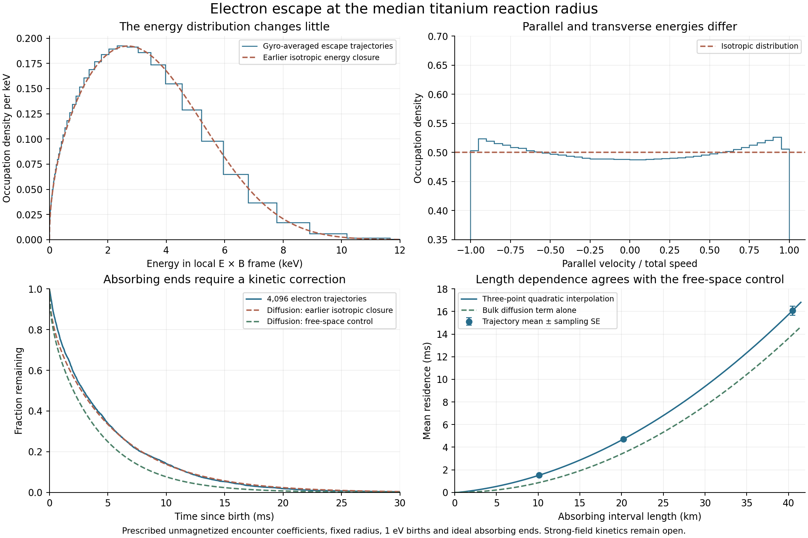

# Gyro-averaged electron escape ✨

The selected titanium source admits a finite electron-escape calculation under a prescribed collision model. At its median reaction radius, **4,096 cold test electrons have a mean residence of 4.72 ms**, radiate **77.8 keV each**, and leave an ideal absorbing end with **5.43 keV** of kinetic energy in the local electric-drift frame. Halving the collision step gives 4.66 ms and 76.6 keV. These are useful transport benchmarks for the proposed electron-poor source.

The calculation retains **unmagnetized Landau encounter coefficients**. It resolves gyrophase averaging, pitch angle, energy and axial escape, improving on the earlier [isotropic energy closure](LEPTON-KINETIC-BENCHMARK.md). Strong-field encounters, actual birth spectra, radial evolution, positron removal and finite collectors remain open. The [1.474 mW/kg whole-plant allocation](NETWORK-PLANT.md) has not been revised using these results.



## Prescribed source and particle process

The calculation uses the saved 140 T nominal-field plant, whose finite solenoid gives 137.149 T in the source. Its active length is 20.235 km. At the radius enclosing half of Ti49(p,n) events, r = 4.100 mm, the proton and titanium densities are 1.021e19 and 5.502e17 per cubic metre. Both ion species have kT = 1.6 MeV. The local electric-drift velocity is −6.192 million m/s in the azimuthal direction, while the ions rotate at −12.195 million m/s. Their relative mean velocity is therefore −6.003 million m/s.

The local densities and velocities are frozen. Electrons start with isotropic 1 eV kinetic energy in the electric-drift frame and uniform axial positions. This is a specified benchmark birth population. An electron born nearly at rest in the laboratory already has about 109 eV in that drift frame, while nuclear pair production can create much more energetic particles. Those birth distributions have not been substituted into this calculation.

The test-particle coefficients are the drift and diffusion tensor for Maxwellian ions, with prescribed ln Λ = 15. Each step samples gyrophase, transforms to the mean ion frame, updates relative energy and direction, and returns to the electric-drift frame. Exact perpendicular radiation damping is applied in two half steps. The nonrelativistic perpendicular-energy damping time is 137.127 microseconds. Axial motion uses the changing parallel velocity. The first crossing of either end is absorbing, with a fractional-step interpolation.

The main integration parameter limits the collision step to 0.02 of the local slowing time. The bound is independent of the randomly sampled gyrophase, avoiding a phase-dependent sampling weight. Angular diffusion uses energy-conserving spherical rotations. A positive low-speed radial-energy update preserves the first energy moment and the fixed-energy Lorentz limit. Every retained production run reports zero negative-energy proposals.

An ordinary Cartesian Euler pilot was rejected because finite angular kicks introduced spurious energy at a level comparable with the physical heating. A subsequent radial Milstein pilot produced negative-energy proposals and was also rejected. Neither pilot supplies the retained results.

## Finite escape and numerical precision

Each absorbing reference run has 4,096 independent trajectories. Errors below are one standard error of the sample mean; they measure sampling precision within the prescribed process.

| Collision-step parameter | Mean residence | Radiation per electron | Exit energy |
|---|---:|---:|---:|
| 0.04 | 4.732 ± 0.082 ms | 77.890 ± 1.366 keV | 5.466 ± 0.036 keV |
| 0.02 | 4.719 ± 0.081 ms | 77.806 ± 1.354 keV | 5.426 ± 0.035 keV |
| 0.01 | 4.665 ± 0.082 ms | 76.583 ± 1.344 keV | 5.390 ± 0.036 keV |

All sampled particles reach an end before the 100 ms integration limit. For the main run, the median residence is 2.927 ms, the 90th percentile is 11.71 ms and the 99th percentile is 22.37 ms. This sample does not establish an absolute maximum residence.

The occupation-weighted mean energy is 3.469 keV, nearly equal to the earlier isotropic estimate of 3.468 keV. The ratio of transverse temperature per degree of freedom to parallel temperature is 0.936. Radiation is 16.49 MeV per occupied electron-second, compared with 16.86 MeV/s in the isotropic closure. Escape selects higher-energy particles: the mean energy at the absorbing end exceeds the occupation mean.

The largest sampled energy in the main run is 16.74 keV. The model remains nonrelativistic; these numerical checks do not bound omitted relativistic, atomic or collective effects. Free-space cyclotron emission is also prescribed, without a cavity or radiation-reabsorption calculation.

## Why the earlier diffusion estimate gave a similar escape time

The earlier Green–Kubo calculation gave a homogeneous axial diffusion coefficient of 7.343e9 m²/s. Substituting it into the uniform-birth diffusion expression L²/(12D) gave 4.65 ms. The more complete velocity process has a different bulk diffusion coefficient and a finite-end correction. Their partial cancellation explains the similar reference escape times.

Two controls retain the same velocity process but allow unbounded axial displacement. Each follows 2,048 particles for 6 ms, discards the first 1 ms of displacement, and estimates D from the mean squared subsequent displacement divided by twice the elapsed time. Step parameters 0.02 and 0.01 give respectively **(10.42 ± 0.35)e9** and **(9.27 ± 0.32)e9 m²/s**. Their difference is 2.45 combined sampling standard errors. The broad range, rather than a claim of percent-level diffusivity, is appropriate here. “Closed” in the filenames denotes these no-escape controls; their axial coordinate is unbounded, with no reflecting end.

Independent absorbing runs vary the interval length while keeping the source coefficients fixed:

| Length | Trajectories | Mean residence |
|---|---:|---:|
| 10.118 km | 2,048 | 1.519 ± 0.036 ms |
| 20.235 km | 4,096 | 4.719 ± 0.081 ms |
| 40.471 km | 2,048 | 16.070 ± 0.401 ms |

Interpolating these three points as t = a(L/L0)² + b(L/L0) + c gives a = 3.300 ms, b = 1.452 ms and c = −0.032 ms. Interpreting the quadratic term as bulk diffusion gives **D = (10.34 ± 0.99)e9 m²/s**, consistent with both free-space controls. The linear term contributes about 31% of the reference mean residence. An effective extrapolation length derived from that term is 1.48 ± 0.74 km. It describes the finite-velocity boundary effect and is not an electrode dimension.

Three points determine three coefficients exactly. This interpolation has no spare degrees of freedom for a goodness-of-fit test. It supports the transport interpretation through the independent free-space comparison; it does not establish a general length law. The longer control also remains spatially homogeneous even where a real particle's radial displacement would change the source coefficients.

## Energy and angular momentum

The collision impulse in the azimuthal direction implies a diagnostic guiding-center displacement

```
delta r = sum(m_e * delta v_theta) / (−e * B).
```

The main run gives a mean outward displacement of 60.79 ± 1.01 micrometres. The median is 38.41 micrometres and the 99th percentile is about 283 micrometres. These are accumulated force-drift diagnostics; the calculation does not move the particle through the radial density and electric-field profiles.

In the local electric-drift frame, mean collisional work is 83.231 keV. It closes against 77.806 keV of radiation plus 5.425 keV of exit kinetic energy above the 1 eV birth energy. The largest individual energy-ledger discrepancy is below 8e−8 eV in the main run.

Laboratory work includes the azimuthal momentum transfer. With the local field held fixed,

```
W_collision,lab = W_collision,drift + v_ExB * sum(delta p_theta)
                = W_collision,drift + e * E_r * delta r.
W_electric      = −e * E_r * delta r.
```

The extra term averages 51.630 keV. Laboratory collisional work is therefore 134.861 keV, while the electric field removes 51.630 keV from kinetic energy and places it in electrostatic potential energy as the electron drifts outward. The global charge-return circuit must account for that energy. Applying a heat-conversion fraction directly to the 77.8 keV radiation figure would leave this part of the ledger unresolved.

Likewise, an electron attracted through the positive end barrier circulates tens of MeV of electrostatic energy. Its net loss depends on collection, recovery and charge return. Converter capacity must count the gross throughput. Neither a 40 MeV gross acceleration nor a 77.8 keV radiation loss can be substituted alone as the complete electrical cost per electron.

## What a specified electron cost would allow

The complete-plant allocation has an extra electrical allowance of 1.11714 MeV per primary titanium event before reaching 1 mW/kg under its existing mass rules. Let C be a separately established, all-in electrical cost in MeV per new electron. Allocating the entire margin to that source permits at most 1.11714/C electrons per primary event. This parameterization keeps the unknown recovery and processing costs visible.

The titanium channels supply 1.649e12 primary events per second per square metre of inner wall. If every freshly released H atom supplies one electron to the hot population, the corresponding sufficient limit on fresh atom supply is:

| Assumed complete cost C | Electrons per primary event | Fresh H atoms per m² per second | Equivalent H₂ outgassing at 300 K |
|---|---:|---:|---:|
| 0.01 MeV | 111.7 | 1.842e14 | 3.815e−7 Pa·m³/(s·m²) |
| 0.1 MeV | 11.17 | 1.842e13 | 3.815e−8 Pa·m³/(s·m²) |
| 1 MeV | 1.117 | 1.842e12 | 3.815e−9 Pa·m³/(s·m²) |
| 10 MeV | 0.1117 | 1.842e11 | 3.815e−10 Pa·m³/(s·m²) |

The gas-release conversion uses q = J_H2 kT. The saved data also give a pressure equivalent defined by the one-sided Maxwell flux J_H2 = P/sqrt(2πm_H2 kT). That pressure is a unit-flux conversion, not the predicted pressure inside the operating channels. Repeated gas-wall encounters are not repeated fresh atoms. Pumping, sticking, recycling, ionization and charge exchange determine the actual density and source rate. Excess ions, heavier impurities, other processors, other electron sources and added equipment also consume the margin.

[Ady et al. (2015)](https://doi.org/10.18429/JACoW-IPAC2015-WEPHA011) measured gas release and electron yield from accelerator-wall coatings under 4 keV-critical-energy synchrotron radiation. Activated getter coatings reduced desorption substantially. Those measurements identify relevant surface processes; MeV nuclear photons, neutrons, fields and reactor service conditions need their own yields.

Atomic collision data must use the laboratory neutral/ion relative velocity. At the median radius, titanium's rotation alone corresponds to about 0.78 MeV per nucleon against stationary gas. Using only the thermal ion speed or the ion/electric-drift difference would select the wrong collision energy. [Janev, Bransden and Gallagher (1983)](https://doi.org/10.1063/1.555697) provide evaluated charge-exchange methods and data, including titanium, but the low-energy titanium table does not cover this rotational energy. No titanium charge-exchange number from that table has been inserted into the source calculation.

## Verification and next discriminator

All **72 checks** pass. Independent limits include scalar/array collision-tensor agreement, the Itô energy moment, spherical angular harmonics, fixed-energy Lorentz scattering and its finite-time mean squared displacement, exact pitch-dependent radiation cooling, Maxwellian-bath equilibration, time-step comparisons, pathwise energy ledgers, the independent free-space/length comparison, the laboratory energy transformation and a direct integral of the one-sided Maxwell flux. These verify the prescribed numerical process and units.

The key remaining collision issue is that electron gyroradii are roughly a thousandth of the ion screening length. The encounter tensor must treat the magnetic field during long-range interactions, along with dynamic screening, finite geometry and the rotating ions. The [Jose–Baalrud collision-volume formulation](https://doi.org/10.1063/5.0025158) supplies a route to such a calculation and discusses its recollision and screening limitations. Its massive-projectile example does not supply the light-electron operator used here.

Next calculate or bound that operator, then use physical birth spectra and a radial/axial collection geometry. Positrons require separate removal because the positive end barrier repels them. Bulk pair production, decay, charge exchange, injection contamination and driven stability remain separate from the successful electron-escape benchmark.

## Reproduction

Use the Python and dependency versions in the research README. `lepton_escape_mc.py` accepts explicit `--root` and `--outdir` paths. For the saved runs:

```
python lepton_escape_mc.py --name lepton-escape-main --particles 4096 --seed 93811 --step .02
python lepton_escape_mc.py --name lepton-escape-fine --particles 4096 --seed 43171 --step .01
python lepton_escape_mc.py --name lepton-escape-coarse --particles 4096 --seed 49127 --step .04
python lepton_escape_mc.py --name lepton-escape-closed --particles 2048 --seed 99287 --step .02 --closed --time .006 --burn .001
python lepton_escape_controls.py
python lepton_escape_analysis.py
python validate_lepton_escape.py
python plot_lepton_escape.py
```

The control script produces the half-length, double-length and finer free-space cases with explicit seeds. Deterministic gzip files retain one row per independent trajectory; individual microscopic steps are not archived. The manifest records input/output hashes, parameters, timings and the portability-only path change made to the control runner. The final figure was visually inspected.
