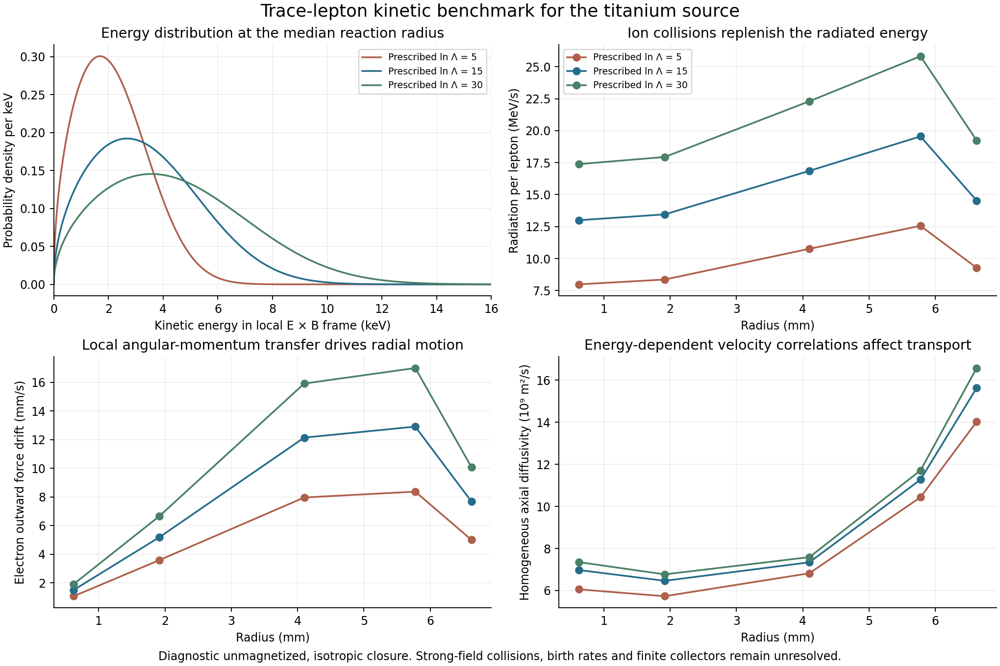

# Trace-lepton kinetic benchmark ✨

A local collision/radiation calculation gives a useful scale for the interior-electron problem: **a few keV per lepton and roughly 10–20 MeV/s of cyclotron radiation per lepton** at the central prescribed collision strength. The ions continually replenish that energy. The total loss therefore depends on how many leptons are born and how long they remain in the source.

This is a diagnostic calculation with **unmagnetized collision coefficients and an isotropic velocity closure**. The actual source lies well outside the weak-magnetization regime. Its electron gyroradius is about one to two thousandths of the local ion static screening length. The calculation provides a baseline for a stronger-field kinetic model; it supplies no new qualified plant output or completion date. The existing 1.474 mW/kg allocation remains conditional.



## Prescribed local problem

The calculation uses five radii containing 1%, 10%, 50%, 90% and 99% of the main titanium channel's reactions. Proton and titanium densities, electric field and common ion rotation come from the saved equilibrium. The field is 137.15 T and ion temperature is 1.6 MeV.

The local reference frame moves at the electric-field drift velocity, E cross B divided by B squared. The ion rotation differs from that drift. At the median reaction radius the drift is 6.192 million m/s in the azimuthal direction, while the ions rotate at 12.195 million m/s in the same direction. Their relative speed is 6.003 million m/s. This relative motion contributes to both momentum and energy exchange.

The model retains the standard Maxwellian-background test-particle slowing and velocity-diffusion coefficients tabulated in the [NRL Plasma Formulary](https://homepage.physics.uiowa.edu/~ghowes/teach/phys4731/resources/NRL_Plasma_Formulary_2023.pdf), pages 31–35. It prescribes Coulomb logarithms 5, 15 and 30, and repeats each case with and without relative ion flow. This variation tests sensitivity to collision strength; it is not a magnetic correction or a statistical uncertainty interval.

For each electron energy, the velocity-space drift vector and diffusion tensor are averaged over an isotropic direction distribution. Ito's transformation of kinetic energy gives

```
A_E = m v dot A_v + (m/2) trace(D_v)
B_E = m^2 v dot D_v dot v.
```

Here D_v is the velocity-increment covariance per unit time. The energy distribution satisfies the resulting one-dimensional Fokker–Planck equation. Isotropic averaging of free-space cyclotron radiation adds an energy drift of -2E/(3 tau_perp), where tau_perp is 137.13 microseconds. The zero-current stationary solution is evaluated on a logarithmic energy grid from 0.001 eV to 50 keV.

The stationary distribution need not be Maxwellian. It is determined by diffusion, collisional heating and radiation together. The calculation omits electron–electron collisions, finite injection/removal, bremsstrahlung, atomic processes, collective fields and relativistic corrections. At the central prescribed collision strength, rms electron speeds are about 0.10–0.13c; a later quantitative model should retain the corresponding relativistic corrections.

## What the benchmark gives

These values include the relative ion flow and use the prescribed Coulomb logarithm 15:

| Reaction fraction inside radius | Radius | Mean lepton energy | Radiation per lepton | Electron outward force drift |
|---|---:|---:|---:|---:|
| 1% | 0.623 mm | 2.674 keV | 13.00 MeV/s | 1.50 mm/s |
| 10% | 1.917 mm | 2.768 keV | 13.46 MeV/s | 5.19 mm/s |
| 50% | 4.100 mm | 3.468 keV | 16.86 MeV/s | 12.14 mm/s |
| 90% | 5.775 mm | 4.022 keV | 19.56 MeV/s | 12.91 mm/s |
| 99% | 6.622 mm | 2.989 keV | 14.53 MeV/s | 7.68 mm/s |

At the median radius, varying the prescribed logarithm from 5 to 30 changes mean energy from 2.214 to 4.587 keV and radiation from 10.77 to 22.30 MeV/s. Suppressing relative flow at logarithm 15 lowers the mean to 2.405 keV. These comparisons show why the rotating ion distribution matters.

The tabulated outward speed is a local force-drift diagnostic. A tangential collisional force F_theta produces radial guiding-center motion F_theta/(qB). The same prescribed collision force gives opposite radial signs for electrons and positrons. Under this approximation, electrons drift outward and positrons inward. Radial density gradients, strong-field corrections, field-energy changes and boundaries must be included before that tendency becomes a removal mechanism. In particular, an electron that moves outward through the positive plasma potential changes its electrostatic energy; the ion heat, rotational work and recovered field energy must be accounted together.

For any specified population, the radiation loss is obtained by integrating its local density times the per-lepton emission. If a lepton remained at the median benchmark conditions for 10 ms, it would radiate about 0.169 MeV. This is a conditional energy scale, not a residence prediction or a net electrical cost. Birth rates remain to be derived from nuclear radiation, gas, injection, internal pair conversion and in-source decays.

## A velocity-correlation transport comparison

The simple fixed-speed estimate D_parallel = average[v squared/(3 nu_direction)] ignores energy changes during velocity decorrelation. A second calculation retains the energy process. It solves the backward equation

```
(nu_direction - L_energy) g = v
L_energy g = (B_E f g')'/(2f)
D_parallel = average[v g]/3.
```

A finite-volume discretization preserves the positive quadratic form. In the artificial isotropic, homogeneous process, this is the Green–Kubo diffusion coefficient. It still omits the energy–angle correlations of the actual drifting plasma.

At the median radius and logarithm 15 it gives **7.343e9 m2/s**, compared with 8.545e9 m2/s from the fixed-speed average. For a homogeneous diffusion process in a 20.235 km interval with absorbing ends and uniform birth positions, L squared/(12D) would be **4.65 ms**. The corresponding comparison ranges from 2.18 to 5.28 ms over the five sampled radii. Real birth spectra, finite collector fields, anisotropy and strong-field collisions determine the reactor's residence distribution. In particular, the positive end barriers do not give positrons the same absorbing boundaries as electrons.

The mean angular decorrelation rate times the isotropic radiation time ranges from about17 to74 for these central-strength cases. This comparison motivates testing an approximately isotropic distribution, but the average can conceal slowly scattering energetic particles. A gyro-averaged velocity-space simulation with absorbing electron ends is the next check on this closure.

## Why the magnetic correction cannot be skipped

At the median radius, the isotropic rms gyroradius is 1.18 micrometres and the ion static screening length is 565 micrometres. The latter is a local scale, not a complete dielectric response for the rotating nonneutral column. Collisions at larger impact parameters occur over substantial gyromotion, so a Coulomb logarithm change alone cannot supply their angular and energy-transfer structure.

[Jose and Baalrud (2020)](https://arxiv.org/html/2008.06080v1) provide a generalized collision-volume method that follows the magnetic force during binary encounters. Their numerical demonstration concerns a massive projectile in a light background. Applying the method here requires the light test lepton, two hot ion species, their relative drift and the appropriate screening. Their discussion also identifies recollision and dynamic-screening limitations. The published curves are therefore a methodological lead rather than coefficients to import.

[Kennedy and Helander (2021)](https://doi.org/10.1017/S0022377820001622) derive how radiation and collisions can produce anisotropic distributions. Their bulk-neutral assumptions and collision ordering differ from this trace-lepton source. Their radiation time agrees with the coefficient used here, while their applicability discussion reinforces the need to distinguish ordinary Landau collisions from strongly magnetized scattering.

## Verification and next discriminator

The **86 checks** reproduce Maxwellian detailed balance at several mass ratios, independently recover Maxwellian temperature-exchange and drag moments, check probability and energy balance, and refine both the energy mesh and angular quadrature. The velocity-correlation solver reproduces the exact Ornstein–Uhlenbeck spatial diffusivity. This validates the specified equations and numerical implementation.

Next, test the isotropic and homogeneous approximations with gyro-averaged velocity trajectories and finite electron escape; then replace or bound the unmagnetized collision contribution using the appropriate magnetic scattering/response. Keep the birth calculation separate until its rates and spectra exist. Positron extraction, recombination, minority-charge stability and the full energy/angular-momentum ledger remain necessary before inserting any result into the plant allocation.

Reproduce with `lepton_collision_screen.py`, `validate_lepton_collision.py` and `plot_lepton_collision.py`. Inputs, run times and hashes are recorded in `lepton-collision-manifest.json`.
