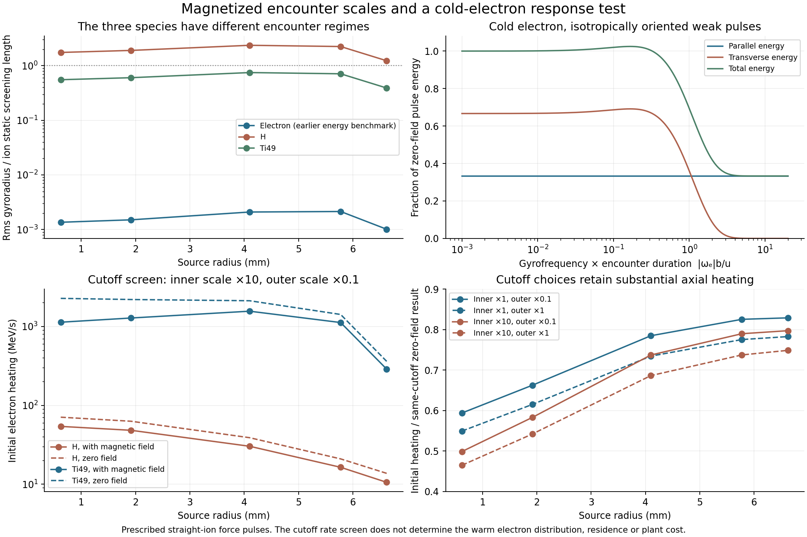

# Magnetic encounter scales and cold-electron response ✨

The titanium source spans several collision regimes. Its electrons turn many times during distant encounters, while close encounters remain nearly three-dimensional. A single replacement Coulomb logarithm cannot represent both. This checkpoint maps those scales and derives an independently checked **cold-electron force-pulse response**.

For a weak, distant pulse, the magnetic field suppresses energy transfer into transverse electron motion exponentially with encounter duration. The parallel impulse remains. Integrating this response over prescribed straight ion paths gives a useful initial-heating screen, but it does not yet replace the finite-energy collision operator in the [escape benchmark](LEPTON-ESCAPE.md). No new residence, abundance or plant cost is assigned here.



## Scale ordering in the reference source

At the median titanium reaction radius, the field is 137.149 T, the local ion static screening length is 565.47 µm, and the earlier isotropic electron mean energy is 3.468 keV. The electron gyrofrequency is 2.4122e13 radians/s and its rms perpendicular gyroradius is 1.182 µm. The cyclotron quantum is 0.01588 eV, far below this kinetic energy; resolving the classical magnetic orbit remains appropriate at that energy.

| Median-radius quantity | Proton encounters | Titanium encounters |
|---|---:|---:|
| Ion rms perpendicular gyroradius | 1.333 mm | 0.422 mm |
| Ion gyroradius / static screening length | 2.357 | 0.747 |
| Ion gyrofrequency / its own plasma frequency | 3.124 | 1.930 |
| Ion self-coupling parameter Γ | 3.15e−9 | 5.75e−7 |
| Reference classical 90° impact scale | 0.148 pm | 4.404 pm |
| Reference reduced de Broglie length | 2.797 pm | 3.255 pm |
| Impact scale for one electron radian per encounter | 1.717 µm | 1.475 µm |

The encounter-speed diagnostic combines the earlier electron mean-square speed, ion thermal variance and ion/electric-drift relative flow. The classical scale is Z e²/(4πε₀ μu²), and the quantum comparison uses ħ/(μu), where μ is reduced mass. These are scale conventions; no quantum scattering cross section is supplied by choosing their maximum.

Using that maximum as an inner scale and the static screening length as an outer scale gives logarithmic intervals of 19.12 for protons and 18.67 for titanium. Of these, 11.03 and 10.42 lie below the impact scale corresponding to 0.1 electron radian per encounter. Another 5.80 and 5.95 lie above one radian. The intervening decade is a transition region. These logarithmic intervals describe geometry, not fractions or bounds on the actual magnetized collision tensor.

The local density-gradient lengths at the median radius are 3.60 mm for protons and 5.59 mm for titanium. The electric-field gradient length is 4.32 mm. Local homogeneous approximations are thus more plausible for encounters well inside the screening length. Near the radius enclosing 99% of reactions, the titanium density-gradient length falls to 0.382 mm, below the local screening length. A distant-encounter calculation there requires the spatial source profile.

Ion motion also needs its own ordering. At the reference warm-electron encounter speed, a screening-length passage turns a titanium ion by about 0.095 radian. An initially stationary electron sees slower relative ion motion, so the same passage lasts longer and the ion turns farther. The saved scales record both speeds. The cold calculation below prescribes straight paths; extending its outer cutoff to the full screening length is an explicit extrapolation of that approximation.

## An analytic force-pulse test

Consider an electron initially at rest in the local electric-drift frame. An ion moves on a prescribed straight path with speed u and impact vector b perpendicular to its direction. Work to first order in the Coulomb force when obtaining the velocity impulse, so the resulting heating is second order in the interaction strength. Radiation during this short encounter is omitted.

With dimensionless time s = ut/b, the force is proportional to

```
(b_hat + s*u_hat) / (1+s²)^(3/2).
```

The parallel velocity integrates this force at zero frequency. The transverse velocity in a rotating frame integrates its Fourier component at the electron gyrofrequency. Defining a = |ω_e|b/u gives

```
integral exp(i*a*s) / (1+s²)^(3/2) ds = 2*a*K1(a)
integral s*exp(i*a*s) / (1+s²)^(3/2) ds = 2*i*a*K0(a),
```

where the integrals run over the whole real line and K0,K1 are modified Bessel functions. Let μ = u_z/u, and average over the azimuth of the impact vector. Relative to the total zero-field impulse energy for the same b and u, the directional energies are

```
f_parallel      = (1−μ²)/2
f_perpendicular = [a*K1(a)]²*(1+μ²)/2 + [a*K0(a)]²*(1−μ²).
```

As a approaches zero, these sum to one. At large a the transverse terms decrease exponentially. For isotropically oriented ion paths, the surviving parallel fraction is one third. A perpendicular mean ion flow changes the angular weights; it is retained in the rate screen. There is also a small enhancement of transverse response in part of the transition region, reproduced by the direct Lorentz integration. The magnetic field does no work; the prescribed moving ion supplies the energy.

The response is quadratic in the Coulomb strength and therefore independent of its sign at this order. This statement concerns weak pulses. Nonlinear attractive and repulsive encounters, including slow encounters and repeated interactions, can differ.

## A limited rate screen

For each Maxwellian ion species with a mean velocity perpendicular to the field, the rate screen integrates the impulse energy against the encounter flux n u 2πb db. Its common dimensional factor is

```
dP = 4π*n*[Z e²/(4πε₀)]²/(m_e*u) * f_direction * d(ln b).
```

It integrates the drifting Maxwellian speed distribution and its conditional angle to the field. For drift magnitude U and thermal speed v_th = sqrt(2kT/m_i), define q = 2uU/v_th². The conditional mean of μ² is coth(q)/q − 1/q², with the regular limit 1/3 at q = 0.

Two inner-scale multipliers, 1 and 10, and two outer cutoffs, 0.1 and 1 times the static screening length, expose the cutoff choice. The larger inner multiplier removes more of the range where a weak-orbit approximation is least reliable. The smaller outer cutoff reduces ion turning and source-gradient effects. These variations are not a confidence interval for the actual plasma.

At the median radius, using **10 times the inner scale and 0.1 times the screening length** gives:

| Ion species | Zero-field initial heating | Parallel heating with B | Transverse heating with B | Total with B / zero-field total |
|---|---:|---:|---:|---:|
| Protons | 38.869 MeV/s | 13.164 MeV/s | 17.108 MeV/s | 0.779 |
| Titanium | 2114.277 MeV/s | 967.435 MeV/s | 591.442 MeV/s | 0.737 |

These are instantaneous rates for an electron initially at rest. They are much larger than the 16.5 MeV/s radiation rate of the already warm escape population. Applying the initial rate throughout a millisecond residence would be incorrect: the electron leaves the cold limit almost immediately.

With the inner multiplier 1 and the full static outer cutoff, titanium's initial total is 2240.493 MeV/s versus 3049.970 MeV/s in the matching zero-field screen. The transverse contribution is unchanged when the already distant outer cutoff increases from 0.1 to 1 screening length, while the parallel contribution grows. This follows from the exponential transverse suppression and persistent zero-frequency axial impulse.

The zero-field calculation with a prescribed constant logarithm of 15 agrees with the independent NRL cold-test-particle tensor. This verifies the normalization of the encounter-flux integral. It does not validate the static cutoffs, straight paths or finite-temperature extension.

## Relation to published strong-field calculations

[Jose and Baalrud (2023)](https://doi.org/10.1063/5.0146417) calculate energy-exchange moments for a heavy test ion in an electron bath, including attractive and repulsive interactions. The accepted manuscript's method and parameter ranges are readable through the authors' [public full text](https://www.researchgate.net/publication/370648681_Theory_of_the_ion-electron_temperature_relaxation_rate_in_strongly_magnetized_plasmas). Its mass ratio is 1000, with background coupling parameters 0.1, 1 and 10; attractive examples use Γ = 1. Those conditions differ substantially from this very weakly coupled, drifting trace-electron problem. Its reported inverse-field parallel relaxation is not substituted here.

The subsequent [2025 anisotropic-relaxation study](https://doi.org/10.1103/PhysRevE.111.035201) treats repulsive interactions. [Dubin's 2014 long-range analysis](https://doi.org/10.1063/1.4876749) distinguishes isolated and interrupted encounters when both species are magnetized. These sources support retaining the separate physical regimes and charge-sign dependence where applicable. They do not supply a numerical tensor for the current source.

## Verification and next step

All **67 checks** pass. Independent checks include quadrature of both force Fourier transforms, direct Lorentz trajectories and their work/energy balance, impact-angle averaging, drifting-Maxwellian normalization and inverse-speed moments, the zero-field NRL limit, independently differentiated source gradients and speed/impact quadrature refinement. The four-panel figure was visually inspected.

The next step is the response of an electron with finite parallel energy and finite gyroradius. The calculation must retain a consistent drift as well as velocity diffusion, so it conserves phase-space probability and accounts for work transferred from ion thermal and rotational motion. Close encounters, the gyroradius-scale transition and distant encounters need a matching prescription without double counting. Dynamic screening, ion turning, source gradients, nonlinear slow encounters and recollisions then need explicit bounds or treatment. A numerical coefficient from this cold limit must not simply multiply the existing Landau tensor.

Reproduce with `magnetized_lepton_scales.py`, `cold_magnetized_response.py`, `validate_cold_magnetized.py` and `plot_cold_magnetized.py`, using the dependencies in the research README. All accept an explicit output directory; the first three accept an input root. Input and output hashes are in `cold-magnetized-manifest.json`.
