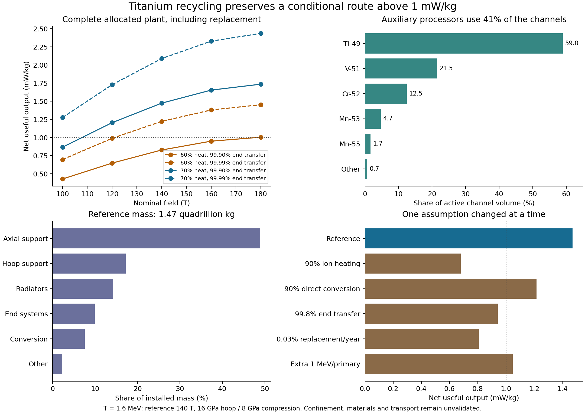

# Protium reactor with explicit catalyst recycling ✨

The titanium accelerator candidate remains above the requested **1 mW/kg** after allocating its auxiliary isotope processors. At 140 T nominal field, the reference produces **2.160 TW at 1.466e15 kg**, or **1.474 mW/kg after replacement manufacture**. Its mass is 7.72e-13 Jupiter masses. This is a conditional complete-mass allocation with unvalidated confinement, material and transport requirements. It establishes a candidate worth developing, with a measurable budget for the remaining engineering.

This calculation supersedes the generic 50 MeV side-restoration parameter in the earlier [shared-solenoid allocation](SHARED-SOLENOID.md). It uses the explicit [TENDL-2025 recycling network](CATALYST-RECYCLING.md), evaluated neutron/photon spectra, separate ion channels for each active isotope, cold capture stock, converter capacity and a closed maintenance/radiator allocation. No article chronology has been selected.



## What the auxiliary channels do

The principal reaction remains Ti49(p,n)V49. Extracted vanadium captures an electron in cold storage and returns titanium; the neutron makes deuterium from ordinary hydrogen. A closed deuterium cycle supplies helium. Other titanium reactions feed additional processors, principally V51, Cr52, Mn53 and Mn55. Their return paths and explicit small makeup/waste streams are in the recycling audit.

At an ion temperature of 1.6 MeV, the conserving network performs 1.27546 pn reactions across all processors per primary Ti49 pn. Including other nuclear transformations, it extracts 1.29867 reacting ion pairs. It consumes 2.55586 hydrogen atoms, produces 0.638964 helium atoms, and supplies 16.17665 MeV of nuclear heat after the conservative neutrino allowance and removal of positive makeup-transmutation credit. This larger heat per primary event accompanies additional hydrogen consumption.

Fifteen processors have positive stationary flow; Ni64 has zero flow in this selected network. The auxiliary reactors occupy **41.0% of active channel volume**:

| Processor | pn events per primary Ti49 pn | Active channel volume |
|---|---:|---:|
| Ti49 | 1.00000 | 58.97% |
| V51 | 0.24507 | 21.46% |
| Cr52 | 0.01553 | 12.48% |
| Mn53 | 0.00459 | 4.73% |
| Mn55 | 0.00827 | 1.68% |
| Other active isotopes | 0.00199 | 0.68% |

Cr52 and Mn53 need appreciable volume despite their small pn counts because their pn reactivities are lower. Their inelastic photon losses are also explicitly included.

## Spectra and the electrical ledger

The archived standard-format TENDL-2025 files contain exclusive MF3 cross sections and MF6 product spectra. `recycling_spectra.py` reads the spectra with IAEA's ENDF parser. The [ENDF-6 manual](https://www.nndc.bnl.gov/endfdocs/ENDF-102-2023.pdf), sections 6.2–6.3, specifies the coordinate frames and the separate treatment of discrete lines and continuum histograms. The code integrates these components separately. Light-particle CM spectra and laboratory-frame heavy-recoil spectra are kept distinct. Duplicate incident energies can represent discontinuities and retain their two one-sided values in the independent integration check.

The maximum populated spectrum-normalization discrepancy is 9.24e-6. Thermal moments integrate the cross section, multiplicity and mean emitted energy as separately interpolated functions. An independent piecewise polynomial/incomplete-gamma calculation checks those moments. The tiny negative integrated CM remainder in trace channels totals 1.05e-12 MeV per primary event and does not affect the quoted power.

For each isotope-changing event, the hot input energy is its reaction-selected mean CM energy plus 3kT/2 of pair COM motion. Neutron CM energy comes from MF6; the thermal COM share is added using the neutron mass fraction. Prompt photons thermalize. The remaining prompt energy is assigned to collectable charged products. Inelastic events that retain the same proton and isotope stay in the thermal plasma, and their photon energy must be replaced by heating. Ordinary elastic redistribution conserves plasma heat.

The reference assumes 95% ion-heating efficiency, 95% charged-energy conversion and 70% conversion of residual heat. Escaping neutrinos receive the conservative allowance from the recycling audit, including its weak-isomer excitation margin. Trace tritium/He3 completion is credited entirely as heat. Atomic preparation has an additional electrical reserve of 0.1 MeV per extracted pair; this is a specified processing allowance requiring a stripping/neutralization design.

Before confinement and extraction, the combined source ledger per primary Ti49 event is:

| Quantity | MeV per primary event |
|---|---:|
| Hot-ion energy supplied, including inelastic reheating | 11.27003 |
| Collectable charged energy, including downstream D burning | 12.11984 |
| Thermal energy | 15.32685 |
| Nuclear heat | 16.17665 |
| Electrical surplus before confinement/extraction | 10.80203 |

Charged plus thermal output minus hot input equals nuclear heat. The electrical result includes the separate 1000 MeV reserve per rare discarded high-energy event. It is then reduced by rotation, wall circulation, potential handling, radiation, end transfer and processing.

## Allocating the plasma channels

Every processor gets a fully stripped proton/heavy-ion Poisson–Boltzmann equilibrium. A finite search varies rotation, central density and proton charge share, with eight candidate wall positions. It evaluates 2161 central configurations and retains their closed radial solutions. Radial integrals use 6001 samples and ODE relative tolerance 1e-10.

For fixed isotope flows f_i, a candidate channel has loss L_i per pn and volume/rate ratio A_i. The selected finite family maximizes

```
(E_bare - sum f_i L_i) / (sum f_i A_i).
```

Fractional optimization repeatedly chooses each isotope's minimum L_i + R A_i and updates the common ratio R. This is a finite-family optimum for source power per channel volume. The plasma distribution, temperature, wall and whole-plant equipment have not been globally optimized together. Tighter calculations of the selected profiles use 12001 radial points and ODE tolerance 1e-11.

Potential circulation is charged for every isotope-changing event, using its total positive charge. The explicit end barrier is 25 kT per proton, or 40 MV at 1.6 MeV. A main reaction's total charge traverses 920 MeV of additional coherent energy. The reference assumes 99.9% transfer in each direction, in addition to the separate radial-potential transfer allowance. Converter mass is rated on the large total circulation, including wall recycling. In the reference, that rating is **1657.9 MeV per primary event**, about 1.109 PW.

Ion–ion dipole bremsstrahlung and vacuum ion-Larmor radiation remain in the budget. Low electron abundance is still a required operating condition. The finite radial equilibria and assigned conversion efficiencies do not establish stable driven injection, extraction or electron removal.

## Complete reference allocation

The winding, finite on-axis field correction, axial force, buckling screens, water channels and cooling equations retain the derivations in [SHARED-SOLENOID.md](SHARED-SOLENOID.md). Each isotope's wall uses its own electric pressure and channel radius. The model recomputes the water volume, source rate, capture stock and mass feedback after fitting all processors.

| Quantity | Reference |
|---|---:|
| Nominal / finite source field | 140 / 137.15 T |
| Core radius / magnet length / active length | 1.00 / 30.06 / 20.24 km |
| Primary Ti49 reaction rate | 4.1745e24/s |
| Source electrical output after confinement/processing | 2.968 TW |
| Plant bus output | 2.624 TW |
| Allocated replacement manufacture | 0.4644 TW |
| Net useful output | 2.160 TW |
| Complete allocated mass | 1.466e15 kg |
| Net useful power per mass | 1.474 mW/kg |
| Nuclear heat after capture allowance | 10.759 TW |
| Radiator area | 2.081e14 m2 |
| Cold isotope-decay inventory | 1.470e7 kg |
| Cold capture-isotope stock, lower-bound screen | 1.900e11 kg |
| Fresh Ti49 makeup | 17.21 kg/year |
| Capture-stock processing power | 0.602 GW |

The homogeneous capture-bank screen gives equivalent 2200 m/s flux 1.2945e14/m2/s. It assumes the selected captures can be arranged while 99.5% of the remaining light-fuel neutrons are captured usefully. Most capture-stock cross sections are total-absorption upper bounds, so the reported stock is a lower bound. Spatial transport, competing absorptions, carrier circulation and isotope separation remain open.

Structural assumptions remain demanding: 16 GPa hoop working stress at 1600 kg/m3, 8 GPa compression at 3500 kg/m3 and 1 TPa compression modulus. The winding assumes 1e8 A/m2 engineering current density at 10% of critical current. No conductor or kilometre-scale structural material has been qualified for those combined field, stress and lifetime conditions.

The coil operates at 4.2 K, the water blanket at 300 K, and heat rejection at 30 K to a 3 K background. Thermal conversion is 70%, below the 90% Carnot ceiling. Radiator allocation is 1 kg/m2. Shield energy transmissions remain prescribed at 1e-6 for neutrons and 1e-5 for photons; they are awaiting transport calculations. The separate D plant retains its equipment allowance and requires its own engineering.

Other operating loads receive 10% of the remaining positive pre-auxiliary power. Replacement uses 0.01% of total mass per year at 100 MJ/kg, with manufacturing equipment and spare stock. Radiator mass, manufacturing power and total mass are solved together. Axial support is 48.9% of mass, hoop support 17.2%, radiators 14.2%, end systems 9.9% and conversion equipment 7.6%.

## Sensitivity and the remaining power budget

The 20-case field/efficiency sweep retains the 1.6 MeV nuclear network. At 70% heat conversion and 99.9% end transfer, net output ranges from 0.866 mW/kg at 100 T to 1.735 mW/kg at 180 T. At 60% heat conversion, the 140 T case gives 0.827 mW/kg. With 99.99% end transfer, that 60% case gives 1.222 mW/kg.

One change at a time from the 140 T reference gives:

| Changed assumption | Net mW/kg |
|---|---:|
| Reference | 1.474 |
| 8 GPa hoop and 4 GPa compression | 0.369 |
| 90% ion heating | 0.680 |
| 90% direct charged-energy conversion | 1.217 |
| 99.8% coherent end transfer | 0.942 |
| Converter equipment at 1 kg/W | 0.744 |
| 0.03% annual mass replacement | 0.807 |
| Additional 1 MeV electricity per primary event | 1.049 |
| Additional 2 MeV electricity per primary event | 0.633 |

The extra-load calculation also adds converter capacity and closes waste heat and replacement again. The reference reaches exactly 1 mW/kg at **1.11714 MeV of additional electrical load per primary Ti49 event**, beyond the processing and general auxiliary allowances already present. This gives finite extraction and electron-control studies a quantitative margin. Reduced power caused by different isotope cross sections or changed plasma states also requires recomputing channel volume and all relevant costs.

## Economic implication

The reference consumes about 0.01786 kg/s of hydrogen, or 563 tonnes/year, and delivers approximately **0.135% of that hydrogen's rest-mass energy** after its allocated upkeep. Its large recirculating energy flows and structural mass dominate economics. With the specified 100 MJ/kg manufacturing energy, construction energy equals about 1770 years of plant-bus output or 2150 years of net output; stored magnetic energy is an additional startup inventory reported in the data.

Those figures are compatible with a very long-lived infrastructure role only if manufacturing, maintenance and energy alternatives make it worthwhile. A future article must compare this candidate with deuterium separation, solar collection and mature accretion power, and distinguish this prototype's delivered efficiency from canon's higher mature-fusion benchmark. Abundant ordinary hydrogen alone does not settle that comparison.

## Reproduction and next discriminator

Run `recycling_spectra.py`, `network_ion_budget.py`, `allocate_network_channels.py`, `network_plant.py`, `network_plant_sensitivity.py`, `validate_network_plant.py` and `plot_network_plant.py`, in that order. The saved finite family can be reused with `allocate_network_channels.py --reuse-family`. Inputs are the archived TENDL files, NUBASE/atomic masses already used by the recycling audit, and explicit engineering parameters in the scripts. All 292 checks pass, covering independent spectral moments, radial convergence, finite-family optimization, isotope-flow allocation, installed mass and energy closure, including the engineering sensitivities. Versions, reproduction times and hashes are recorded in `network-plant-manifest.json`.

Next, develop finite product selection and electron/positron handling, with particle birth rates, trajectories, coherent-energy recovery, contamination and driven stability. Then replace prescribed shield transmissions with neutron/photon transport and examine material lifetime. These checks can consume the remaining margin or require a different geometry. The isotope-network allocation itself no longer depends on an unspecified 50 MeV restoration factory.
