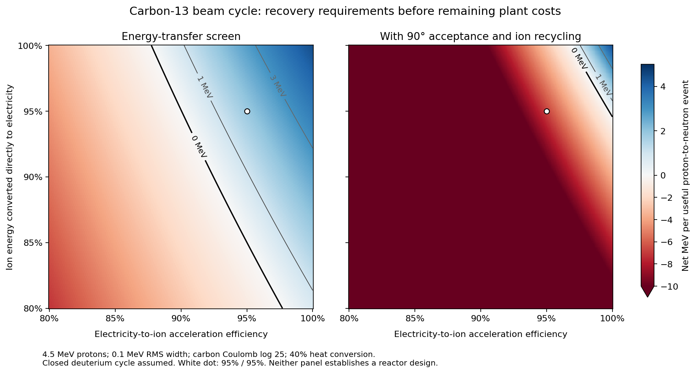

# Carbon-13 neutron catalysis and nonneutral beams ✨

Checkpoint: 29 October 2026. This branch has a reproducible reaction/energy screen and a magnetic-field mass screen. It has **no complete reactor design**. In the tested narrow-beam scenarios, angular scattering consumes more power than the first energy-transfer calculation allows. Broad-angle confinement and much more efficient phase-space recovery remain distinct possibilities to investigate.

## The closed fuel cycle

The useful sequence is:

1. C13 + p → N13 + n, with Q = −3.003 MeV and a laboratory proton threshold near 3.236 MeV.
2. N13 → C13 + positron + neutrino. Its approximately 9.951-minute half-life permits the catalyst to be stored outside the reaction region while it decays.
3. n + p → D + gamma, releasing 2.225 MeV.
4. A closed, catalyzed deuterium cycle converts the new deuterium to helium and recaptures its own secondary neutrons.

The net nuclear fuel is ordinary hydrogen. Two proton-to-neutron events accompany each helium nucleus. With a mean N13 neutrino energy of 0.706 MeV, the available nuclear energy is about **12.6595 MeV per new neutron**, or 25.319 MeV per helium nucleus. The calculation obtains the mass differences from the same pynucastro nuclear masses used elsewhere in this investigation.

The secondary deuterium cycle must close. Equal DD branching followed by burning all T and He3 gives 6D → 2He + 2p + 2n; recapturing the two neutrons on those protons returns 2D. Its net reaction is 4D → 2He. This model allocates the charged product energies to potentially direct conversion and the neutrons/capture photons to heat. It presently gives the deuterium reactor free confinement and heating, making the result optimistic.

The competing C13(p,d)C12 channel consumes catalyst. It can be closed with C12(n,gamma)C13: the combined pair performs n+p → D. Consequently it can substitute for some hydrogen neutron capture, provided enough new neutrons remain for catalyst restoration. This is an explicit neutron inventory, not a fresh carbon supply. The model requires the p,d/p,n event ratio to be at most one and assumes every required neutron is captured successfully. It has not designed the graphite capture blanket or isotope extraction plant.

## The data and a consequential inconsistency

`beam-data/padf2-c13-2026.ndf` is the C13 evaluation marked EVAL-MAR26 in PADF-2, retrieved from the authors' public `2026_April_23.zip` archive. `read_padf.py` extracts its MF10/MT5 production tables to `padf2-c13.json`, preserving the source hash and interpolation law. The useful N13 production curve is based on measurements cited by the evaluators, including Kitwanga (1989) and Firouzbakht (1991). Many competing channels rely on nuclear models.

These are independently evaluated production cross sections. They cannot be treated as a set of mutually exclusive, conserving reaction probabilities. At 5 MeV the file gives 0.073666 barn for deuterium production and 0.057381 barn for C12 production. In this energy region the p,d channel should contribute equally to both. The model uses the larger deuterium table for its p,d event count and exposes the mismatch. A defensible final design needs a consistent channel evaluation and measured competing-channel constraints.

The 1995 ACSELAM evaluation gives much smaller deuteron production at these energies. JENDL-5 gives substantially larger values than that older file. Using the older estimate would create a misleadingly easy catalyst budget. The PADF Q fields also appear numerically in MeV where ordinary ENDF convention would suggest eV; the screen uses nuclear masses for all Q values.

## Energy and scattering calculation

For a proton of laboratory kinetic energy E striking a stationary C13 nucleus, let b90 = Zp ZC e²/(8π ε0 Ecm) and f = 4 mp MC/(mp+MC)². The Rutherford recoil-energy cross section is approximately

`S_E / E = 2π f b90² ln Λ`.

The screen uses ln Λ = 25 and averages cross sections, energy transfer and reaction rates over a specified proton energy distribution. Removing electrons eliminates the dominant cold electronic stopping term, but leaves this ion recoil term. A numerical impact-parameter integral verifies the energy-transfer expression. The corresponding small-angle laboratory deflection variance is

`S_theta = 8π [MC/(mp+MC)]² b90² ln Λ`.

The angular expression differs by about 1.3% from an exact Rutherford-angle integral for the selected logarithm. Nuclear elastic scattering, proton–proton redistribution, energy straggling, maintenance of the narrow energy distribution, target motion and realistic cutoffs remain to be added.

At 4.5 MeV with 0.1 MeV RMS energy width, the current evaluation gives:

| Quantity per useful p,n event | Screen value |
| --- | ---: |
| Effective N13 production cross section | 0.0892 barn |
| p,d events requiring carbon restoration | 0.611 |
| Carbon recoil energy transferred by Coulomb scattering | 22.64 MeV |
| Minimum inelastic excitation loss | 1.92 MeV |
| Energy of protons consumed in p,n and p,d | 7.27 MeV |
| Total beam preparation before angular recycling | 31.83 MeV |
| Potentially recoverable charged-particle energy | 30.80 MeV |
| Heat, including reaction products and recovered preparation energy | 13.69 MeV |
| Accumulated small-angle deflection variance | 64.99 rad² |

The charged and thermal outputs sum to preparation input plus nuclear energy. The large charged output includes recovered beam energy; it is not additional nuclear generation.

If eta_d of charged energy is converted directly to electricity, its remaining share becomes heat in this optimistic accounting. Thus its total useful fraction is `eta_d + (1−eta_d) eta_th`. Electricity consumed to prepare the beam is `Eprep / eta_acc`. Driver losses receive no heat refund. The assumed 40% heat conversion requires suitable heat collection and temperature; it is not automatically available for distributed or cryogenic losses.

At 90% acceleration efficiency, 90% direct ion recovery and 40% heat conversion, the 4.5 MeV case loses **0.94 MeV per useful event** before other plant loads. At 95%, 95% and 40%, respectively, it produces **1.85 MeV** before the omitted loads. A specified 50 MeV net-electric restoration cost for each B10 or N14 side product reduces this to 1.845 MeV at this energy. That restoration cost is a sensitivity parameter, not a developed recovery process. Higher proton energies increase the B10 side-channel burden sharply.

## Why angular acceptance changes the result

The first calculation assumes that deflected surviving protons can remain useful without an additional directional-control bill. A narrow beam must handle the direction changes as well as replace recoil energy.

For an illustrative angular-diffusion process that extracts ions after they leave an acceptance cone and reinjects them on axis, the mean escape time is

`t_escape = −8 ln[cos(theta_accept/2)] / (d<theta²>/dt)`.

This is a specified control scenario, not a theorem about every magnetic trap. At the 4.5 MeV operating point it implies:

| Accepted half-angle | Extra beam energy circulated per p,n event | Electrical penalty at 95% acceleration / 95% direct recovery / 40% heat conversion |
| --- | ---: | ---: |
| 0.3 rad | 3,237 MeV | 267 MeV |
| 1 rad | 280 MeV | 23.1 MeV |
| 90 degrees | 105 MeV | 8.72 MeV |

Each exceeds the 1.85 MeV preliminary surplus. A trap accepting all pitch angles avoids this particular reset mechanism, but requires a consistent orbital distribution, energy redistribution calculation and stability analysis. Another route is much better recovery during the repeated phase-space transformations. Neither has been established here. Near-perfect recovery is not prohibited by the arithmetic; it has to be supplied by an actual physical process with its mass, entropy disposal and losses.

## Field mass and the beta-decay inventory

For one optimistic Penning-style magnetic configuration, the cold carbon Brillouin condition bounds the total positive charge density by

`nH + 6 nC ≤ 6 ε0 B² / (2 MC)`.

At fixed charge density and prompt removal of N13, nH = 6 nC maximizes nH nC. The field energy is B²/(2 mu0). The mass screen allocates five times this energy divided by a structural specific strength of 1 MJ/kg. These are necessary force and mass screens; they do not establish a mixed-species equilibrium or a magnet design.

Using the preliminary positive 1.845 MeV energy balance, at 20% plasma filling of the field volume, the field-mass-only performance is 0.196 mW/kg at 20 T, 1.22 mW/kg at 50 T and 4.89 mW/kg at 100 T. **These numbers omit the angular-recycling penalty and the rest of the plant. They do not meet the user's complete-system criterion.** They show that field mass alone does not immediately exclude the criterion at very high fields.

N13 must be removed promptly to achieve the stated reactant densities. At 100 T, leaving it in the same field volume throughout its decay reduces the optimal reaction rate to about 43% of the prompt-removal value. Its cold inventory outside the field is small by mass; separation and reinjection remain engineering requirements.

An ideal conducting cylinder changes longitudinal space-charge waves. In a cold, uniform two-fluid approximation the transverse fundamental mode replaces the infinite-plasma coupling with a factor `kz²/(kz²+kperp²)`, with kperp ≈ 2.4048/pipe radius. The associated threshold is checked against the dispersion polynomial. A sufficiently narrow pipe can place the two streams above this model's instability band. This excludes neither transverse modes nor resistive-wall, rotating-plasma or finite-temperature instabilities.

The illustrative 100 T pipe has radius 4 mm, while a 4.5 MeV proton at 90-degree pitch has a free Larmor radius of about 3.1 mm. This geometry cannot simply be combined with unrestricted pitch-angle acceptance. The tradeoff between collimation, angular scattering, field mass and collective stability must be solved together.

## Remaining work

- Construct a consistent competing-channel evaluation, using inverse reactions and detailed balance where measurements support it.
- Compare a retained broad-angle, nonneutral distribution with a genuinely collimated recirculating beam. Treat proton–proton energy redistribution and carbon heating explicitly.
- Calculate electron production/removal, photon losses and the energy cost of any stripping or reionization. In the cold-electron limit, about 2.5e−4 of the neutralizing electron density already gives electron stopping comparable to carbon recoil; hotter electrons require a different stopping calculation.
- Develop carbon-12 neutron capture and isotope extraction, including parasitic capture and the deuterium reactor's power and mass.
- Supply a concrete phase-space recovery process before using efficiencies of 95–99.9% as more than sensitivities.
- Keep the opaque-pulse route in parallel. This beam checkpoint supplies neither a universal impossibility proof nor a demonstrated smaller alternative.

`validate_nonneutral.py` independently checks isotope closure, energy closure, Coulomb quadrature, the narrow-spectrum limit and the ideal pipe dispersion threshold. Passing these checks validates the accounting and specified mathematical models, not the missing engineering.
