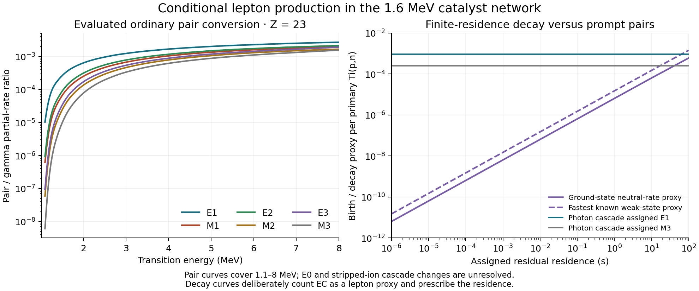

# Prompt pairs and finite-residence weak decays ✨

The recycled catalyst network produces leptons inside its active plasma through nuclear pair conversion. Magnetic insulation of the walls leaves this source present. Folding the evaluated prompt photon spectra with BrIcc coefficients gives **0.000253–0.000906 pairs per primary Ti(p,n) event** across six assumed pure multipolarities. These values cover transitions from 1.1 to 8 MeV and treat the existing photon cascade as a gamma-only reference. Nuclear monopole transitions, actual multipolarity mixtures and changes to cascades in fully stripped ions remain to be reconstructed.

At an assigned unrecovered removal work of 40 MeV per positron, that component costs **0.0101–0.0362 MeV per primary event**, or **0.91–3.24%** of the 1.11714 MeV extra electrical margin in [NETWORK-PLANT.md](NETWORK-PLANT.md). This comparison motivates a finite collector calculation. The original conditional plant allocation remains unchanged.



## Photon-associated pair calculation

The official [BrIcc manual](https://bricc.anu.edu.au/documentation/BrIccV2.3Manual.pdf) defines the ordinary pair coefficient as the pair partial rate divided by the gamma partial rate. For the charges used here, BrIcc selects the Schlüter–Soff table, tabulated from 1.1 to 8 MeV for E1–E3 and M1–M3. The ANU executable identifies itself as BrIccS v2.3d, 13 September 2022. The saved source manifest distinguishes that executable, the December 2011 manual, and the IAEA-NSDD package supplying its binary tables.

For each exclusive TENDL reaction, the calculation integrates every discrete photon line and continuous spectrum segment. It then interpolates the conditional moment, photon yield and reaction cross section separately in incident energy before applying the same 1.6 MeV Maxwellian relative-energy average as the earlier network. The final residual charge supplies a proxy for the emitting charge. It does not identify the nucleus at every intermediate cascade step. The MF6 photon energy in the incident proton–target center-of-mass frame is used as a transition-energy proxy; a level-resolved treatment should include emitting-residual recoil.

Two integrals are saved:

- `pair_ratio`: photon yield multiplied by `alpha_pair`. This is the photon-associated pair/gamma diagnostic for the assigned multipolarity.
- `pair_branch`: the same reference yield multiplied by `alpha_pair / (1 + alpha_pair)`. This treats the photon cascade as a hypothetical gamma-only transition cascade and diverts a fraction of its transitions into pairs.

The second quantity is the scenario used for the removal-work comparison. The difference between the two is small here, but their definitions must remain separate. Actual nuclear branching among several daughter levels also changes when bound-electron conversion is suppressed. The [TALYS manual](https://nds.iaea.org/talys/tutorials/talys.pdf) documents electron-conversion corrections to discrete gamma branches. The inspected current source defaults to applying them and divides gamma yield by `1 + conv`. TENDL-2025 identifies TALYS 2.0 as its generating code; the inspected source is a later snapshot, not a reconstruction of its exact run settings.

| Uniform transition assignment | Pair/gamma diagnostic per primary | Gamma-only branch scenario per primary | Unrecovered 40 MeV work, MeV/primary |
| --- | ---: | ---: | ---: |
| E1 | 0.000907048 | 0.000905862 | 0.0362345 |
| M1 | 0.000481450 | 0.000481018 | 0.0192407 |
| E2 | 0.000555538 | 0.000554994 | 0.0221998 |
| M2 | 0.000335452 | 0.000335207 | 0.0134083 |
| E3 | 0.000388322 | 0.000388008 | 0.0155203 |
| M3 | 0.000253182 | 0.000253022 | 0.0101209 |

These assignments span a set of transition models. They supply neither a measured total source nor a statistical confidence interval. In the E1 scenario, the main Ti49 processor contributes 0.000690032 pairs/primary and V51 contributes 0.000173815. The remaining processors contribute about 4.20e-5. The sum of pair kinetic energies is 0.00216368 MeV/primary; the corresponding transition-energy allocation is 0.00308947 MeV/primary. Their difference equals the pair rest energy times the pair count.

The high-energy MT5 discard branch is retained separately. Its evaluated photons contribute 1.368e-6 photons and 4.659e-6 MeV per primary. Applying the same E1 diagnostic gives 1.576e-9 pairs/primary in the tabulated interval. This addition is kept separate from the earlier exclusive-network photon-energy identity and from its existing discard reserve.

## Spectral coverage and missing transitions

The exclusive photon calculation reproduces the earlier **3.29596427 MeV/primary** energy total and adds a count of **2.15229285 photons/primary**.

| Photon-energy interval | Photons/primary | Photon energy, MeV/primary |
| --- | ---: | ---: |
| Below pair threshold, 1.0219979 MeV | 0.871707 | 0.348364 |
| Threshold to 1.1 MeV | 0.0709497 | 0.0743425 |
| 1.1–8 MeV | 1.204823 | 2.829871 |
| Above 8 MeV | 0.00481320 | 0.0433873 |

The two intervals outside the coefficient table stay explicit in the output. For scale, assigning the largest tabulated 1.1 MeV coefficient over Z=18–29 to the entire near-threshold interval would add 8.30e-7 pairs/primary. That is an endpoint-coefficient scenario, not an independently derived threshold bound. Assigning one pair to every above-8-MeV reference transition would add 0.0048132 pairs/primary and 0.192528 MeV/primary at 40 MeV per positron. That deliberately severe cascade scenario still requires the same interpretation of the reference transition count. No extrapolated coefficient is silently used.

Electric monopole transitions connect states of the same spin and parity. Their rate requires a nuclear monopole strength and an electronic factor; a single-photon multiplier cannot reconstruct their population. This includes possible E0 components between nonzero-spin states. The [Dowie et al. paper](https://arxiv.org/html/1911.00031v1) explains this separation and supplies newer E0 factors. The present calculation uses only the ordinary pair coefficients. Text searches of the adopted Ti49 and V49 evaluations found no E0-labelled entry; this does not establish absence of an unmeasured E0 contribution. Level populations and branching remain necessary.

The manual's nominal coefficient uncertainty is not a full error bar for this calculation. Multipolarity, emitting charge, frame conversion, atomic screening and the changed cascade can dominate the numerical integration error. Free-free internal pairs persist in bare ions; bound-electron conversion and bound-free pair channels require their own treatment.

## Weak decays before extraction

The second ledger starts with **directly produced heavy residuals**, summing to the network's 1.29867096 extraction events/primary. It applies NUBASE2020 neutral-atom half-lives over an assigned residence `t` through `1 - exp(-ln(2) t / half_life)`. Later decays following cold neutron captures are kept in the cold processing system.

Two population scenarios are retained: each residual in its ground state, and every residual in its fastest known weakly decaying ground/isomeric state. The latter assigns the full total decay rate to the weak channel, including any competing internal transition. EC/B+ entries are all counted as if they supplied one lepton. This intentionally inclusive neutral-rate proxy avoids equating an eventual cold decay with an in-plasma positron birth.

| Assigned residence | Ground-state proxy, decays/primary | Fastest-known-weak-state proxy, decays/primary |
| --- | ---: | ---: |
| 1 microsecond | 6.3633e-12 | 1.4885e-11 |
| 1 millisecond | 6.3633e-9 | 1.4885e-8 |
| 0.1 second | 6.3629e-7 | 1.4885e-6 |
| 1 second | 6.3591e-6 | 1.4878e-5 |
| 100 seconds | 5.9561e-4 | 1.4241e-3 |

Fe53 dominates the ground-state proxy. Assigning all Mn52 production to its 21.1 minute isomer raises the second scenario. All 39 directly produced weak-candidate nuclides have parseable neutral half-lives in the retained dataset. Complete stripping suppresses bound-electron capture and can modify beta-decay channels; continuum capture depends on the actual lepton distribution. The calculation therefore retains neutral-rate proxies rather than claiming a universal upper bound on fully stripped nuclear decay. Retained hot-catalyst decay, later in-plasma chains, unlisted states and an actual extraction-time distribution remain separate.

## Energy circulation and collection

Pair rest energy comes from the nuclear transition already represented in the reaction energy balance. Subsequent annihilation returns that energy to radiation. It must not be added a second time as new nuclear output.

For a pair born at the same potential and transported to the same collector potential, the sum of their electrostatic potential-energy changes is zero. An electron falling through a positive end potential can release the energy required to lift a positron through it. Crediting that cancellation in a plant requires an actual acceleration, collection and recovery circuit. The 40 MeV comparison deliberately charges the positron work without claiming this recovery. It also leaves radial potential changes, drive efficiency, RF background load, converter mass and deposition into the confined ions to the finite design.

The next discriminator is a collection arrangement for both signs of charge with bounded ion losses. Candidate driven axial extraction and azimuthal torque schemes need their actual resonances, fields, phase capture and hardware costs evaluated. The previously computed wall-access barrier applies to particles entering from the wall; these nuclear pairs are born inside it.

Residual-gas ionization, charge exchange, injection contamination, external gamma conversion in the active gas and wall-generated secondary transport remain to be quantified. NIST XCOM's public methods and form were inspected; a direct calculator-form request returned HTTP403 and yielded no numerical table. No XCOM cross section has been inserted into the source ledger.

## Verification and reproduction

The retained suite passes **111 checks** covering analytic line/continuum moments, an independent adaptive integral for the nonlinear branching fraction, threshold partitioning, reproduction of the earlier photon-energy ledger, stage-by-stage sums, MT5 separation, pair rest-energy accounting, coefficient-grid refinement, half-life units and survival bounds. Halving the coefficient grid changes the six integrated pair scenarios by at most 9.53e-6 relative. These checks establish numerical consistency within the stated scenarios.

The two coefficient tables, both source calculations, decay ledger, validation result and figure are saved alongside their code. The figure was visually inspected. `prompt-pair-manifest.json` records file hashes and the external table provenance. All current calculations are terminal.

With the research Python dependencies available:

```sh
python prompt_pair_supply.py --coefficients bricc-pair-coefficients.json.gz --out prompt-pair-supply.json
python prompt_pair_supply.py --coefficients bricc-pair-coefficients-refined.json.gz --out prompt-pair-supply-refined.json
python residual_lepton_births.py
python validate_prompt_pair_supply.py
python plot_prompt_pair_supply.py
```

Regenerating the external coefficients additionally requires the documented BrIcc executable and data files, supplied through `--bricc-home`; use `--generate --step .025` or `.0125`. The ordinary reproduction path reads the archived coefficient tables and performs no network request. The new results do not select a future breakthrough date or establish a complete reactor design.
