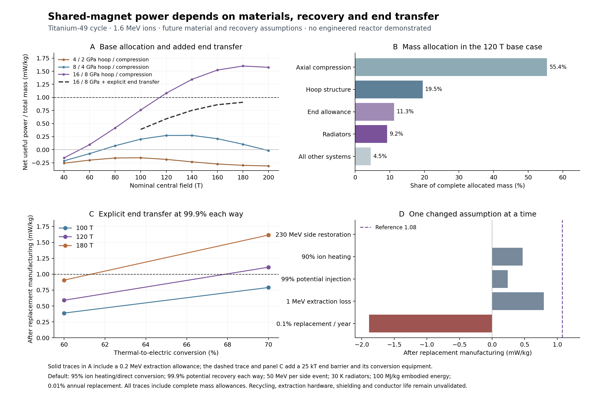

# Shared-field titanium reactor allocation ✨

This checkpoint gives the electron-poor titanium route a conditional complete-mass allocation. A **140 T case with explicit end-barrier energy circulation reaches 1.70 mW/kg at the plant bus and 1.37 mW/kg after replacement manufacture**. It requires 16 GPa circumferential working stress, 8 GPa compression, 70% heat conversion, 99.9% coherent energy transfer in each direction and a specified isotope-restoration cost. These remain engineering hypotheses. The calculation identifies a quantitative candidate for further investigation; it does not establish a working reactor or a completion date.

A base 120 T allocation initially reaches 1.08 mW/kg after replacement while assigning 0.2 MeV per reaction to unspecified extraction. Explicitly crossing a proton-confining end barrier raises catalyst energy circulation enough to reduce that case to 0.59 mW/kg at 99.9% recovery. Both versions are retained below so the unengineered selective-extraction assumption remains visible.

The subsequent [complete allocation with explicit recycling](NETWORK-PLANT.md) replaces this page's 50 MeV side-cost parameter with the [titanium recycling network](CATALYST-RECYCLING.md), evaluated product spectra and separate auxiliary channels. Its 140 T reference reaches 1.474 mW/kg after replacement, still conditional on demanding engineering assumptions. The calculations below remain the earlier parameterized checkpoint.

The main nuclear process and its unresolved side products are described in [the catalyst comparison](CATALYST-COMPARISON.md). Ordinary hydrogen becomes deuterium through Ti49(p,n)V49, cold external electron capture back to Ti49, and neutron capture on hydrogen. A separate closed deuterium cycle supplies helium. The model still charges a specified inclusive restoration cost for other nuclear products. A conserving, independently evaluated side factory remains the next nuclear discriminator.



## Source refinement

`optimize_titanium_source.py` scans 504 rotating two-species equilibria at 1.7 MeV and 60% heat recovery. Of these, 242 run into the solver's density-blowup condition. The strongest retained case has rotation fraction xi=0.4, central dimensionless proton density 0.18113597 and Ti density 0.0020583633. Its radial charge density decreases into a very dilute outer tail; the titanium component has a small off-axis shoulder.

At 100 T the selected wall radius is 3.213 cm, the reaction rate is 8.609e10 per metre per second and the modeled trap surplus is 3.8025 MeV per useful pn event. The earlier generic field-mass convention gives 0.569 mW/kg, compared with 0.375 mW/kg for the earlier profile. Tightening the ODE tolerance and radial sampling changes the overlap by 8.8e-8 relative and the net energy by 2.6e-6 relative. This improves the source search; it is not a global optimum over all plasma states.

The complete-plant scan retains that dimensionless profile, changes temperature and field, and reoptimizes the wall position. It retains 95% ion heating, 95% direct charged-particle conversion, 99.9% potential-energy transfer in each direction, and 50 MeV of net electrical cost per inclusive side-restoration event. At the reference point roughly 264 MeV of potential energy circulates per useful pn event. That large circulation makes electrical recovery an important constraint.

## Winding and mechanical allocation

Many centimetre-scale channels share one large solenoid. The channels occupy 70% of the active core cross section. A water blanket lies between channels, with another 5 m around the whole core. A continuous winding and hoop structure surround this blanket; an outer compression structure carries the axial load. Empty end regions are reserved for confinement and processing.

The local winding model sets radial material stress to zero and shares each radial element between conductor and circumferential structure. For field B, radius r, operating engineering current density J and working hoop stress sigma,

```
j_average = 1 / (1/J + B*r/sigma)
dr/dB     = -1 / (mu0*j_average)
f_conductor = j_average/J
f_hoop      = j_average*B*r/sigma.
```

Both fractions sum to one. The hoop fraction carries the local Lorentz load at its specified stress. Integrating from the inner field to zero gives conductor mass, hoop mass, radius and field energy throughout the winding. The field outside the bore is included. The calculated hoop mass obeys

```
sigma * M_hoop / rho_hoop = 2 U_field.
```

For infinite conductor current density, the independent analytic limit is

```
r_outer = a exp[B0^2/(2 mu0 sigma)]
U_field / L = (pi sigma a^2 / 2) {exp[B0^2/(mu0 sigma)] - 1}.
```

Thus arbitrarily increasing B at fixed working stress eventually makes the magnet much heavier. If reaction power scales as B^4 and other geometric factors are fixed, the maximum of the ideal structural power ratio occurs at x=B^2/(mu0 sigma)=1.593624. For 16 GPa this gives 179 T. The numerical allocation has its broad maximum near 180 T. This agreement explains the turnover; it does not validate a 180 T conductor.

The long-solenoid axial force is the **total** field energy per unit length. Using only bore energy would underestimate this load. Compression area is F/sigma_compression, with an additional 30% mass allowance. Conventional global Euler and local shell-buckling screens are reported. The scan chooses length so its Euler criterion has a 20% margin beyond a factor-of-two load allowance. These are screening calculations: finite magnetic forces, anisotropy, strain compatibility, end-load transfer and coupled magnetoelastic stability require a separate solution. The 2026 [Pridöhl et al. primary study](https://doi.org/10.1016/j.tws.2026.114619) shows why deformation and magnetic forces must be solved together; its experimental geometry does not validate this much larger structure.

A finite-length on-axis Biot–Savart integral supplies a field reduction at the active region's end. The source is evaluated at that reduced field throughout the active volume. This accounts for one finite-length correction. Off-axis field variation, the finite equilibrium and the actual end electrodes are still unmodeled.

## Base allocation with unspecified selective extraction

The following values are from `bundle-sensitivity.json`, including electrostatic pressure on the channel walls and classical ion–ion bremsstrahlung.

| Quantity | Conditional reference |
|---|---:|
| Nominal field / source field | 120 / 117.38 T |
| Core radius / magnet length | 1.00 / 25.85 km |
| Active length | 17.21 km |
| Channel radius / channel count | 2.647 cm / 9.99e8 |
| Ion temperature | 1.6 MeV |
| Hoop stress / density | 16 GPa / 1600 kg/m3 |
| Compression stress / density / modulus | 8 GPa / 3500 kg/m3 / 1 TPa |
| Operating engineering current density | 1e8 A/m2 |
| Coil / warm blanket / radiator temperatures | 4.2 / 300 / 30 K |
| Thermal-to-electric efficiency | 60%, two-thirds of Carnot |
| Plant bus output | 984.9 GW |
| Allocated replacement manufacture | 223.4 GW |
| Remaining useful output | 761.6 GW |
| Total allocated mass | 7.049e14 kg = 3.71e-13 Jupiter masses |
| Bus output / bus plant mass | 1.410 mW/kg |
| Output after replacement / associated total mass | 1.080 mW/kg |
| Stored magnetic energy | 6.871e20 J |
| Radiator area / waste heat | 6.519e13 m2 / 2.695 TW |
| Cold V49 decay inventory | 5.68e6 kg |

The compression structure is 55.4% of the mass, hoop structure 19.5%, end-system allowance 11.3% and radiators 9.2%. Remaining systems occupy 4.5%. Converter mass is charged against the large circulated energy flow, including potential handling, at 0.1 kg/W. The D plant is allocated 0.2 kg/W of its gross fusion output. These are explicit equipment allowances, not designs established by a vendor or experiment.

The channel wall now carries water pressure **and** electric pressure, epsilon0 E_wall^2/2. The latter is 0.342 MPa in the reference and exceeds the assumed 0.010 MPa water pressure. A cylindrical external-pressure buckling estimate with 1 TPa modulus and safety factor 3 gives a 0.422 mm wall. Wall volume displaces moderator water. Hermeticity, irradiation damage, electrical coatings, individual support and manufacturing remain open.

## Cooling and radiation

A 30 K radiator with emissivity 0.9 radiates about 0.0413 W/m2 to a 3 K background. Its allocated areal mass is 1 kg/m2. Such a radiator requires a suitable distant-space environment, viewing geometry and coolant network. Its area is much larger than the magnet footprint. At 300 K and 30 K, 60–70% thermal conversion lies below the 90% Carnot ceiling. Achieving those efficiencies at the allocated mass remains a heat-engine requirement.

The refrigerator consumes Q_cold*(T_radiator/T_coil-1)/0.3. The model charges heat leaking from the warm blanket, radiation penetrating the shield, outer thermal leakage and a power-law conductor loss. It removes the previously credited thermal conversion of energy diverted into the cold coil. The operating current is assumed to be 10% of the critical current and the power-law exponent 30; both must eventually be checked at the actual field, angle, strain and damage level.

The 5 m shield currently uses prescribed energy transmissions of 1e-6 for neutrons and 1e-5 for photons. They are **not transport results**. [NIST's liquid-water attenuation coefficients](https://physics.nist.gov/PhysRefData/XrayMassCoef/ComTab/water.html) help set scales, but uncollided attenuation and energy-absorption coefficients do not determine total thick-shield leakage. The nuclear spectrum, scattered buildup, streaming through ends, neutron capture and irradiation of the superconductor need explicit transport. The 99.5% useful hydrogen-capture fraction assumes remaining neutrons thermalize in parasitic absorptions; no useful energy credit is assigned to their capture Q values. A low heat load alone also fails to establish acceptable conductor lifetime.

The electron-poor mixture retains ion–ion bremsstrahlung. For common-temperature repulsive Coulomb encounters, define reduced mass mu, Coulomb constant K=Z1 Z2 e^2/(4 pi epsilon0), and dipole charge q_eff=e(Z1 m2-Z2 m1)/(m1+m2). The classical thermal power coefficient is

```
P_brems / (n1 n2) = (2/3) q_eff^2 K kT / (epsilon0 mu^2 c^3).
```

This follows by integrating the dipole radiation on a Rutherford orbit; the dimensionless impact-parameter integral is 2/3. It agrees with [Hardy and Lasenby (2017)](https://doi.org/10.1007/JHEP02(2017)033), appendix B, equation B.6 after selecting electromagnetic charges. For p–Ti49 at 1.6 MeV the estimate is 0.000166 MeV per useful pn event. The Sommerfeld parameter is about 2.72, so quantum corrections warrant checking, but the term is already small compared with the several-MeV energy margin. Identical-species dipole radiation cancels; quadrupole radiation and nuclear-scale corrections remain outside this screen. The separate vacuum ion-Larmor term is retained.

Electrons entering the plasma could cause much larger losses. An illustrative residence-time calculation gives electron/positive-charge line-density ratio 2.8e-9 for one electron born per pn event and a 0.1 ms residence at 100 T. Both birth rate and residence are assumptions. Cold electrons emitted from a locally flat wall are magnetically insulated in the ideal crossed fields: E/(cB) is about 0.008 and their maximum penetration is about 0.27 micrometres. This does not describe energetic Compton electrons, rough surfaces, neutral-gas ionization, end fields or secondary discharges.

An ideal Maxwellian proton end barrier of 25 kT is about 40 MV at 1.6 MeV. Adding the plasma potential gives approximately 53 MV relative to the wall. The thermal axial loss estimate is about 1.9e-4 H ions per pn event for a 20 km active column. A finite electrode design, product selection, continuous extraction, recovery and driven-plasma stability remain essential. The inclusive 0.2 MeV extraction allowance must also cover stripping/neutralization losses; atomic-binding corrections are not explicitly resolved in the nuclear mass convention.

## Explicit high-barrier extraction branch

The 40 MV end barrier corresponds to **920 MeV for V23+**. Incoming proton plus Ti22+ carries the same total charge. A route that sends both incoming and outgoing material through that barrier must handle this additional coherent energy circulation; the base 264 MeV source-potential circulation alone is insufficient. Thermal end losses can be small while deliberate product extraction is energetically demanding.

`end_transfer_sensitivity.py` adds 23*(25kT)=920 MeV per pn event to the circulated energy used for converter mass. It charges the additional loss

```
E_end * [1/eta_in - eta_out - (1-eta_out)*eta_heat].
```

At 99.9% transfer in each direction and 60% heat conversion this costs 1.289 MeV per pn, before the separate 0.2 MeV extraction/selection allowance. At 99.99% it costs 0.129 MeV. These efficiencies describe coherent energy transfer; thermal ion heating and direct conversion retain their separate 95% assumptions. An accelerator, reversible transfer path, electrode geometry and isotope-selection mechanism still need design. Species-selective extraction could change the circulation, but it must be demonstrated before being credited.

| Field | Heat conversion | Coherent end transfer, each way | Remaining mW/kg |
|---|---:|---:|---:|
|100T|60%|99.9%|0.389|
|120T|60%|99.9%|0.590|
|120T|60%|99.99%|0.987|
|140T|60%|99.99%|1.223|
|120T|70%|99.9%|1.109|
|140T|70%|99.9%|1.367|
|180T|70%|99.9%|1.615|

The 140 T / 70% / 99.9% case allocates 1.360e15 kg, or 7.16e-13 Jupiter masses, and exports 1.859 TW after replacement manufacture. Its magnet length is 30.06 km, active length 20.24 km and radiator area 1.407e14 m2. Its bus-energy payback at 100 MJ/kg embodied energy is about 1865 years. It retains the same unresolved nuclear side factory, conductor, transport, finite equilibrium and lifetime assumptions as the base allocation.

## Primary material evidence and extrapolations

The [2026 Jaroszynski et al. study](https://arxiv.org/html/2502.02706v3) characterizes REBCO through 45 T and documents substantial conductor variability and flux-jump issues. The proposed 100–180 T current performance is an extrapolation. An upper critical field measured in a short pulse is distinct from useful engineering current under steady operation. Field orientation and conductor strain must be respected.

The [July 2026 Wang et al. primary paper](https://doi.org/10.1038/s41467-026-75150-1) reports a thin CNT ribbon with breaking strength 12.5 GPa and specific breaking strength 7.5 MJ/kg. The paper distinguishes its thin-ribbon modulus of 260 GPa from the rolled-fibre specimen's 370 GPa. Gauge-length comparisons extend to 50 mm. This updates the earlier 8 GPa specimen cited in the catalyst comparison. Measured breaking values do not establish 16 GPa service stress in kilometre-scale supports. [Nanoscale diamond experiments](https://doi.org/10.1126/science.aar4165) demonstrate large elastic strains, but also do not establish the proposed bulk compression structure. These results support investigating stronger materials while preserving the engineering gap.

## Sensitivity and economic meaning

At the same 120 T geometry, one changed assumption gives:

| Changed assumption | Remaining mW/kg |
|---|---:|
| Reference | 1.080 |
| 230 MeV per side-restoration event | 0.005 |
| Ion heating 90% | 0.470 |
| Direct conversion 90% | 0.864 |
| Potential injection 99% | 0.239 |
| Thermal conversion 40% | 0.094 |
| Extraction loss 1 MeV per pn event | 0.795 |
| Conversion equipment 1 kg/W circulated | 0.945 |
| End-system mass allowance doubled | 0.938 |
| Annual replacement fraction 0.1% | -1.885 |

The side-factory and electrical-efficiency assumptions can remove the target margin. The result therefore cannot be promoted into a successful design by its mass or power arithmetic alone.

Replacement manufacture is modeled explicitly: annually replace a fraction f of total mass at embodied energy E_emb, giving load f E_emb M/year. Its waste heat, extra radiator mass, factory equipment at 1 kg/W and ten years of replacement inventory are solved self-consistently. Active plasma mass is also counted; the D-plant mass allowance includes its working inventory. The reference uses f=1e-4/year and E_emb=100 MJ/kg. This load differs from ordinary net plant output; both are reported. No capital-price forecast is implied.

At 1 mW/kg, a gigawatt needs a trillion kilograms of plant. At 100 MJ/kg embodied energy, simple energy payback is about 3170 years. The reference bus-specific output repays that manufacturing energy in about 2247 years, before opportunity cost and external transportation. Long-lived local construction is therefore central to its economic case. Importing the entire structure at interplanetary velocities could add substantial energy cost. A long service life and abundant hydrogen would matter more than rapid expansion. Solar energy, deuterium separation and black-hole power still require explicit comparison before assigning an economic role or future date.

## Reproduction and remaining decisions

Run `optimize_titanium_source.py`, `bundle_solenoid.py`, `scan_bundle.py`, `bundle_sensitivity.py`, `ion_radiation_and_ends.py`, `end_transfer_sensitivity.py`, `validate_bundle.py` and `plot_bundle.py` with the dependencies listed in the research README. `bundle-scan.json.gz` contains 675 base geometry/temperature/efficiency cases; `end-transfer-sensitivity.json` adds 40 explicit high-barrier cases. The profile search and source library are separate from this full-mass allocation.

Independent analytic winding radii and mass/energy quadratures agree with the ODE to roughly 4e-15 relative for the checked cases. Virial, infinite-current-density, finite thin-sheet field, mass/energy ledger and profile-convergence checks pass. These checks establish mathematical consistency within the stated equations.

Next: replace the titanium side-cost parameter with a conserving nuclear network, quantify product extraction and electron management, and calculate shielding and conductor life. Keep the opaque-pulse branch's driver and catcher gaps active. A future-history choice should state which engineering capabilities were achieved and why this reactor served a useful purpose.
