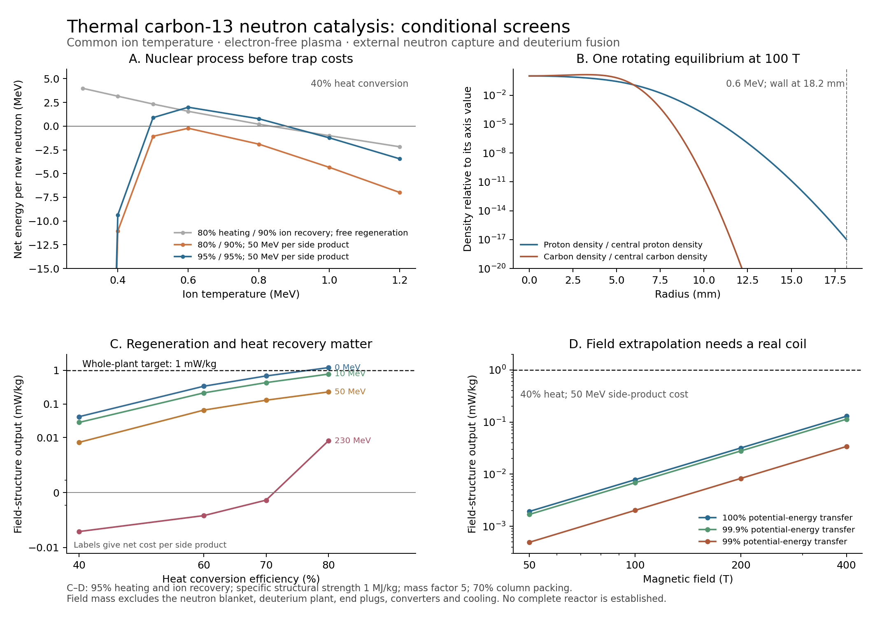

# Thermal nonneutral carbon catalysis ✨

Checkpoint: 29 October 2026. A thermal population avoids the repeated directional reset of the narrow beam examined in [NONNEUTRAL-BEAMS.md](NONNEUTRAL-BEAMS.md). This calculation finds conditional positive process energy and solves one family of two-ion radial equilibria. Its present mass accounting covers magnetic structure. **No complete reactor has been established, and these results do not set a universal lower mass or power limit.**

The calculations remain useful because their assumptions can be varied explicitly. At 100 T, the selected structure gives about 0.007 mW/kg with 40% heat conversion and a specified 50 MeV regeneration cost per B10/N14 side product. With 60% heat conversion and a 10 MeV cost, it gives about 0.21 mW/kg. An extreme 80% heat-conversion, zero-regeneration-cost case reaches 1.2 mW/kg before the other components are counted. A stronger structural material increases these field-only numbers proportionally. The next engineering task is to replace those recovery and mass parameters with physical processes.

## Thermal reaction accounting

`thermal_neutron_screen.py` integrates the archived PADF-2 C13 production curves against a common, nonrelativistic Maxwellian ion temperature. It transforms the laboratory proton energy to the center-of-mass energy using the nuclear masses. The reaction-rate integral is

`<sigma v> = sqrt[8/(pi mu)] (kT)^(-3/2) integral sigma(E) E exp[-E/(kT)] dE`.

The script uses 24-point Gaussian quadrature on every linear data interval. It separately integrates the extra energy moment. A reacting proton/carbon pair carries mean random kinetic energy `<Ecm>reacting + 3 kT/2`; using the mean energy of arbitrary particles would miss the reaction's preference for the energetic tail.

Ion–ion equilibration conserves the common population's heat. It therefore receives no beam-stopping or angular-reset debit. The current process instead extracts all products of the p,n and p,d reactions, cools the catalyst outside the trap, and reinjects the required ions. It counts the selected pairs' exported kinetic energy, neutron energy, inelastic photon production, neutron capture, N13 decay and the separate closed deuterium cycle. The latter still receives free confinement and auxiliaries.

The reduced cycle closes to the same 12.6595 MeV of nuclear heat per new neutron as the beam calculation. Its p,d channel restores C13 through C12 neutron capture. Neutrons above the N13 production count are provisionally assigned to C13(p,pn)C12, with half their available kinetic energy assigned to the outgoing neutron. That assumption becomes weaker as higher channels open. A 3.5 MeV average C13 excitation is used for the inelastic production curve; it is a specified estimate, not a measured spectrum.

B10 and N14 regeneration remains a parameter representing the complete net electrical cost of producing these side products and returning the original catalyst and other participating inventories. The numerical energy closure excludes their detailed pathways. Zero cost represents a particularly favorable sensitivity; 10, 50 and 230 MeV are alternatives, rather than measured processing requirements.

At 0.6 MeV ion temperature, before rotation, potentials and radiation from ion motion:

| Quantity per useful p,n event | Value |
| --- | ---: |
| p,n reactivity | 2.944 × 10⁻²⁴ m³/s |
| Reaction-selected relative kinetic energy | 4.085 MeV |
| Random kinetic energy of reacting pair | 4.985 MeV |
| p,d event ratio | 0.565 |
| B10 event ratio | 0.015 |
| Preparation energy in reduced process | 9.843 MeV |
| Net with 80% heating, 90% ion recovery, 40% heat conversion, 50 MeV side cost | −0.222 MeV |
| Net with 95% heating, 95% ion recovery and the same other assumptions | 1.991 MeV |

The low-temperature region is penalized by radiative proton capture to N14 relative to useful p,n production. Higher temperatures raise the reaction rate but also the exported neutron energy and competing channels. This gives a window whose location depends strongly on recovery assumptions.

## A radial equilibrium instead of uniform overlapping densities

The equilibrium form follows the conserved energy and canonical angular momentum described by [Dubin and O'Neil (1999), sections III.A and III.G](https://nnp.ucsd.edu/pdf_files/RMP_REV_PAPER.PDF). Their treatment covers species with differing charges and masses. Ideal global thermal equilibrium is stable. Fuel injection, reaction-product extraction, end boundaries and asymmetries make a reactor a driven system that needs additional analysis. [Dubin's multispecies discussion](https://nnp.ucsd.edu/pdf_files/DUBIN_NNP12.PDF) also describes separation and transport; its simplified equal-charge formulas should not be applied directly to protons and fully stripped carbon.

For positive ions in axial field B, take the actual rotation rate as −omega. Integrating the rotating Boltzmann distribution over velocity gives

`n_s(r) = n_s(0) exp{-[q_s(phi(r)-phi(0)) + (q_s omega B - m_s omega²) r²/2]/(kT)}`.

`penning_equilibrium.py` solves this relation together with cylindrical Poisson's equation. It uses x = r/l, l² = kT mp/(e²B²), psi = e[phi(r)−phi(0)]/(kT), and density scale epsilon0 B²/mp. Protons and carbon share temperature and rotation, while their profiles differ. The calculated overlap, rotation energy and electrostatic potential replace the earlier uniform-density estimate.

A coarse scan covers nine rotation fractions, eight central-charge-density fractions and five proton-charge fractions. Of 360 choices, 212 produce profiles that decay through the chosen outer radius; 148 grow beyond the numerical threshold. This is a scan of specified profiles, not a proof of a global optimum. Negative-output cases often select the upper wall-radius bound merely because additional inert mass reduces the magnitude of negative W/kg; their numerical optimum has no power-plant interpretation.

For 0.6 MeV and 100 T, the best scanned case before vacuum radiation and electric-potential losses has:

| Quantity | Value |
| --- | ---: |
| Rotation / carbon cyclotron frequency | 0.5 |
| Central charge / cold carbon rotation-density value | 1.1 |
| Central proton share of positive charge | 0.75 |
| Pipe radius | 18.16 mm |
| Useful reactions per metre per second | 9.60 × 10⁸ |
| Mean rotation energy of reacting pair | 3.75 MeV |
| Axis potential above wall | 4.70 MV |
| Wall electric field | 146 MV/m |
| Allocated magnetic structure per metre | 29.44 kg |
| Net per event before vacuum radiation/potential losses | 1.32 MeV |
| Corresponding field-structure output | 0.00690 mW/kg |

The model estimates wall loss by applying a full outgoing Maxwellian flux to the calculated wall density. Its energy per lost ion is `2 kT + m omega² Rwall²/2`. This is a specified, fully replenished tail estimate. A real absorbing-boundary distribution and collisional transport can differ. The chosen profile needs a very dilute proton tail at the wall; the field must fill the intervening space as well as the central plasma.

## Recovery, radiation and field mass

Each extracted reaction pair carries total charge +7e. Returning ions to the reaction region circulates an electric-potential energy of about 45 MeV per useful neutron in the 0.6 MeV example. A reversible circuit cancels this work. With finite input and output efficiencies, the residual loss can be substantial. The model keeps these efficiencies separate from heating and kinetic-energy recovery. At 99% in each direction, this load nearly removes the remaining surplus in the selected low-temperature case. At 99.9%, it is much smaller. A circuit achieving the specified efficiencies has not been designed.

The vacuum Larmor estimate includes the local electric field, bulk rotation and random ion velocities. It gives about 0.325 MeV per useful neutron in the same example. A conducting tube changes the available electromagnetic modes and reabsorption, so this vacuum estimate is not its actual radiation spectrum. The sensitivity runs conservatively let all of that radiation escape the ion population and recover its energy at the specified thermal efficiency. Ion collision bremsstrahlung, electron contamination and material-generated electrons remain unmodeled.

Magnetic mass is allocated as five times the field energy divided by a structural specific strength of 1 MJ/kg, with 70% pipe packing. All the empty space to the pipe wall is included. This is a virial-style allowance, not a wound conductor and support design. It omits critical-current limits, shielding, cryogenics and coil stresses in detail. Increasing the strength parameter raises the calculated W/kg proportionally; high fiber strength alone does not establish an equally strong operating magnet.

At fixed dimensionless equilibrium, raising B reduces the pipe radius in inverse proportion and increases reaction power per unit length approximately as B². The field-only mass per unit length remains fixed. The 200 and 400 T cases are mathematical extrapolations requiring a new coil analysis; their magnetic pressures are roughly 16 and 64 GPa, respectively.

At 100 T, 95% ion heating/recovery, 99.9% potential-energy transfer and full vacuum ion-radiation escape, the best temperature in the tested range gives:

| Heat conversion | Net side-product regeneration cost | Selected ion temperature | Field-structure output |
| --- | ---: | ---: | ---: |
| 40% | 50 MeV | 0.65 MeV | 0.00723 mW/kg |
| 60% | 50 MeV | 0.85 MeV | 0.0655 mW/kg |
| 60% | 10 MeV | 1.20 MeV | 0.213 mW/kg |
| 70% | 10 MeV | 1.45 MeV | 0.430 mW/kg |
| 80% | 0 MeV | 2.00 MeV | 1.197 mW/kg |

The last case reaches the upper temperature boundary of the scan. Its higher-channel simplifications are least reliable, and 80% heat conversion plus costless regeneration are stringent assumptions. None of the rows includes a complete plant. The spread shows why a single assumed efficiency cannot exclude this entire branch.

## Next discriminators

1. Replace B10/N14 regeneration parameters with a conserving network and explicit processing. C12(d,p)C13 can reverse the p,d channel. B10(alpha,p)C13 can reverse p,alpha. B10(alpha,n0)N13 followed by decay can complete another proton-to-neutron path; neutron channels populating proton-unbound N13 excited states do not provide the same conversion. Use ground-state reaction data rather than importing a stellar LTE excited-target population.
2. Model the neutron-capture blanket and isotope separation. A graphitic absorber can use diffusion rather than a straight absorption path, but parasitic capture, C13 recovery and heat extraction must be included. The separate deuterium plant must close its own energy and mass accounts.
3. Develop a finite-length trap, product separation and electrical recovery circuit. Include axial end losses, canonical angular momentum, drift/rotation work, electrons and imperfect boundaries. The full-tail wall estimate is not a substitute for kinetic transport.
4. Design one magnetic assembly at a stated field and service strength, with current density, stress, shielding and cryogenic heat removal. Compare actual advanced-fiber evidence with allowable long-term structural stress; do not treat 1 MJ/kg as a fundamental material limit.
5. Evaluate heat recovery at physically specified source/sink temperatures. A 60–80% efficiency requires an appropriate hot blanket, converter and cooling system. Count their mass and recirculating loads before comparing with the 1 mW/kg whole-plant target.

## Verification and reproduction

Run `thermal_neutron_screen.py`, `penning_equilibrium.py`, `scan_penning.py`, `thermal_penning_sensitivity.py`, `thermal_recovery_sensitivity.py`, `validate_thermal_penning.py` and `plot_thermal_penning.py` in that order, using the dependencies recorded in [README.md](README.md).

The independent incomplete-gamma integration agrees with the Gaussian cross-section integrals to 1.1 × 10⁻⁹ relative. A constant-cross-section Maxwellian check passes at floating-point precision. An importance-sampled million-event calculation reproduces reaction-selected energy moments. The dilute Gaussian limit, independently integrated Gauss law, tighter solver tolerance, charge/mass separation identity and field-scaling identities pass. The reduced nuclear energy residual is below 2 × 10⁻¹² MeV. These checks verify the stated mathematics and accounting; the independently evaluated nuclear channels and missing engineering retain the limitations above.
