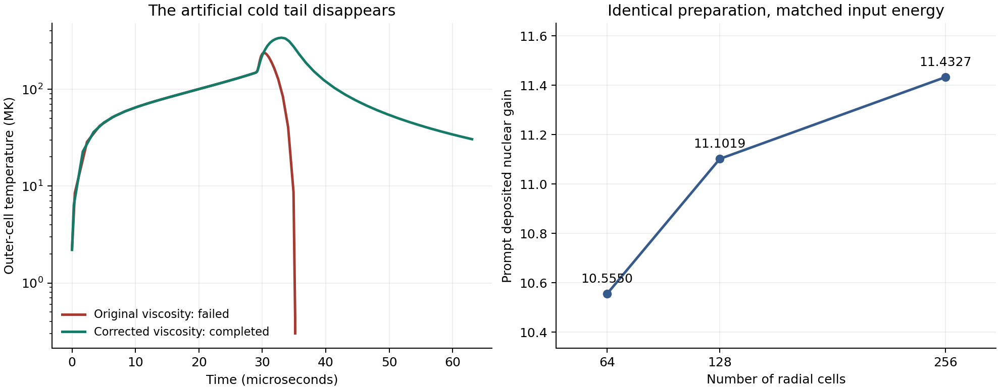

# Carbon-stage numerical completion ✨

The failed B2 carbon stage now completes its requested four reference sound times with the original EOS, original nuclear reaction rates, radiation treatment and prescribed hot inflow. The failure was caused by a sign error in the artificial-viscosity model: a scalar artificial pressure removed heat from expanding spherical shells. Correcting that pressure's compression measure removes the unphysical cold tail. No cold EOS extension, rate floor or abundance renormalization was needed in the completed runs.

The 64-zone reference result has prompt deposited nuclear gain **10.55503** and O14 yield **0.8218845 per initial C12 nucleus**. Its initial internal-plus-kinetic energy is 4.0743930×10^25 J and pulse mass is 1.1309734×10^13 kg. The integration ends at 63.062725 microseconds. The radius used for units is 30 m; the supplied convergent flow initially has a 170.279 m outer radius. A tighter time-integration tolerance changes gain by 1.82×10^-8 relative. Spatial discretization matters more: refining the same physical profile to 128 zones raises gain by about 5% and yield by about 6%. The 256-zone sensitivity completes too, with gain 11.43273 and O14 yield 0.8985604. Its gain is 2.98% above matched 128. The 64-zone case remains the coherent all-stage station baseline; the finer B2 cases quantify spatial sensitivity without establishing percent-level convergence.



The temperature panel compares the original failed 64-zone run with the corrected completed 64-zone run. The grid panel uses the same source profile with matched initial kinetic energy.

## Diagnosed cause and correction

The original artificial pressure was

```
C_radial = max(-Delta v, 0)
q = rho (2 C_radial^2 + 0.5 c_s C_radial).
```

It entered both spherical nodal forces and cell pressure work as an isotropic pressure. Its specific internal-energy contribution is `-q dot(V)/m`. A negative radial velocity difference does not imply that a spherical shell is shrinking: the exact discrete volume rate is `dot(V) = 4 pi Delta(r^2 v)`. Thus the old rule sometimes assigned positive q to expanding-volume cells, giving negative dissipative heating. Equal and opposite force/work bookkeeping still conserved total energy, which explains why the old energy residual looked excellent.

At the frozen old accepted outer-cell state (density 272.6489 g/cm³, temperature 301365 K), the reconstructed artificial-pressure temperature derivative is approximately **−7.20×10^13 K/s**. Physical adiabatic cooling contributes about −3.14×10^10 K/s, while radiation exchanges heat **into** the cold cell at +4.278×10^12 K/s. The artificial pressure was about 93 times the physical pressure. This explains the implausibly large temperature fall across a tiny density change. [The saved RHS decomposition](rhs-audit.json) and [independent EOS audit](EOS-audit.md) provide the inputs and checks.

The selected continuous correction is

```
C_volume = max(-(dot(V) / V) Delta r, 0)
C = min(C_radial, C_volume)
q = rho (2 C^2 + 0.5 c_s C).
```

It preserves the original measure in homologous compression and approaches it in a thin planar shock. It limits some other nonhomologous compressive states. Most importantly, q vanishes continuously as volume compression vanishes, and `-q dot(V)/m` is nonnegative by construction. The paired force and work expressions and viscosity coefficients remain unchanged. Artificial pressure generating entropy in compression is the standard physical intent of shock viscosity; see the [NASA-hosted primary abstract](https://ntrs.nasa.gov/citations/19810029495) and the [spherical radiation-hydrodynamics method of Tscharnuter and Winkler](https://doi.org/10.1016/0010-4655(79)90111-5).

The [algebraic regression](viscosity-checks.json) tests an explicit expanding-shell counterexample, homologous compression and expansion, 400 random spherical states, dissipation sign and force/work cancellation. All eight checks pass. The original EOS interpolation error in the accepted cold state is only around 10^-5 in the adiabatic coefficient, so changing its interpolation would not have addressed the dominant cooling term.

## Completed runs and numerical sensitivities

Gain is `(nuclear mass-difference energy − assigned escaping weak energy) / initial internal-plus-kinetic energy`. It includes energy subsequently emitted as photons; receiver capture and driver efficiency are separate calculations. O14 yield is the target product count per initial C12 nucleus, with the full output isotope vector used in process accounting.

| Case | Gain | O14 yield | Peak temperature, GK | Final energy residual / input |
|---|---:|---:|---:|---:|
| 64 zones, selected compression cap | 10.55503134 | 0.821884480 | 1.647110 | +2.972×10^-7 |
| 64 zones, tenfold tighter tolerances | 10.55503114 | 0.821884455 | 1.647112 | +1.916×10^-8 |
| 64 zones, eight sound times | 10.55503134 | 0.821883971 | 1.647110 | +2.972×10^-7 |
| 64 zones, alternative divergence viscosity | 10.65920037 | 0.830758217 | 1.946081 | +2.702×10^-6 |
| 128 zones, identical physical profile | 11.08986799 | 0.870095795 | 1.679368 | −3.426×10^-7 |
| 128 zones, initial kinetic energy matched | 11.10189371 | 0.870264495 | 1.678866 | +1.160×10^-7 |
| 256 zones, initial kinetic energy matched | 11.43272617 | 0.898560388 | 1.674130 | −4.327×10^-6 |

All listed cases reach the specified final time with the original EOS and nuclear rates. The default tolerances are `rtol=1e-7`, `atol=1e-12`; the tight case uses `1e-8`, `1e-13`. The alternative viscosity uses `C=max(-(dot(V)/V) Delta r/3,0)`. It is entropy-safe and calibrated to homologous compression, but reduces the near-planar artificial-pressure terms at a fixed local state by approximately a factor of three in the linear term and nine in the quadratic term. It changes gain by +0.987% and target yield by +1.080%. Peak temperature is more sensitive than integrated yield.

The 128-zone comparison refines the **same 64-zone source profile**, rather than loading an independently prepared 128-zone inflow. The nested enclosed-mass grid preserves each parent's density through linear interpolation of radius cubed in mass coordinate and inherits its temperature and composition. Nodal velocity is interpolated linearly in radius. This preserves mass and initial internal energy; staggered kinetic quadrature rises by 0.0978721%. The energy-matched control multiplies the refined velocities by 0.9995109984 to restore exactly the original discrete kinetic energy. Its target yield differs from unscaled 128 by only 0.0194%, establishing that the main change comes from spatial resolution rather than that small energy difference.

The same-profile, energy-matched 256-zone run completes four sound times in 1007.3 seconds. Gain rises by 2.980% and target yield by 3.251% from matched 128, compared with 5.181% and 5.886% from 64 to matched 128. This shrinking change is evidence of a refinement trend; it is not a demonstrated error bound or percent-level continuum convergence. No additional hydro runs are included. The 128 and 256 cases remain explicit B2-only sensitivities, with A/B1/C13 retained at their corrected 64-zone resolution in the process comparison.

The yield change is concentrated in the partially burned outer material: 91.4% of the additional O14 in matched 128 comes from the outermost eight original cells, which contain 33.0% of the mass. Every original mass bin gains target yield under refinement. The fastest tail remains more grid-sensitive than integrated nuclear output: terminal maximum velocities are 17.80, 20.82 and 23.46 million m/s at 64, matched 128 and matched 256. Each endpoint remains outward and strictly monotone. [Machine-readable comparison](completion-summary.json) records exact values and endpoint kinematics.

## Freeze-out and outflow

The 64-zone extension reaches eight sound times (126.12545 microseconds). Prompt capture gain changes by only 1.1×10^-12 relative from four times. O14 yield decreases by 5.09×10^-7 absolute as weak decay proceeds. This establishes capture freeze-out within this model; radioactive descendants still require later processing.

All final boundary velocities are outward and strictly increasing at both endpoints. At eight times the maximum velocity is 17.9453 million m/s and the smallest adjacent velocity increase is 140378 m/s. Internal energy falls from 4.5770% of internal-plus-kinetic energy at four times to **0.98572%** at eight. Four-to-eight-time velocity growth is at most 2.944% and averages 1.887% with nodal-mass weighting. The later trace is therefore the more suitable ballistic starting profile for the 64-zone baseline. The 256-zone calculation ends at four times with 3.835% of its internal-plus-kinetic energy still internal; no eight-time extension at that resolution is claimed. The remaining internal fraction bounds the energy still available for pressure acceleration globally; it does not bound every individual shell's final velocity error to 1%.

The successful corrected trajectory's lowest stored temperature is 2.200041 MK in the supplied initial profile; the four-time outer temperature is 30.5099 MK and the eight-time minimum is 9.16729 MK. It never follows the old artificial collapse toward the 100000 K EOS floor. Some initially cool zones are below the nominal 10 MK rate-fit interval, so their individual reaction flows still need the [rate audit](nuclear-rate-audit.md); completion does not imply that every rate fit is experimentally validated at every sampled temperature.

## Independent conservation and entropy checks

The independent auditor reconstructs density, EOS energy, staggered kinetic energy, radiation/weak accumulators, nuclear mass defect and signed weak charge directly from trace arrays. It also reconstructs viscous entropy production and force/work cancellation. Each completed case is checked against its actual requested end time. See [the independent report](independent-audit.md) and its per-case JSON files.

For the selected 64-zone reference, the maximum sampled total-energy residual is 6.18×10^-7 of input, the baryon residual is 1.24×10^-14 and the most negative sampled isotope mass fraction is −2.86×10^-12. Stored accepted abundance arrays are not clipped or renormalized; EOS evaluation retains the original normalized nonnegative composition copy. Independently integrated reaction heat agrees with the isotope mass-defect energy within 1.29×10^-13 of input. The signed weak-reaction charge accumulator agrees with abundance-derived charge change within 4.92×10^-16 per baryon. Every saved sample has nonnegative artificial-viscous heating, and pressure-force/work cancellation is at about 2.14×10^-16 relative. Tiny negative trace abundances remain recorded as numerical tolerance error.

For the 256-zone sensitivity, the independent full-trace audit confirms the four-time endpoint, maximum energy residual 4.3334×10^-6 of input, baryon error 4.09×10^-14 and reaction-heat/mass-defect agreement within 2.59×10^-13 of input. The signed weak-charge discrepancy is 2.82×10^-14 per cell. It finds zero negative-viscous-heating samples and force/work cancellation at 3.12×10^-16. Its minimum sampled mass fraction is −9.54×10^-12; its final minimum is −4.35×10^-19. Both are preserved separately. See [the independent 256 audit](B2-256-independent-audit.json).

The same correction was applied independently to the other four small-stage preparations. All complete four sound times; gains change by less than 0.4%. Their radiation partitions change more, so downstream collection must use the corrected metadata. See [the four-stage regression report](regression.md).

## Preserved failures and reproducibility

The initial hard-switch repair (`volume_gate`) set q to zero whenever volume expanded, while retaining a finite radial-gradient q immediately on the compressing side. BDF stalled at 1.302530391 sound times with “Required step size is less than spacing between numbers.” That result remains a recorded solver failure. The continuous cap resolves this discontinuity in the selected production runs.

An earlier continuous-divergence run reached trace writing when the `/tmp` user quota was exhausted. Its output was incomplete, and no successful numerical result is inferred from that I/O failure. The valid divergence sensitivity was rerun in `/var/tmp/tkwa-chatgpt/protium-b2-completion`. Historical cold-rate/EOS-floor attempts remain unchanged in the earlier packet; they are diagnostics of a trajectory whose artificial viscosity was wrong.

The exact production physics module is [radial_completion.py](radial_completion.py), SHA-256 `3af8f36fad063bde4ac5b3491c324c9add973a5459ecb1a9e913630564eb70cc`. It adds independent reaction-heat and signed weak-charge accumulators but retains the original network/EOS/opacity. The runner [run.py](run.py) records all input and source hashes. Its historical default mode is not the selected mode: explicitly pass **`--mode compression_cap`** and a descriptive output name when reproducing a production run.

```sh
PYTHONDONTWRITEBYTECODE=1 OPENBLAS_NUM_THREADS=1 \
NUMBA_CACHE_DIR=/var/tmp/tkwa-chatgpt/protium-b2-completion/numba \
MPLCONFIGDIR=/var/tmp/tkwa-chatgpt/protium-b2-completion/mpl \
PYTHONPATH=/tmp/protium-python \
python run.py --root /path/to/docs/protium-fusion \
  --output /path/to/writable/scratch --zones 64 \
  --mode compression_cap --name B2-64-compression-cap
```

Use `--rtol 1e-8 --atol 1e-13` for the tolerance case, `--time 8` for the tail extension, and `--zones 128 --energy-match` for the matched refinement. Each output includes its exact prepared profile, configuration, result and full raw trace. Repository `.trace.npz` files contain exact unmodified subsets of those traces, retaining first/final states and sampled temperature extrema. Their `-trace-reference.json` files identify full-trace locations and hashes; [archive_outputs.py](archive_outputs.py) verifies the copied arrays bit for bit. Independent audits use full traces. [The artifact manifest](numerical-artifacts.json) checks metadata hashes, full/compact trace hashes, exact copied states and endpoint retention; [runtime.json](runtime.json) records package versions.

Completion establishes a consistent reduced spherical calculation for these specified hot inflows. Driver preparation, multidimensional merger/mixing, composition-dependent transport, Coulomb/screening corrections and whole-plant collection remain separate physical questions. Those requirements belong in the engineering assessment rather than being inferred from this solver's successful exit.
