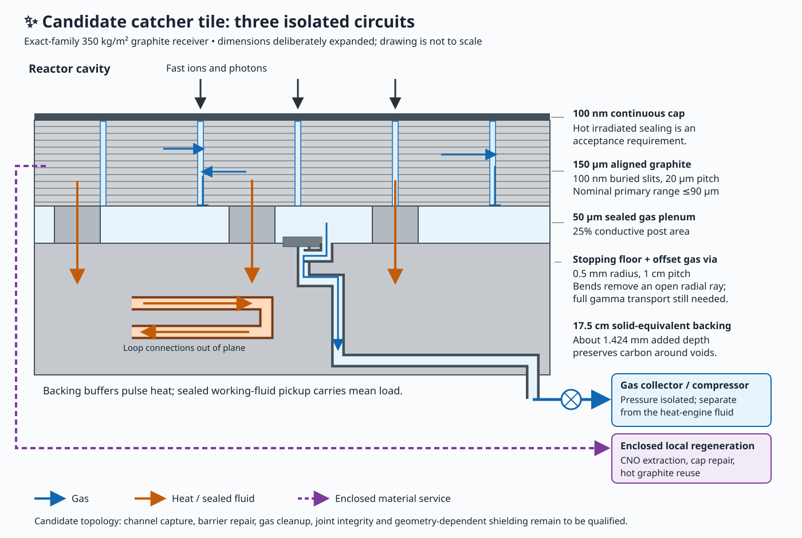
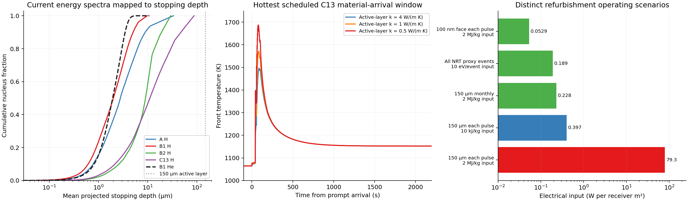

# ✨ Graphite capture, gas recovery and per-pulse refurbishment

The thick receiver stops the modeled primary ions. The engineering problem is routing the stopped atoms into reusable inventory while keeping the cavity compatible with incoming fuel. A sealed sphere can conserve matter and still accumulate enough circulating gas to change pellet heating, timing and preparation. Gas, dust and serviced graphite inside that boundary remain inventory.

The recommended local receiver candidate is a **150 µm aligned graphite collection layer with buried side channels, a low-pressure sealed manifold and targeted repair during operation**, backed by the retained 350 kg/m² graphite stock. Heat leaves through conductive supports into a separate closed working-fluid circuit. Gas crosses short local paths into the material-recovery line. Periodic isolated extraction handles stronger traps. Warm molecular compression feeds a low-pressure hot buffer and a small, shielded cold collection line. The main qualifications are the irradiated material's routing and emission, the complete pump train, and the fuel capsules' response to the resulting gas.

This packet uses the coherent delivered-B1/C13H2 family, H/catalyst number ratios **3,2,2,2**, radius **1.1×10⁹ m**, and the exact final 370-day dispatch with **4,228 pulses**. Earlier research snapshots are preserved. Stage tables and gas calculations are recomputed from the current source128 spectra and actual flight-time decays.

## What reaches the graphite

| Stage | All primary material, µg/m²/pulse, baryonic | H+He, µg/m²/pulse, baryonic | H median / 99.9% mean projected depth, µm |
|---|---:|---:|---:|
| A | 743.802 | 96.1324 | 2.78 / 32.81 |
| B1 | 7.43802 | 1.92184 | 2.01 / 9.70 |
| B2 | 743.802 | 20.7432 | 9.04 / 29.34 |
| C13 | 743.802 | 30.3319 | 11.10 / 87.38 |

The supplied approximate mass checks reproduce correctly. Neutral atomic masses give slightly higher H loads: the complete returned H and He flows are **3.2270 and 2.7589 million kg/s**. Nucleus counts close both conventions. B1 supplies almost all helium; its mean projected He depth is about 1.94 µm at the median and 5.3 µm at the 99.9th percentile.

The largest nominal primary CSDA stopping column is about **0.179 kg/m²**, compared with **350 kg/m²** of backing. Halving the electronic stopping still leaves about a **977-fold** column margin. This establishes a large intact-backing stopping margin. A stopping path or mean projected depth does not supply a retained fraction. The [stopping packet](stopping/) keeps source energy bins, finite-flight decay, NIST stopping, detour factors and heavy-ion electronic/elastic components separate.

The physical pathways are:

- **Ballistic transmission:** absent in the current nominal primary CSDA model of intact backing. Channels require blind floors and doglegs, because average areal mass alone does not close a straight hole.
- **Prompt reflection/backscatter:** a separate angular/energy distribution. Reflected energetic atoms remain inside the sphere and can hit another surface; their intervening trajectories and pulse overlap need transport accounting.
- **Secondary ejecta:** sputtered carbon, molecular fragments and dust enter the cavity with their own energy and size distributions. Their source has not been obtained from a displacement-energy count.
- **Stopped atoms:** may become mobile, occupy defects, form chemical bonds or enter pores. Mobility and trap occupation determine their subsequent route.
- **Later permeation and extraction:** require a connected pathway and a pressure boundary. The design supplies nearby enclosed channels; it does not depend on migration through the whole 17.5 cm slab.

The integrated plant transport account also remains separate: 93.57% of its captured total pulse energy (nuclear release plus preparation energy) is assigned to the hot boundary, with the balance charged to colder equipment. Its separate overall energy-capture factor is 0.99. Thick graphite stopping of primary H/He does not imply that every photon is absorbed there.

The [reflection calculation](stopping/reflection/) combines primary low-energy binary-collision tables with a screened-Coulomb escape model outside their domains. For normal incidence, explicit high-energy model multipliers 1–3 give first reflection of **0.0227–0.0533% H** and **0.0080–0.0175% He**. These are model sensitivities. Typical reflected atoms retain tens of keV and re-hit the receiver after thousands of seconds. Counting every first-reflected atom as eventual warm gas is a conservative source allowance; reflection itself does not instantly thermalize the atom. Grazing facets and the evaluated nuclear-elastic kernel remain qualifications.

Receiver nuclear secondaries are also distinct. A deliberately generous ¹³C(α,n) screen gives negligible station power compared with the plant output, while allowing actual neutron escape and local activation/dose questions.

## Retention and release under the actual temperatures

The [temperature reconstruction](geometry/temperature-histories.json) superposes the final dispatch, conserves delivered pulse heat, includes finite backing storage and separates microsecond prompt intervals from slower material arrival. The representative geometry reaches about **1496 K** at its hottest sampled material-phase front. The earlier **1639–1668 K** figures remain conservative envelopes. Neither figure is a temperature held for the whole interval between pulses.

The literature supports multiple populations and strong material dependence. The [hydrogen evidence](hydrogen-evidence/) includes trapping, concentration-dependent recombination, interlayer/pore transport and a MeV implantation experiment. The [helium evidence](helium-evidence/) includes orientation dependence, release under thermal desorption, defects and possible bubbles. Full article text was retrieved for the Li helium study and several other primary papers. Jung and Atsumi full texts remained inaccessible; their partial records were not turned into reactor retention fractions.

For the explicitly mobile helium reference, the B1 depth distribution at 1000 K has median and 90% front-release delays of about **0.065 and 2.12 s** in an absorbing half-space. That result applies to the mobile cohort. It says nothing about how much of the implanted helium initially occupies strong traps. Under actual warm B1 histories, retaining 95% of a first-order trapped cohort for 1000 s needs a barrier around **3.85–4.08 eV**, for attempt frequencies 10¹²–10¹³/s. The hottest C13 history raises the corresponding long-hold requirement. These are kinetic requirements; a barrier height is not a compulsory electrical extraction cost.

Consequently, repair after each pulse is useful for damage and seals, while mobile-gas collection must also operate during the pulse. Stronger populations can await controlled extraction if their capacity and survival are demonstrated. The [depth-resolved inventory screen](refurbishment/results.json) makes this capacity question explicit: if every incident He atom stayed at its mean projected depth for a year, the 1–2 µm band would reach about 0.31 He atoms per 100 carbon atoms. That is an inventory calculation, rather than a bubble-formation threshold.

## Local heat and gas geometry

The [geometry](geometry/) uses a 150 µm active laminate, 100 nm-wide buried slots at 20 µm pitch, a 100 nm continuous cap, and a nominal 50 µm rear plenum with conductive posts. Gas vias avoid the slot projections and have stopping pads/doglegs. Voids are compensated by additional physical depth so the retained graphite stock remains 350 kg/m². All gas-storage pressures use the actual enclosed void volume and valve position. Both heat pickup and atom recovery must cover the illuminated roofs, blind floors, doglegs and baffles. In particular, ions crossing a slit roof can stop behind the slit/plenum and must feed a real extraction route from that surface. The inherited photon/hot-capture fraction is an integration assumption until the completed channels and baffles preserve shielding and route their absorbed energy into the hot loop.

Basal alignment is a physically motivated way to favor lateral movement toward channels while limiting front permeation. Primary graphene experiments support strong barriers to thermal helium, and hydrogen has additional dissociation and transport mechanisms. The irradiated, hot, defect-containing laminate still needs its own permeability and diffusion measurements.

The [finite two-dimensional routing calculation](channel-routing/) solves the continuous cap and side channels jointly. With D_parallel/D_normal=100,000, the 100 nm/20 µm geometry gives source-rate-weighted front exit of **0.103% for mobile H and 0.0875% for mobile He**. Those are simulated responses of an ideal material/geometry specification, rather than measured capture efficiencies. Range straggling, trapping, solid permeation, finite slot roofs, imperfect sinks and connected irradiation defects remain separate. The fine-grid difference is below 8.5×10⁻⁶ absolute probability.

The ratio 100,000 is a comparison value rather than a universal material requirement. The [pitch trade](channel-routing/pitch-trade/) has an exact diffusion-model similarity: **5 µm pitch with anisotropy 625 equals 20 µm with 10,000**. A refined 5 µm/1000 case gives front fractions **0.175% H and 0.145% He**. Four times the slit area can be paired with four times the small warm pumping speed, preserving nearly the same per-cap leakage/repair allowance. Slit roofs and the transmitted stream stopping behind them have their own closed recovery paths; gas from those floors must join the actual material balance.

The [barrier review](barrier-review/) favors continuous low-pressure collection followed by isolated higher-pressure storage. At the specified finite downstream pumping speed, mean H₂+He manifold pressure is about **0.00148 Pa**, with an instantaneous-release A-pulse pressure scale of **4.58 Pa**. A complete A gas pulse held only in the actual 37.5 µm-equivalent local void instead reaches roughly **10.7 kPa** at 1000 K. Storage capacity and front leakage therefore depend on the operating sequence.

For a plenum-to-cavity return allocation of 0.1%, the molecular-pore model requires an equivalent connected front area of roughly **10⁻⁹ of the wall** at the chosen conductance. This is a requirement on through-connected paths, with their transmission probability included. It cannot be inferred from NRT displacements. Hydrogen permeation through intact solid needs a separate pressure-dependent law. Direct mobile front release already uses a similar fraction and must be added to this plenum contribution.

Heat flows through graphite/posts into a sealed working-fluid loop. The material catcher and extracted atoms stay in their own circuit. The [conductivity curve](geometry/conductivity.md) gives material-phase maxima of 1687, 1572 and 1496 K for cross-plane k=0.5, 1 and 4 W/(m K). A chosen 1700 K material-arrival screen would need k≈0.475 W/(m K); it is an illustrative acceptance screen, with prompt heating and gas permeability still to qualify.

## Refurbishment and controlled extraction

[The explicit service ledger](refurbishment/) separates four operations: renewing a cap, repairing surviving defects, selectively handling collected atoms and reworking a broad layer.

- A **50 µm layer is 0.1 kg/m²**. Handling a 100 µm layer every pulse moves about **835 kg/m²/year**. At a selected 10 kJ/kg input this costs **0.264 W/m²**; at 2 MJ/kg it costs **52.9 W/m²**. These are different processing scenarios.
- Renewing the **entire 100 nm face after every pulse** costs **0.0529 W/m²** at the same 2 MJ/kg input. Renewing only the thin covers over slot mouths handles less material. Connected defects may still need service within a pulse.
- For the nominal E_d=25 eV NRT proxy, servicing every proxy event at **10 eV of net electrical input per event** costs **0.189 W/m²**. The surviving service fraction and net operation cost remain inputs. Defect recombination can release stored irradiation energy.
- Selectively upgrading each returned H/He nucleus by **100 eV of useful free energy at 50% efficiency** costs **0.00494 W/m²**. Pump conductance, machinery, standing losses and refrigeration remain separate.

Cooling and reheating a 150 µm layer every pulse diverts nearly 50 W/m² of sensible heat without recuperation. Hot in-situ service, local patches, efficient heat recovery and less frequent broad-layer work change that cost. No whole-layer atomization is assumed. The manufacturing premise applies to a specified free-energy transformation; it does not prescribe an arbitrary cost per kilogram moved.

## Chamber gas and incoming fuel

The [gas model](gas/) uses the actual dispatch and stage-dependent source spectra, with packet-dependent routing and explicit source-leakage sensitivities. For the ideal 100 nm channel contribution and an **independently supplied ambient capture probability g=0.01**, the steady-initialized chronological run gives mean radial gas column **6.02×10⁻⁸ kg/m²** and pressure about **1.69×10⁻¹⁰ Pa at 1000 K**. This value excludes the separately allocated plenum leakage, reflection, source leakage and secondary C/N-bearing species; a plant candidate must sum its complete species-source ledger before applying the capsule criterion. The graphite cap itself receives no free credit for capturing ambient thermal helium.

The gas is transitional across the sphere: a representative 10⁻¹⁹ m² transport cross section gives mean free paths around 0.5–0.6 billion metres. Uniform Maxwellian wall balance remains applicable to the stated steady model; a collisionless first-flight pulse calculation is a conditional transport comparison. Directed plumes, dust and charged transients require their own paths and columns.

The acceptance criterion comes from the fuel. For a 1 cm C13 CH₂ capsule at its actual median speed, the current IR/field dose plus the conditional gas dose is about **259 kJ/kg**, compared with the material-based, isotope-scaled 20→300 K enthalpy bracket of **251–282 kJ/kg**. A 2 cm variant has more thermal margin, and doubles acceleration length at the same surface field and accelerating gradient. Slow packets still need the source's thermal protection. Bulk enthalpy does not establish coating integrity or arrival precision. The gas packet quantifies differential timing, local plume and dust screens instead of treating 10 kJ/kg or 10⁻⁹ Pa as universal limits.

The [additional-source study](gas/source-leakage-followup/) makes the margin explicit. At g=0.01, the selected 2 cm fast C13 grain and 300 K solid-core enthalpy cases permit total radial gas columns of **4.36–5.13×10⁻⁷ kg/m²**. A 20 µm/10,000-anisotropy skin plus 0.1% leakage of the locally collected stream and a further 0.3% conditional H/He source gives about **229 kJ/kg** for that fast grain, inside both enthalpy cases. The same comparison does not qualify the unchanged 1 cm grain. Chemistry, source leakage, reflection, exposed edges and solid permeation must share the total column allowance; their individual illustrative budgets cannot all be spent independently.

Hydrogen chemistry can change the gas column materially. At equal species capture probability, methane carrying about **2% of escaped hydrogen nuclei**, or ammonia carrying about **1.3%**, adds 10% to the total H/He-reference column. The current returned nitrogen flow is **24.45 million kg/s**; **177 kg/s of cavity N₂**, about **7.25 parts per million of that flow**, has the same 10% effect at g_N2=0.01. These are release×routing×capture acceptance curves. The thresholds scale with species-specific cleanup, and none is a prediction of molecular production or a fresh-material loss.

Nitrogen and oxygen chemistry deserves a material-recovery design of its own. The [current nitrogen account](nitrogen-chemistry/) finds that **23.36% of eventual returned nitrogen arrives initially as oxygen-14/15**. Implantation chemistry therefore precedes some beta decays. A retrieved primary nitrogen-implantation study has a desorption feature near **955 K**, close to the receiver baseline, while other primary studies identify more strongly bound graphitic nitrogen. Its published integrated gas quantity does not normalize consistently to the stated implanted sample inventory, so it supplies evidence for a release mechanism and temperature, rather than a calibrated release fraction. Carbon, nitrogen and oxygen that enter captured molecules remain recoverable material.

## Warm mechanical cleanup and the cold interface

Ambient helium needs an active route out of the cavity. The preferred direction is [warm mechanical pumping](warm-mechanical-cleanup/): particle-stopping graphite turns lead to a warm antechamber and a moving-blade compressor. A separate, small booster extracts the much larger direct-catcher stream. Their pressure boundaries remain separate until both streams have reached an isolated downstream buffer. Cooler getter and helium-sorption banks then see compressed gas through small, thermally shielded lines. Hydrogen getters have no assigned helium pumping credit.

Every directly illuminated graphite baffle must carry the same local gas-collection function or supply an explicit equivalent recovery path. Leaving a 10% illuminated baffle footprint untreated would introduce a large new H/He source. Surface angle, carbon emission and intake conductance must also enter the combined geometry.

For the declared warm-entrance transmission of 0.30, a 10% receiver intake footprint, and the current benchmark H₂ aperture capture of 0.0622, obtaining g_H2=0.01 requires about **0.245 m² of pump aperture per receiver m²**. The reference zero-throughput compression K₀=10⁹ tolerates a 10⁻³ Pa foreline partial pressure at an approximately 10⁻¹⁰ Pa inlet partial pressure while retaining useful speed. These are coupled area, conductance and compression requirements. The foreline must stay isolated from the direct-catcher pulse pressures.

The [moving-blade Monte Carlo](warm-mechanical-cleanup/blade-screen/) provides a constructive component result. A 45° blade row moving at 700 m/s through 1000 K gas pumps even under specular reflection: the simulated forward/reverse transmission ratios are **1.548 for He and 1.357 for H₂**. For identical stages separated by genuine stationary Maxwellian reservoirs, the resulting long-cascade aperture captures are **0.193 and 0.138**. Diffuse reflection cases also pump. The 41.6-million-trajectory study checks energy exchange, zero-speed reciprocity and direct versus accelerated tracing. A continuous long specular channel retains approximately one-row compression: actual stators or scattering plenums must reset the velocity distribution to multiply compression. This is a simulated component mechanism, with a complete multistage pump still to design.

The reference warm pump and a conservative additional particle baffle have an existing-hardware mass scale of about **179 kg/m² receiver**. Rotor hoop stress at 700 m/s is about **0.88 GPa** for density 1800 kg/m³; blade roots, hubs, high-temperature material, clearances and containment require an actual design. A selected 1 W/m² receiver motor/idle allocation corresponds to about **4.1 W per pump-aperture m²**. A small measured magnetic-bearing pump used about 904 W per projected rotor m². Larger and slower modules, reduced control losses and useful recovery of warm dissipation are engineering directions; the comparison is an explicit performance gap, not a thermodynamic obstacle.

The alternative [warm-ion cleanup](warm-ion-cleanup/) can ionize gas and implant it into isolated regenerating cathodes. Its collection energy is small at the required atom rate. A broad static magnetic field would substantially deflect the outgoing fusion debris. The illustrative superconducting array also needs roughly 589 kg/m² of cable, local photon shielding and pulse buffer before completing its supports. Switching it, collecting late tails and recovering its field energy require a distinct design. That result favors the mechanical route for the present coherent ballistic receiver.

A direct cold local-collection port remains a useful fallback: the explicitly conductance-sized shared mouth intercepts approximately **5.67 W/m²** of hot radiation. Its local electricity is **0.679 W/m² centrally**, with a subjective 80% interval **0.408–1.355 W/m²**, including the explicit alternating-bank cycle from a refrigerator fraction of Carnot of 0.30 [0.15, 0.50], holding the specified optical and cycling loads fixed. This interval concerns refrigeration efficiency. It assigns no confidence interval to the graphite routing or the complete reactor. Compressing gas while warm can greatly reduce the necessary cold admission area; it does not remove sorber regeneration, capacity, supports or bearing heat leaks from the account.

The [hot-buffer calculation](warm-mechanical-cleanup/BUFFER.md) closes the next part of the physical route. A **0.5 m³/m², 1000 K sealed buffer**, reached through finite warm pumping, has a full-incident-gas capacity response of about **0.680–1.691 Pa** under the actual dispatch after the [passive cold-panel correction](warm-mechanical-cleanup/cold-interface-correction/). The corresponding cold gas reservoir is about **0.000594 Pa on average and 0.001057 Pa at its peak, at 300 K**. The direct-catcher source still has its several-pascal transients. A 1 mm-radius, 0.1 m dogleg outlet per specified module admits enough gas while diverting only **0.01411 W/m²** of radiation and conductive heat to the cold system. Its two-bank He collection still pays for the colder shield view and regeneration. The buffer's explicit ribbed-box mechanical scale is **3.15 kg/m²**, with a dense liner/seals or a separately pumped guard required for hermeticity. Raw porous graphite receives no gas-tightness credit.

The [complete two-bank and material-interface account](gas/cold-interface-followup/) includes inactive-bank radiation, finite cooldown, electrical warmup and the delivered cold pumping speed. A physically shared regional station serving 1 km² of receiver would have about 4.42 kW of steady 5 K view load and a 17.81 kW handoff duty under the stated unphased cycle. Local apparatus must provide that capacity or share a properly scheduled plant and headers; mathematical global staggering alone does not provide it.

The full-incident buffer curve is a capacity comparison. In a combined physical realization, local extraction and later global recapture partition the same incident atoms. Their sum, the change in cavity/solid/buffer stock and final output close explicitly; global recapture is never added as a new source on top of an already counted 100% incident flow. The actual routed 370-day cohort check closes to below 7×10⁻¹⁴ of incident H/He.

If every returned nitrogen atom becomes N₂, the buffer's stated impulse-release sensitivity gives **1.58–3.52 Pa** with the same outlet. Chemical separation ahead of the He sorber remains required. A mean month of fully held H/He would instead cause a 6.59 Pa pressure jump if released all at once; that cohort replaces its earlier prompt source. Metered extraction, sufficient bank capacity and genuinely connected shared headers permit controlled recovery. Recycled skin, traps, buffer stock and captured molecules remain inventory throughout.

The [molecular windage calculation](warm-mechanical-cleanup/windage/) explicitly charges molecules that repeatedly enter and leave rotor rows, even when net gas throughput is tiny. For its uniform-area thermalized train, including diffuse flat-tip drag and 90% motor efficiency, the two-species global comparison needs **0.332–0.379 W/m²**, and the local booster **0.0137–0.0155 W/m²**. These occupy part of the chosen total 1 and 0.13 W/m² motor allocations; bearings, controllers, real stators and other losses must fit the remainder. A smaller high-pressure moving area reduces windage. Keeping the entire broad rotor area exposed to a 1 Pa foreline would have a much larger loss, so the separate small booster is substantive.

## Carbon emission and heat spreading

The [secondary-ejecta study](secondary-ejecta/) found a consequential distinction between structural erosion and cavity cleanliness. A common carbon emission yield of one atom per incident C/N/O nucleus removes only **64 mg/m²/year**, yet thermal carbon spends days in flight across this sphere. Its steady radial column is **6.72×10⁻⁶ kg/m² per unit yield** if the next wall permanently captures it. Small annual removal can therefore matter to fast capsules.

Extrapolating primary physical-sputtering fits to the actual MeV spectra gives a modest carbon source, around **1.2×10⁻⁸ kg/m²** in the selected 3 eV, unit-recapture steady comparison. Short-time sticking is insufficient to establish permanent recapture. An empirical low-keV radiation-enhanced-sublimation formula, evaluated as a deliberately unvalidated diagnostic on the hot pulse histories, gives much larger columns, of order **10⁻⁵ kg/m²**. Its energy, flux, defect-depth and surface-state extrapolations prevent treating that result as a reactor prediction. The actual hot, damaged surface-emission law is a high-priority design discriminator. CO, hydrocarbons, nitriles and dust have separate balances.

Warm reactive collector faces offer inexpensive capacity and regeneration. A **10 nm Ti layer over forty times the receiver area** has 0.0018 kg/m² of metal and about 0.45 g/m² of stoichiometric carbon capacity, before competing chemistry. At the unit C/N/O yield that is about seven years of capacity. A 100 eV/C useful processing requirement at 50% efficiency costs **0.00326 W/m²**. Capture kinetics, passivation and permanent incorporation must still be established; raw basal graphite is not assigned unit sticking. The collector can use a different texture and chemistry from the aligned gas barrier.

The [radial-cell hood](warm-mechanical-cleanup/recapture-hood/) is a useful bounded comparison, with an important limitation. Ten-millimetre cells, 100 mm depth and 10 µm walls add **0.399 kg/m²**. At a stipulated irreversible sticking probability of 0.25 and diffuse scattering, they reduce escaped carbon atom count about 130-fold. The surviving atoms are collimated inward, so the coupled spherical model reduces radial carbon column only **9.5-fold**; perfect local capture gives about **13.4-fold** for this geometry. Tip emission, intercepted H/He, alignment, sidewall heating and pump-intake resistance remain charged. A simple particle-count reduction cannot be used as the same reduction in pellet exposure. This hood is an optional component study, rather than a credited solution to the adverse sublimation diagnostic.

The [heat-spreading calculation](geometry/heat-spreading/) attacks the temperature excursion itself while retaining the same mass, actual dispatch and 1000 K minimum. With the 150 µm k=4 skin and posts unchanged, effective backing conductivities 50, 200, 500 and 1000 W/(m K) give material-phase maxima **1496, 1293, 1220 and 1199 K**. The chosen 1250 and 1200 K comparison screens require about **325 and 934 W/(m K)**. An all-event bound checks the controlling cases across the actual schedule. These are thermal-response requirements, not universal damage or erosion temperatures; microsecond photon heating remains a separate interval calculation.

[Primary graphite measurements](geometry/heat-spreading/material-evidence/) support basal conductivities around 423 W/(m K) at 1000 K and 368 at 1250 K. Ideal parallel packing to the stipulated 2000 kg/m³ gives about 378 and 328, leaving limited hottest-point margin for joints and damage at the 325 target. The bulk can orient its conductive planes radially while the shallow gas layer retains its distinct alignment. The higher target needs enhanced transport. A [sodium phase-change screen](geometry/heat-spreading/SODIUM-REQUIREMENTS.md) quantifies the roughly 0.22 kg/(m² s) peak internal phase flow and an approximately 5.2 kg/m² tube/wick/fluid example. Vapor pressure drop alone does not establish the required thermal response: evaporation, wetting, liquid return, interfaces and distributed condensation into the graphite storage mass must close. Any channels must also preserve the radiation shield.

Prioritize the measured-material conductivity route, an actual damaged-surface emission model and local capture tests before committing to a deep hood. Efficient local repair remains useful throughout, especially when it controls the defects responsible for both gas permeation and carbon release.

## Integrated plant consequences

The [complete plant account](plant-account/) retains the pulse family, rate and material ledger and re-solves conversion, heat exchangers, radiator, support, spares and replacement. Its warm-buffer requirement case assigns **300 kg/m²** of new services within the existing allowance, plus explicit motor, repair, regeneration and heat-leak requirements. About **196 kg/m²** has component or throughput scales assigned; the remainder still needs machinery. An allowance alone does not demonstrate that the equipment fits.

| Conditional account | Net specific power | Cold radiator |
|---|---:|---:|
| Existing allocated reference | 20.78 mW/kg | 200 K |
| Warm-buffer collection and declared cleanup requirements | **20.66 mW/kg** | **200.19 K** |
| Same, with 50% more source peak hardware | 19.61 mW/kg | 200.19 K |
| Direct cold local port and same global cleanup allocation | 19.27 mW/kg | 202.23 K |

The source-hardware row is an explicit sensitivity for a changed capsule/source design. It is not a measured cost of 2 cm capsules. These rows remain component-integration requirements; the work does not replace the archived selected point with a newly qualified operating plant.

The warm case leaves about **1 W/m²** of its existing auxiliary allowance after naming the new loads. Servicing every nominal proxy defect at 100 rather than 10 eV electrical input lowers it to about **20.33 mW/kg**. For the other reference inputs, retaining at least 20, 10 or 1 mW/kg permits ambient-pump electrical input up to about **3.4, 24.9 or 44.3 W/m²**, respectively. Warm dissipation returned to the heat engine can improve those limits; its electrical input is still charged. Thus the selected 1 W/m² pump input is a high-performance target, rather than a universal viability threshold.

There is no new compulsory fresh-carbon debit for held gas, damaged graphite or locally redeposited carbon. The existing 0.0003129 fresh-C:H mass ratio and the 0.0056 fuel / 0.0014 structural allowances remain distinct from circulating recovery throughput. Nuclear conversion of catalyst to retained oxygen-16 remains in the underlying material account. Any genuinely inaccessible or deliberately exported stream would need an explicit new debit.

## Decisive next tests and what this work establishes

1. **Measure or calculate the coupled irradiated collection layer.** Use the actual H/He/C/N/O energy-angle spectra and pulse temperatures. Resolve mobile transport, trap populations, connected leakage, carbon emission and lasting conductivity together. The useful acceptance result is the complete species- and angle-resolved cavity source, plus recovered material and retained stock. A CSDA range, pristine diffusion coefficient or NRT count alone cannot supply it. Atomistic/cascade calculations and rare-path analysis can narrow designs; relevant implantation/desorption/permeation measurements are still needed to qualify the material.
2. **Close a real warm pump and baffle unit.** Follow forward/reverse molecules through rotor rows, actual stators, clearances, particle-protecting turns and the source/plenum/foreline network. Include molecular recirculation, bearing/drive losses, thermal paths and warm shutdown/regeneration. Present measurements establish pumping and material mechanisms; the full 1000 K unit remains an engineering design. Its transport, mechanical and thermal models can be substantially advanced without a reactor experiment.
3. **Join the complete gas/dust ledger to the actual fuel assembly.** Sum mobile and trapped release, blind-floor and baffle return, prompt reflected lineages, source leakage, chemical volatiles, carbon and service debris. Preserve their velocities, angles and release times where they matter. Run pellet heating, coating response, differential drag and assembly errors on that combined environment. The present solid-core comparison supplies useful limits while leaving capsule containment and slow-packet handling open.
4. **Qualify the thermal and regeneration interfaces.** Test conductivity and contact resistance after irradiation, the selected spreader response, loaded He-sorber capture/cycling, liner leakage and actual delivered pumping speed. Refurbishment trials should record serviced volume, successful operations, net work and recovered gas. Whole-layer handling, targeted repair, stored chemical energy and sensible-heat cycling remain separate measurements.

The first two named primary papers, Jung and Atsumi, remained available only in partial records despite bounded retrieval attempts; their missing quantitative tables limit direct reuse. Other full primary papers and data were inspected. More fundamentally, no retrieved experiment combines the proposed hot nanostructured cap, mixed MeV irradiation, actual pulse history and continuous local recovery. There is therefore no defensible narrow probability interval for its total retention or service lifetime. The report gives exact material balances, simulated responses, deterministic sensitivities and explicit apparatus requirements separately. The refrigerator efficiency interval is the one conditional subjective 80% interval used in the plant integration.

This follow-up supports **continuous enclosed extraction plus targeted refurbishment and periodic isolated regeneration** as a useful architecture. It does not require processing all 17.5 cm after each pulse. The consequential remaining questions concern surface transport/emission and the completed machinery, while the mass that is stopped, trapped, redeposited or held in gas lines remains accessible inventory unless an explicit path removes it.

## Reproduction and provenance

The stopping plot uses source-weighted mean projected depths, without straggling or an inferred retention probability. The temperature plot uses the actual material/decay arrival histories; the short prompt-photon bounds are separate. Refurbishment bars compare explicitly different operations and input-work assumptions.

Run `python validate_packet.py` for aggregate syntax, strict-JSON, file-hash, local-link, material-flow and plant-balance checks. Each component directory supplies its numerical scripts, input hashes and local refinement/verification notes. Full thermal/source reconstruction uses the existing raw data under `/home/tkwa/src/protium-fusion/output`; the exported spectra and compact primary-data extracts support downstream reruns. The research environment used Python 3.10.20, NumPy 2.2.6, SciPy 1.15.3, Matplotlib 3.10.9 and pynucastro 3.1.0. The parent research snapshot and all earlier calculations are preserved.

The [writing handoff](WRITER-HANDOFF.md) identifies stable article changes and the limits of the conditional plant numbers. Research notes describe evidence and design requirements; the separate in-universe history retains its established narrative voice and canon.
