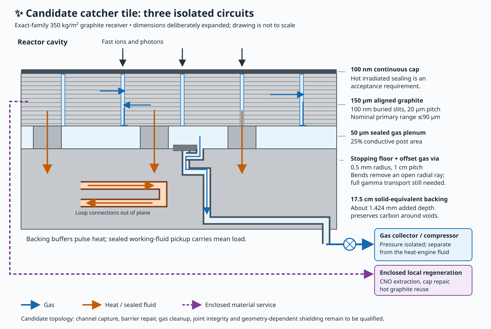

# ✨ A three-circuit catcher tile

A concrete candidate uses a 150 µm aligned graphite collection layer on the existing 350 kg/m² receiver, with buried gas slits, a sealed rear gas plenum, and a separate heat circuit. The principal unresolved requirements are hot irradiated front-barrier permeability, connected-defect repair, and removal of gas that returns to the cavity. Its stopping and thermal dimensions fit the present receiver; those facts alone do not establish the gas-recovery efficiency.

The calculations in [calculate.py](calculate.py) and [results.json](results.json) use the exact delivered-B1/C13H2 source family, the representative 350 kg/m² operating point and actual dispatch. The [temperature history packet](temperature-histories.json) contains chronological model temperatures for rate integration. Its microsecond prompt bounds are exported separately from the slower material pulse. The older 1,639/1,668 K envelope remains an envelope, not a dwell temperature.

## Physical layout

From cavity to rear, each compliant receiver tile contains:

1. A continuous 100 nm basal-oriented graphite cap. Beneath it, 100 nm-wide slits repeat every 20 µm through a 150 µm active laminate. The slit projection occupies 0.5% of area. The cap is supported across 100 nm spans; the remaining surface is bonded to the stopping laminate.
2. A 50 µm sealed gas plenum with conductive graphite posts occupying 25% of projected area. These posts carry heat into the retained backing. The chosen post conductivity is 50 W/(m K); the deliberately poorer active-layer sensitivity is 4 W/(m K).
3. Gas-only vias of radius 0.5 mm at 1 cm pitch. They traverse the backing as enclosed passages and feed an independent low-pressure manifold. Their entrances use staggered, blind stopping pads and lateral turns so there is no straight ion path from a front slit through a via. A 200 µm pad over twice the via area adds only 0.0063 kg/m²; it must also have an enclosed extraction path. Its two-step channel geometry adds molecular resistance to the simple straight-via estimate. The through-backing route also bends laterally: a thin entrance pad stops ions, while a bend in the thick backing removes a direct gamma streaming path. The exact remaining solid columns require a geometry transport calculation.
4. Solid backing, isolated heat-pickup passages, and the existing insulating/support layers. The heat-transfer fluid remains sealed from the catcher gas and solid rework streams. The backing buffers the pulse; the engine receives mean heat through the existing thermal circuit.

The active graphite is 0.2985 kg/m², the full-area cap 0.0002 kg/m², and the plenum posts 0.025 kg/m². These carbon elements substitute within the existing stock. Vias occupy 0.7854% of area; preserving the same average 350 kg/m² carbon column increases the physical depth by approximately 1.424 mm. Average column conservation must be combined with the blind-pad ray geometry. Local shielding, joints and heat conduction must follow actual solid paths.

Gas seals, compressors, valves and local repair tools require service allocations. The existing plant has a substantial unassigned service allowance, but this packet does not convert that allowance into manufactured hardware. The 0.0063 kg/m² stopping pads can be charged within it. The backing's existing mechanical joints remain sliding and shielded; a gas-tight connection may flex through a bellows or compliant manifold behind each tile instead of rigidly tying adjacent hot faces.

## Stopping and thermal pickup

The nominal maximum primary straight-CSDA depth among the exact stages is 89.64 µm, set by C13. The 150 µm active layer therefore contains every resolved nominal primary range. Halving electronic stopping increases that maximum to 179.07 µm; the remaining backing retains this material, while extraction must then include a deeper floor region. Projected H/He ranges are evaluated mean-depth proxies. Straggling, aligned channels and irregular surfaces still need a transport calculation. Ions incident over the 0.5% slit area can traverse the cap and stop in the sealed plenum floor; selective floor extraction is part of the design.

The active-layer-plus-post resistance used here is

`R_A = 150 µm / 4 + 50 µm / (0.25 × 50) = 4.15×10⁻⁵ m² K/W`.

It is conservatively added above the preserved backing solution without subtracting the thin intact graphite contribution already present there. The largest sampled material-plus-decay flux is 0.881 MW/m², producing at most 36.57 K additional local drop. The warmest sampled C13 front changes from 1,470.85 K to 1,496.03 K with this laminate and post resistance. At the 116.52 W/m² full-source mean, the added drop is only 0.00484 K. The 150 µm layer's thermal time scale is about 0.02 s, much shorter than its material-arrival pulse. Contact resistance and post spreading are additional acceptance conditions; they must not be silently included in a measured bulk conductivity.

A supported cap has a separate prompt requirement. Even assigning the entire incident photon flux to the cap, the 100 nm span at conductivity 4 W/(m K) gives a maximum steady lateral rise of 26.04 K during C13. The transverse diffusion time is about 9 ns, below the approximately 70 µs source duration. This is a deliberately generous absorbed-power screen. The established spectral prompt-temperature proxy supplies the adjacent material temperature; it is not appropriate to add two independently timed pulse maxima. Wider unsupported caps deteriorate as span squared.

The gas/plenum geometry removes much less than 1% of the backing heat capacity. Its line-of-sight voids and local joints matter more than that small average change. Full coupled photon/charged-secondary transport through these microstructures remains a future check; the solid-slab transport result cannot certify holes by itself.

## Gas routing, pressure and release

For ordinary isotropic mobile gas with absorbing front and rear boundaries, the probability of reaching a rear sink at depth L is x/L. Making diffusion faster changes timing but does not improve that fraction. Basal alignment and nearby side channels can alter this geometry. The [finite cap/channel calculation](../channel-routing/results.json) treats the cap explicitly: at 20 µm pitch, 100 nm cap and diffusivity ratio 10³, the B1 He/H front fractions are approximately 1.06%/1.84%; at ratio 10⁵ they are about 0.089%/0.158%. Those ratios are material requirements. No irradiated effective ratio has been measured for this assembly.

The cap is a solid barrier to thermal gas while energetic particles penetrate. This mechanism has laboratory precedents, with a crucial species dependence: [Bunch et al.](https://arxiv.org/abs/0805.3309) demonstrated gas impermeability in graphene devices, while [Sun et al.](https://arxiv.org/abs/1912.09220) found hydrogen permeation through a dissociation/atom-flip path with an approximately 1 eV activation energy. Neither result supplies a high-temperature irradiated permeability for this laminate. The [H evidence](../hydrogen-evidence/README.md), helium evidence and independent barrier review distinguish crystal mobility, trapping, front permeation and connected defects.

The approximate diffuse long-channel conductance, using a hydraulic diameter for the slits and a circular-via formula, gives C/A = 0.00630 m/s for H2 and 0.00445 m/s for He at 1,000 K, after combining slit and via resistance. This is a geometry screen rather than an exact Clausing calculation; side plenums, bends and finite pumping speed lower it. The gas packet supplies the source throughput and resulting first-stage pressure. A pressure-isolated compressor can raise pressure after collection; high-pressure storage cannot remain openly connected to the cavity.

The acceptance relation for connected apertures is `Q_back/A ≈ δ (v̄/4) P_plenum`. The new results include a repair curve `δ ≈ f_slot Φ a_eff τ`, using exact all-charged 64-point sampled peak fluxes. Here a_eff includes the probability and area of a through-connected hole; it is not inferred from NRT displacement counts. Atoms displaced in solid graphite need not create an open pore. Seams, permeation and defects outside slit projections add independent leakage paths. A narrow radial pore plume can concentrate toward the central assembly; a chamber-average pressure cannot bound its column. Any intentional cleanup outlet must direct gas sideways or through a baffled diffuse boundary, with its actual conductance counted. A successful local catcher also needs a separate ambient-gas cleanup path: the same barrier that retains implanted gas can prevent returned cavity gas from entering it.

## Regeneration and material flow

During each shot, mobile H/He is collected continuously through the short side paths. Strongly trapped populations can be removed by local site-selective processing after the flux falls. CNO and damaged graphite are transferred into enclosed local handling channels, separated, and returned to the fuel or construction inventory. The cap is checked and repaired during operation; a periodic intact-cap rework can occur between pulses. Sections can be isolated behind valves while a neighboring service passage carries the gas load. A laminate relying solely on slow post-shot repair must additionally meet the helium trapping-energy requirements; ordinary mobile graphite does not provide that hold-up automatically.

The gross handling choice matters far more than the initial skin mass. At the declared 2 MJ/kg rework dissipation:

| Reworked region | Every pulse | Monthly | Annually |
| --- | ---: | ---: | ---: |
| 100 nm cap | 0.0529 W/m² | 0.000152 W/m² | 0.0000127 W/m² |
| 100 µm active material | 52.89 W/m² | 0.1521 W/m² | 0.01268 W/m² |
| 150 µm active material | 79.34 W/m² | 0.2282 W/m² | 0.01901 W/m² |

The selected plant exports 45.64 W/m² before these new apparatus-specific charges. At 2 MJ/kg, full 150 µm chemical reworking after every shot would consume more than that. Whole-layer handling at 10 kJ/kg instead costs 0.397 W/m²; the code records that separate scenario. Moving already suitable graphite need not require chemical reworking. Annual or monthly bulk rework is small under either scenario. Selective repair is attractive, while its actual operations and throughput must still be charged. The 2 MJ/kg figure is an explicit dissipation scenario, consistent with the accepted efficient-manufacturing premise. It is neither an atomization requirement nor an unavoidable floor. All three schedules recycle installed matter; none is automatically fresh carbon consumption. Cooling the whole 150 µm layer from 1,000 K to 300 K before every shot would transfer about 50 W/m² of sensible heat at cp=1,800 J/(kg K); keeping the layer hot or recuperating that heat avoids this load. This thermal handling choice is separate from chemical work and from the small implanted-gas heat load.

The exact stopping packet gives 37.36 MJ/m²/year of elastic transfer and 3.73×10²⁴ NRT-proxy displacement events/m²/year at Ed=25 eV. The proxy represents energy available for damage before recoil partition, recombination and annealing. It does not determine cap pinhole yield, surviving damage, replacement frequency, or selective repair work. Those require a damage/repair model and irradiation evidence.

## Alternative open cells and remaining decision

An open-front deep cell with a collecting floor avoids relying entirely on a basal front barrier, but geometric line-of-sight escape is not the complete molecular-flow loss. For a long circular cell, K≈4d/(3L); with capture probability s on each return, eventual escape is K/[K+s(1−K)]. Even L/d=1,000 gives 0.133% escape with perfect return capture and about 1.32% at s=0.1. Thin front walls intercept part of the incoming ions and can release gas near the mouth. An isothermal reflecting labyrinth without a sink eventually returns its gas. Local cold or active capture brings its own radiation, pumping and mass account.

The aligned sealed laminate is therefore a specific candidate with a tractable heat path and moderate stock mass. Its decisive test is the coupled hot irradiated barrier, side-channel collection, local pressure and ambient cleanup system. Present evidence supports acceptance curves, rather than a defensible central estimate or subjective 80% credible interval for achieved recovery. The archived 350 kg/m² plant remains a conditional accounting reference until those apparatus properties are supplied.
