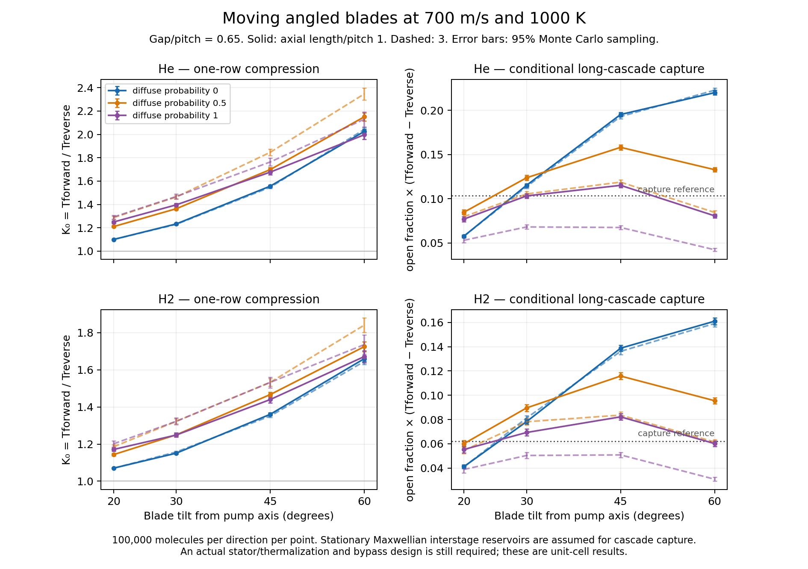

# ✨ Moving angled blades: molecular Monte Carlo discriminator

**Angled moving blades pump specular helium in this collisionless unit-cell model.** At 1000 K and 700 m/s, a 45° blade channel with gap/pitch 0.65 and axial length/pitch 1 gives one-row compression **K₀=1.5483 for fully specular He** and **1.3574 for H₂**. Thus the poor tangential momentum accommodation of a smooth drag sleeve does not prevent normal momentum transfer from an inclined moving facet.

Repeated-stage performance requires another physical element. A single uninterrupted specular corridor sixty pitches long still gives K₀≈1.549 for He and 1.360 for H₂. Large compression comes from a cascade with actual interstage velocity redistribution, such as appropriately designed stators. The thermalized-reservoir calculation below states that condition explicitly.



[SVG](blade-screen.svg) · [PDF](blade-screen.pdf) · [machine-readable summary](summary.json) · [checks](validation.json)

## Geometry and scattering

The spatial model is two-dimensional with three-dimensional molecular velocities. In the translating rotor frame the channel is

`0 < x + s z < gap`, `0 < z < L`, `s = tan(theta)`.

The pump axis is +z, the rotor moves at lab velocity +u in x, and **theta is the blade tilt from the pump axis**. Both parallel side walls move together in the lab. Pitch is normalized to one; the only length dependence in collisionless transmission is through L/pitch and gap/pitch. The open fraction is gap/pitch. The orthogonal span has no end wall, so spanwise clearances are outside this cell.

Molecules are launched uniformly over the open mouth. The lab reservoirs are stationary Maxwellians at 1000 K. With `sigma=sqrt(kT/m)`, incoming rotor-frame velocities are sampled as

- `vx ~ Normal(-u,sigma)`;
- `vy ~ Normal(0,sigma)` in the unmodeled span direction;
- `vz = ±sigma sqrt(-2 ln U)` for forward/reverse axial incidence.

The Rayleigh distribution for |vz| gives **flux-weighted incidence**. Using a half-normal axial velocity would count residence-weighted molecules incorrectly.

Specular reflection uses `n=(1,s)/sqrt(1+s²)` and `v' = v − 2(v·n)n`. Each collision instead uses diffuse reflection with specified probability α: a flux-Maxwellian outward normal velocity and independent Gaussian tangential velocities at 1000 K. This Maxwell mixture is an explicit surface-model sensitivity. α=0, 0.5 and 1 are unweighted cases, not measured hot irradiated graphite coefficients.

An event-driven tracer advances to the next wall or axial end. For α=0 an exact two-reflection skip accelerates repeated zigzags whose complete vertices remain inside the ends. Direct, unaccelerated histories were checked separately. All paths terminate at an end; there is no artificial sticking, gas collision, chemical conversion or residence-time cutoff in the reported transmissions.

Tf is the probability that a forward incident molecule reaches the opposite reservoir; Tr is the corresponding reverse probability. The plotted face capture includes the geometric open fraction. Molecules incident on the remaining blade-tip projection are assigned no throughflow in this cell. A finite-thickness tip shape, root/tip leakage, stator and baffle require additional geometry.

## Confirmed 45° cases

Each row below uses **one million independent molecules per direction** at u=700 m/s, T=1000 K, L/pitch=1 and open fraction f=0.65.

| Gas | Diffuse probability α | Tf | Tr | K₀=Tf/Tr | Conditional long-cascade face capture f(Tf−Tr), 95% sampling interval | Rows for Ktotal≥10⁸ / 10⁹ |
| --- | ---: | ---: | ---: | ---: | --- | ---: |
| He | 0 | 0.839042 | 0.541918 | 1.54828 | 0.193131 [0.192342, 0.193919] | 43 / 48 |
| He | 0.5 | 0.592959 | 0.350123 | 1.69357 | 0.157843 [0.156971, 0.158716] | 35 / 40 |
| He | 1 | 0.439173 | 0.262710 | 1.67170 | 0.114701 [0.113856, 0.115546] | 36 / 41 |
| H₂ | 0 | 0.804793 | 0.592878 | 1.35743 | 0.137745 [0.136941, 0.138549] | 61 / 68 |
| H₂ | 0.5 | 0.559899 | 0.385442 | 1.45262 | 0.113397 [0.112511, 0.114283] | 50 / 56 |
| H₂ | 1 | 0.412908 | 0.286818 | 1.43962 | 0.081959 [0.081107, 0.082810] | 51 / 57 |

The He specular K₀ 95% interval is [1.54519, 1.55138]; H₂'s is [1.35487, 1.36000]. The summary also supplies 80% sampling intervals. These intervals quantify Monte Carlo noise; they are not credible intervals for a fabricated pump or its surface kernel.

All six selected conditional cascade captures exceed the existing reference values 0.1034 for He and 0.0622 for H₂. The result supports further blade/stator design. It does not replace the pump's aperture, mass, idle-power or clearance account with a proven operating point.

The wider grid has 72 baseline gas/geometry/scattering combinations at 700 m/s: theta=20°, 30°, 45°, 60°; L/pitch=1, 2, 3; α=0, 0.5, 1; He and H₂. Another 32 cases vary speed to 600/750 m/s and open fraction to 0.5/0.8 at 30°/45° and L/pitch=1. Every direction has 100,000 particles. The records preserve the entire sweep. Increasing angle can improve specular compression, while longer diffuse channels reduce capture despite higher compression. A low-capture pressure stage and a high-capture inlet stage therefore need not share the same geometry.

## Finite cascade and useful speed

For identical rows separated by well-mixed, stationary Maxwellian reservoirs at the same temperature, write the normalized flux relation

`q = f (Tf p_i − Tr p_(i+1)) × vbar/4`.

With `K=Tf/Tr`, N rows give

`Ktotal = K^N`

`S_eff/(A vbar/4) = f(Tf−Tr)/(1−K^(−N))`

`Q/A = [S_eff/A] (p_in − p_out/Ktotal)`.

The long-cascade capture tends to **f(Tf−Tr)**. Assigning every row the single-pass speed fTf would overstate useful high-compression throughput. Independent dense nodal solves reproduce the saved closed-form network to numerical precision, including internal flow continuity. The existing 10⁷ foreline/inlet pressure ratio retains at least 90% of zero-backpressure speed when Ktotal≥10⁸; species partial pressures enter this relation.

As an interface calculation, retain the warm cleanup's baffle conductance `f_b tau_b=.03`, target g=.01 and Ktotal=10⁹. Substituting the selected H₂ cascade captures would require pump-aperture fractions **0.1106 / 0.1343 / 0.1858** for α=0 / 0.5 / 1. These compare with the current empirical-reference aperture fraction 0.2448. They demonstrate that useful inlet speed and high compression are compatible in this ideal network. Additional stator resistance and bypass can consume that margin.

**A reservoir is an assumption about gas velocities, not an empty gap.** Rarefied gas does not thermalize itself between rows. The continuous sixty-pitch control directly exposes the difference: its specular compression remains roughly that of one row, rather than growing as K^60. A real train must supply velocity reset through stationary surfaces, suitable opposed rows, or another explicitly modeled scattering architecture. Such surfaces can also reflect gas upstream and reduce speed. A coupled rotor–stator cell is the next informative calculation; a nominal count of 43 or 61 moving rows alone cannot certify 10⁸ compression.

## Energy and numerical verification

Specular reflection conserves kinetic energy in the moving wall's frame. In the laboratory, the wall does work

`Delta E_lab = m u Delta vx + Delta E_rotor`.

For specular collisions the final term vanishes; diffuse reflections exchange heat with the 1000 K wall. The recorded incident-to-exit ledger separates this heat from mechanical work. It does not turn the tiny gas-compression work into a prediction of motor/bearing idle power.

The final packet contains **127 cases and 41.6 million incident molecules**, plus twelve 3000-particle comparisons with direct unaccelerated paths. All **812 checks pass**:

- Every trajectory is resolved; transmitted plus returned molecules equal the launched count.
- Largest per-reflection relative specular-energy error is 1.93×10⁻¹⁵; lab work/heat closure is below 5.26×10⁻¹⁶ in the normalized check.
- Twelve exact-skip comparisons match every exit-status hash and reflection-count hash.
- Zero-speed forward/reverse controls are statistically reciprocal. The largest initial discrepancy is 2.76 standard errors among the controls; their aggregate squared score is 10.50 for ten nondegenerate comparisons. An independent million-particle rerun of that case gives K₀=1.00324 and a net-capture interval spanning zero.
- A moving, zero-tilt, fully specular channel has Tf=Tr=1 and K₀=1 exactly. Tangential motion alone supplies no axial pumping in that control.
- Finite-cascade formulas match independent pressure-node solutions.

No unresolved tail was counted as a return or a transmission. Selected values use independent larger samples rather than combining an adaptively chosen winner with its discovery sample. There is no claim of a global optimum. Statistical resolution is already much tighter than the uncertainty in interstage scattering and blade clearances.

## Reproduction

With Python and NumPy, run from this directory:

```sh
python3 simulate.py --mode controls --n 100000 --output records
python3 simulate.py --mode grid --n 100000 --output records
python3 simulate.py --mode refine --n 100000 --output records
python3 confirm.py
python3 long_control.py
python3 analyze.py
python3 plot.py
```

`plot.py` also needs Matplotlib. Seeds, records, script hashes and parent-free numerical inputs are archived here. The figure exports PNG, PDF and SVG. Existing catcher/source archives were preserved.
