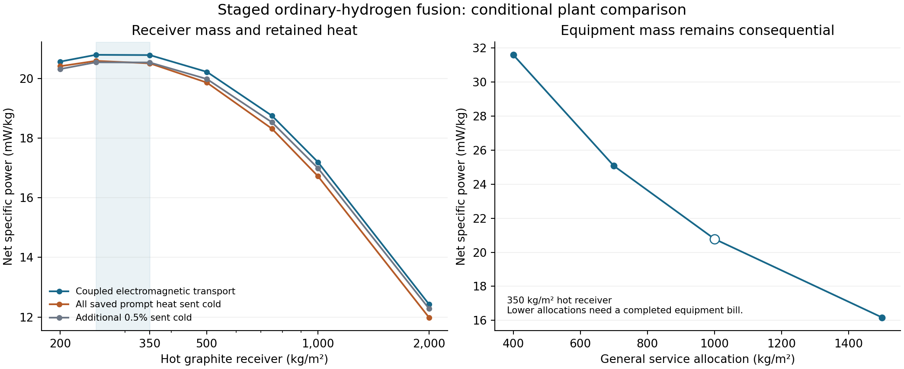

# ✨ Fuel mixtures and the integrated plant comparison

The supported design region in this calculation uses **three hydrogen nuclei per nitrogen-14 nucleus, two per nitrogen-15, two per carbon-12, and two per carbon-13**. The representative plant exports **6.94 × 10²⁰ W** from **3.34 × 10²² kg**, or **20.8 mW/kg**, with a 350 kg/m² hot graphite receiver. These are results of a coupled numerical and equipment-allocation model. Completing the cold fuel assembly and component designs remains the central physical task.

The [selected account](selected-plant/point.json) contains one consistent pulse family, its precursor energy, actual isotope and hydrogen balance, source rating, arrival windows, radiation transport and plant mass. The [component report](../component-design/README.md) explains the apparatus and remaining questions. Earlier research snapshots are preserved.

## Mixture selection

The principal comparison fixes pulse mass, initial density and temperature profiles, total prepared energy and physical burn duration. A separate fixed-flow family preserves radial velocities and lets prepared energy change. The analytic composition factors motivate the sweep; completed hydrodynamic and nuclear calculations determine its yields. [Methods](methods.md).

| Stage | Bulk hydrogen/catalyst number ratio | Candidate feed | Deposited burn energy / precursor energy | Average pulse interval at the selected point |
|---|---:|---|---:|---:|
| Nitrogen-14 | 3 | Isotope-selected ammonia | 10.765 | 9.38 days |
| Nitrogen-15 | 2 | Isotope-selected hydrazine | 7.956 | 128.3 minutes |
| Carbon-12 return | 2 | Isotope-selected CH₂ polymer | 9.919 | 11.44 days |
| Carbon-13 return | 2 | Isotope-selected CH₂ polymer | 22.660 | 129.7 days |

The large pulses contain 1.131 × 10¹³ kg; nitrogen-15 pulses contain 1.131 × 10¹¹ kg. The table's energy ratio concerns the hot burn. The complete plant also counts delayed decay heat and neutrino losses. Capsule skins and optical coatings require their own manufactured input composition; the selected network records describe the bulk recipes.

The carbon-12 refinement compares H/C = 1.5, 1.75, 2, 2.25 and 2.5. H/C = 2 gives the highest whole-plant score in each of four tested carbon-13 combinations. At otherwise common conditions, carbon-13 H/C = 2 costs only **0.237%** relative to H/C = 4; H/C = 3 costs 0.063%. The source-specific polymer calculation then reproduces its prescribed-profile burn gain within 0.006%. This small power trade buys a much simpler preparation path than a methane pressure vessel. The complete constructed-source comparison puts the polymer family's plant penalty around 0.15%. [Refinement](final-refinement/README.md), [polymer source](../component-design/c13-polymer-source/README.md), [capsule comparison](../component-design/capsule-survival/README.md).

Hydrogen-rich mixtures increase unburned hydrogen circulation, displace catalyst at fixed pulse mass, and change pressure and compression. Very rich mixtures can fail to reach the burning state in the specified inflow. No initial-rate optimum has been substituted for a pulse-gain calculation. The [gain figure](plots/mixture-gain.png) and its data retain the fixed-energy, fixed-flow, resolution and rate distinctions.

## Closed material and energy accounts

At the selected point, the model supplies **2.779 million kg/s of fresh hydrogen** and **870 kg/s of fresh carbon**. It returns **3.227 million kg/s of unburned hydrogen** and **35.14 million kg/s of circulating CNO material**. Total gross pulse feed is 41.09 million kg/s. Excess hydrogen therefore has a real collection and processing stream, even though its illustrative processing-energy cost is small compared with output.

The actual external C:H mass ratio is **0.0003129**, about 4.47% of the proposed 0.007 allowance. Almost all fresh carbon replaces catalyst converted into retained oxygen-16. Per net helium nucleus, the stationary account supplies 4.000419 hydrogen nuclei and 0.00010504 carbon nuclei; it produces 0.00010504 oxygen-16 nuclei. Carbon retained in the receiver, a sorting residue or a retired surface remains inventory or rework. Terminal export or escape must receive a separate material entry.

The proposed 0.0056 fuel / 0.0014 structural split remains an allocation. Neither share must be consumed. Initial construction stock has its own resource account. The generalized balance uses each stage's actual input and cold-decayed output vectors, including every unburned proton; it does not infer proton count from the stage label.

Per net helium nucleus, nuclear reactions release **26.7345 MeV**, of which **2.0189 MeV** goes to neutrinos in the selected decay account. Precursor preparation supplies **1.93672 MeV**. Delivered nitrogen-stage preparation radiation is separately charged once. The plant counts driver electricity, conversion losses, cold equipment heating, refurbishment and support before reporting export. Its electrical preparation draw is 2.147 × 10²⁰ W; the modeled net export is 39.03% of total nuclear energy. [Full family and interface](../component-design/final-family/README.md).

## Receiver and power per kilogram

All rows below use the same constructed pulse family, 1.1 × 10⁹ m radius, 200 K radiators, 60% preparation efficiency and 60% heat-to-electric conversion. Energy that passes the hot receiver is charged to cold equipment and its radiator. Eventual material return remains one.

| Hot graphite, kg/m² | Coupled electromagnetic scenario, mW/kg | Entire saved prompt heat sent cold, mW/kg |
|---:|---:|---:|
| 200 | 20.564 | 20.410 |
| 250 | 20.793 | 20.589 |
| **350** | **20.784** | **20.506** |
| 500 | 20.220 | 19.860 |
| 750 | 18.751 | 18.316 |
| 1,000 | 17.193 | 16.720 |
| 2,000 | 12.427 | 11.984 |

The 250–350 kg/m² region is a broad plateau. The 0.043% numerical advantage at 250 is smaller than transport sampling uncertainty. The representative 350 kg/m² choice reduces the calculated thermal envelope and panel bow while retaining essentially the same power per kilogram. These comparisons establish a tested region at the stated radius and equipment assumptions; radius, geometry and complete component mass still offer further design choices.

The radiation model follows coupled photons, electrons and positrons in a closed carbon sphere. The selected hard-source scenario sends 6.429% of hot-boundary energy past the hot receiver. Its angular distributions, source locations and spectral substitutions are explicit. Assigning all saved prompt energy to cold equipment gives the second column above. Additional missed-hot fractions of 0.5% and 1%, applied to the complete precursor energy boundary, reduce the representative point to 20.536 and 20.290 mW/kg. Those are sensitivity cases rather than mandatory losses. [Transport](../component-design/coupled-photon-transport/README.md), [nearby columns](../component-design/coupled-photon-extension/README.md).

The propagated **80% Monte Carlo sampling interval is 20.754–20.813 mW/kg** with all physical and apparatus assumptions held fixed. Source geometry, opacity, material behavior and equipment mass are outside that interval. A whole-reactor credible interval requires those design choices to be specified further.

The general service allocation is now the largest mass term: 1,000 kg/m², or 45.5% of installed mass. Re-solving with allocations of 400, 700, 1,000 and 1,500 kg/m² gives **31.60, 25.08, 20.78 and 16.17 mW/kg**. The smaller allowances require a completed equipment bill that fits them. This conditional range is not a probability interval. [Service sensitivity](selected-plant/services-sensitivity.json).

## Numerical evidence

The network has 27 isotopes and 194 rates. The principal grid comparison uses 64, 128 and 256 radial cells, updated carbon capture evaluations, explicit rate alternatives, and opacity/EOS sensitivities. Completed records retain conservation residuals, physical end times, actual inputs and source hashes. The detailed [nuclear review](nuclear-review.md) distinguishes published uncertainty curves from new model sensitivities.

The nominal selected quartet's final 256-cell plant comparison is 0.56% above its 128-cell counterpart. That comparison includes an explicitly longer carbon-return outflow: a small velocity inversion at the original 256-cell endpoint required more hydrodynamic evolution before a ballistic receiver calculation was valid. The later run removes the inversion with essentially unchanged nuclear yield. The rejected endpoint remains archived. Carbon-13 H/C = 2 and the final constructed family have their own 128-cell results; the H/C = 4 mesh study is supporting evidence rather than a direct convergence test of those profiles.

The delivered nitrogen calculation also tests preparation radiation: its nuclear output falls 0.911% relative to the otherwise identical delivered control. The original hot-profile and EOS handoff differences remain separate. The remaining consequential question is the finite three-dimensional cold assembly, especially central seeds and the outer nitrogen material. A successful spherical continuation defines the fields that apparatus must deliver.

## Economics and next research

At 20.78 mW/kg, each 1 MJ/kg of actual embodied manufacturing energy takes **1.525 years** of net export to repay. A twenty-year operating period supplies about 13.1 MJ/kg of installed plant. The technological premise of at least 50% useful free-energy conversion applies to specified manufacturing transformations. For the example methane-to-graphite chemical step, the selected receiver's energy requirement equals 2.05 export-years at 50% efficiency and 1.04 years at 99%. Feedstock acquisition, delivery, factories and useful life remain separate quantities. [Refreshed economic account](selected-plant/economics/README.md).

The next useful calculations are a finite contact-patch assembly with neighboring streams and seeds, a coupled capsule/neutralizer thermal and mechanical model, finite receiver panels and shielded joints, and a component bill for recovery and general services. These address mechanisms capable of changing the design substantially. The near-tied hydrogen and receiver choices provide room to simplify those components.

The proposed [tamper study](tamper-study/TAMPER-STUDY.md) compares low-Z, bismuth, layered and fuel-liner concepts to improve confinement in smaller pulses. Its saved radius sweep is an untamped sensitivity; the tampered candidates require coupled simulations and whole-cycle accounting.
