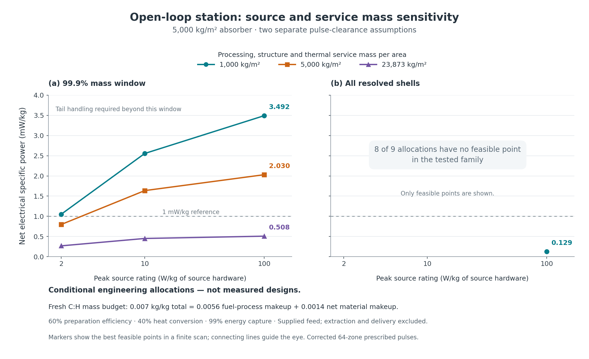

# External-carbon protium station ✨

The newer [shaded-receiver account](../cold-sink-redesign/README.md) supersedes the direct-sunlight load and 40% heat-conversion working assumption used in the tables below. The numerical files here remain the historical pulse and station reference.

The external-carbon redesign removes the local helium-to-carbon factory. With the corrected spherical pulse calculations, the process can fit a **0.007 kg fresh carbon per kg fresh hydrogen** supply budget while retaining a positive electrical margin. A rounded whole-station allocation reaches **2.77 mW/kg**, exporting **3.36×10²⁰ W** from **1.22×10²³ kg**. A heavier service and source allocation reaches **1.31 mW/kg** at the same pulse rate and radius. These are conditional engineering accounts, with the component ratings and recovery requirements stated below. The calculation does not yet establish a unique, physically achievable maximum.

Thomas requested the external-carbon redesign, the best supported net useful power per installed kilogram and the 0.007 supply ratio on 30 October 2026. The ratio is interpreted by mass and used as a resource budget. This document does not treat it as a measured universal carbon abundance. The earlier local-factory account remains a historical design study.

## What changed

The [carbon-stage completion](../b2-completion/NUMERICAL-COMPLETION.md) corrected an artificial-viscosity error that removed heat from expanding shells. The carbon stage now reaches its requested end time. All other small stages were rerun with the same correction. The open-loop balance uses those completed outputs, including their changed photon escape. It admits fresh carbon with a terrestrial-natural reference C13 fraction of 1.07%; the isotope sensitivity is saved separately.

The [process balance](process.md) solves for stationary isotope flows after cold decay, sorting and material loss. Each stage retains its full output isotope vector, including leakage. Gross circulating hydrogen does not inflate the supply denominator. The selected operating case assigns **0.0056 C:H to fuel makeup** and reserves **0.0014 C:H for net material losses**, so total fresh supply remains 0.007. This requires about **99.96276% CNO and hydrogen return per cold processing pass** in the coupled-loss reference. At perfect recovery, nuclear leakage alone would still require fresh carbon. The local carbon factory and its preparation energy disappear from this branch.

[Process scenarios](process-scenarios.md) retain the 0.007 fuel-only case, the 10% and 20% material reserves, and carbon-stage resolution sensitivities. The 64-zone family supplies the station screen so that its process and receiver traces are consistent. Higher-resolution B2 results are separate sensitivities while the other stages remain at 64 zones. Recomputing the receiver for B2 at 128 and 256 zones gives respectively 2.782 and 2.789 mW/kg at the same rounded higher-source-rating point, compared with 2.766 mW/kg for the coherent 64-zone family. The 256-zone repeated-pulse temperature bound is 1,966 K. The [grid propagation](station-grid-sensitivity.json) preserves these modest whole-station shifts alongside the larger single-stage yield sensitivity.

## Rounded operating points

All three surface-heating cases below use a receiver radius of **1.1 billion metres**, 5,000 kg/m² of carbon absorber, a maintained 1,000 K hot boundary, 450 K radiators, 60% preparation efficiency, 40% heat conversion and 99% energy capture. The shared cavity spends at most 80% of its time on the modelled incoming and outgoing portions of pulses. Capturing the remaining slow material is part of the operating requirement.

| Allocation | Source peak rating | Service mass per receiving area | Installed mass | Net electricity | Net specific power |
|---|---:|---:|---:|---:|---:|
| Balanced | 10 W/kg | 5,000 kg/m² | 2.30×10²³ kg | 3.01×10²⁰ W | 1.31 mW/kg |
| Lighter service equipment | 10 W/kg | 1,000 kg/m² | 1.54×10²³ kg | 3.26×10²⁰ W | 2.12 mW/kg |
| Higher source rating | 100 W/kg | 1,000 kg/m² | 1.22×10²³ kg | 3.36×10²⁰ W | 2.77 mW/kg |

The source ratings refer to the complete peak preparation power, including the prescribed initial thermal energy. The service allowance covers processing, structural and thermal equipment; it is a mass requirement rather than a component-resolved design. Source hardware, storage, conversion, radiators, working inventories, feed buffers, support streams, replacement manufacturing, spare stock and a 20% installed reserve are additional counted masses. That reserve includes 3.40×10¹³ kg for one full batch of each stage, in addition to the one-day cold-flow buffer. Support counts shell self-gravity and a conservative scalar envelope of the maximum Solar tidal load at 5 AU; guide topology and stability remain engineering requirements. [Exact operating cases](operating-cases.json) and [station model](station.py) preserve the full decomposition.

At the higher source rating the plant produces 6.48×10²⁰ W gross electricity. Preparation consumes 2.32×10²⁰ W, other operating loads 4.17×10¹⁹ W, replacement manufacture 3.85×10¹⁹ W and support 4.26×10¹⁷ W. Replacement processes 10⁻⁴ of installed mass per year at 100 MJ/kg; its manufacturing capacity is allocated at 1 kg/W. These are declared maintenance requirements. Material from refurbishment is returned for reuse.

The 2.84×10²³ W source peak is about 1,225 times its mean electrical draw. Two large prepared-pulse equivalents require 1.36×10²⁶ J of electrical storage, allocated at 100 kJ/kg. The receiver's bulk heat capacity buffers recovered nuclear energy between shots. The thermal cycle has finite internal temperatures of about 952 K and 476 K; required combined hot/cold exchanger conductance is 7.12×10¹⁹ W/K. Radiators occupy about 4.3% of the spherical receiving area and reject operating heat plus absorbed sunlight at 5 AU. Solar heat receives no electricity credit.

## The carbon budget changes the recovery problem

At the same operating point, fresh hydrogen supply is **2.53 million kg/s**. Fuel makeup uses **14,194 kg/s of carbon**; **3,549 kg/s** remains for net structural carbon loss. Circulating fuel flow is about **44.8 million kg/s**. Initial construction carbon is capital inventory, already counted in mass, and is separate from the ongoing feed ratio.

The material allowance is only **7.36×10⁻⁹ kg/m²/year** when divided over the receiver. Refurbishing 10⁻⁴ of the 5,000 kg/m² carbon layer each year moves 0.5 kg/m²/year. If that receiver alone consumed the whole structural allowance, at least **99.9999985%** of the moved carbon would need to stay in the station or return for reuse. Other carbon equipment makes that requirement tighter. Material circulating inside a closed enclosure can be collected repeatedly; counting every refurbished kilogram as fresh import would violate the supply budget.

Recovering physical fragments is only part of the requirement. Nuclear transmutation and fragmentation during fuel stopping, implantation into receiving material and escape through ports all consume the allowance. The incident nuclei must be slowed before ordinary material collection, with their lost kinetic energy recovered within the heat account. The [stopping audit](../b2-completion/wall-stopping-requirement.md) translates the material allowance to fewer than 6.21×10⁻⁵ irreversibly lost target-carbon atoms per incident fuel nucleus, averaged over the mixture and assuming the receiver uses the whole allowance. A candidate 1 keV per nucleon wall-entry ceiling requires removing at least 99.64% of bulk kinetic energy beforehand, with that energy recovered in electrical loads or coolant. Exothermic charged-particle reactions still have no universal positive threshold; an integrated stopping/reaction calculation must establish the actual probability. The model has not calculated the complete slowing, implantation and substrate-processing system. The [collector report](collector.md) records this requirement explicitly.

## Pulse clearance and surface temperature

The N15 stage repeats on average every **113 minutes**; N14 every **7.5 days**, C12 every **13 days** and C13 every **184 days**. Incoming and outgoing flight times are summed across all stages in the shared cavity. The faster schedule follows the arrival interval containing 99.9% of each pulse's mass. The slow remainder must be collected or protected from the next inflow and ultimately returned. Discarding 0.1% of catalyst would exceed the selected fuel-loss allowance. Waiting for the slowest represented shell instead produces much less power: only the lightest tested allocation remains positive, at about 0.13 mW/kg near its thermal boundary. A continuum core with velocity tending to zero cannot be cleared by a finite ballistic waiting time alone.

The initial surface screen deposits all prompt photons at the mathematical surface and uses the resolved material-arrival profile. Its largest isolated rise at 1.1 billion metres is 854 K. The [finite-slab periodic check](collector-periodic.json) places a 1,000 K heat sink behind the 2.5 m carbon layer. Mean receiving heat of 107.7 W/m² produces a 2.69 K mean conduction offset. Spacing the large A, B2 and C13 pulses at least one day apart bounds previous-shot heating at 7.09 K. Even allowing the current C13 and B1 isolated maxima to coincide, the resulting front-temperature bound is **1,965 K**. Large shots use about 21.5% of the available daily slots. A one-day cold process buffer is counted. The algebraic search maximum sits too close to 2,000 K to provide this headroom; rounded cases are shown separately from that boundary.

The [finite photon-depth sensitivity](collector-depth.json) identifies a physical route to a smaller receiver. A constructed spectrum depositing 10% of prompt energy at the mathematical surface and 90% at the 10 keV carbon attenuation depth permits a 0.7-billion-metre example at **10.5 mW/kg** under the same hardware assumptions. This is an isolated-pulse spectrum sensitivity, without the repeated-pulse thermal qualification used for the selected 1.1-billion-metre design: the grey radiation calculation does not predict that escaping spectrum, and substituting an attenuation length does not solve scattering and secondary-particle transport. It is an identified calculation to do next, not the selected supported output.

Warm surroundings also affect incoming fuel. Small cold hydrogen-bearing parcels need thermal protection, controlled heating or shielded staging during their flight through the hot enclosure. The prescribed hot converging profile does not establish how launchers preserve parcel timing, composition and density. Multidimensional assembly, source preparation, slow-tail handling and material recovery remain the principal integrated physical qualifications.

## What “best supported” means here

The finite search varies two absorber masses, three source ratings, three service allowances, four hot/cold temperature choices, radius, pulse rate and two clearance assumptions. It reaches **3.49 mW/kg** at a surface-temperature boundary near a 1.022-billion-metre radius. That numerical boundary has almost no thermal headroom. Reducing service mass or assuming a harder photon spectrum increases the result, so the search cannot establish an absolute optimum without component and transport models.

The plot separates clearance assumptions and shows dependence on declared apparatus ratings. Missing points mean no positive feasible point in the tested family. The whole-station arithmetic has independent mass, electric-power and global-energy checks; those checks do not substitute for qualification of its component assumptions. The lower-dimensional pulse calculation also retains nuclear-data, transport, EOS and spatial-resolution limitations documented in the adjacent packet.

## Economic consequences

At 2.77 mW/kg, one gigawatt requires about **3.61×10¹¹ kg** of installed plant. Construction at 100 MJ/kg takes about **1,146 years** to repay from net output; the balanced allocation takes about **2,419 years**. Recurring replacement is already subtracted from those outputs. The higher source rating reduces the plant's construction-energy burden but does not make it a rapid replicator.

Fresh feed is externally provided at this system boundary. The higher-rating case exports about **1.33×10¹⁴ J per kg of fresh hydrogen**, leaving substantial energy margin for extraction and delivery, but upstream apparatus is not included in the stated W/kg. Carbon recovery has a stronger effect on process viability than the energy cost of the small makeup stream. Capital supply is larger: the receiver alone contains about 7.60×10²² kg of carbon.

At the same 100 MJ/kg convention, fabrication uses 1.22×10³¹ J. Giving all installed material a 30 km/s cruise speed requires 5.47×10³¹ J of kinetic energy, before propulsion inefficiency, orbital-energy changes, extraction and arrival operations. These are separate costs. With the comparison assumptions of 30% solar conversion and 1 kg/m² complete collector mass, unobstructed sunlight matches 2.77 mW/kg at about **384 AU** from a Sun-like star. Early installations therefore have stronger economic reasons for fuel-cycle development and very long-lived remote power than for replacing existing Solar-system generation.

## Reproduction and evidence

1. `process.py` reproduces the completed 64-zone process family; `process_scenarios.py` adds material-reserve and spatial cases.
2. `collector.py`, `collector-scenarios.py` and `collector-depth.py` produce receiver and timing inputs. Read their recorded raw-trace paths and hashes; some full histories are kept in local scratch while exact compact samples are archived in the adjacent packet.
3. `python station.py --inputs station-inputs.json` reproduces the finite station family. `python operating_cases.py` writes rounded operating cases. `plot_station_sensitivity.py` produces the figure.
4. [the independent station audit](../b2-completion/station-independent-audit.json), `collector-check.json` and the adjacent independent pulse/process audits retain verification results. Scripts and saved inputs are hashed in this packet's manifest.

The design uses established conservation laws, a named nuclear-rate network and explicit reduced models. Its positive station outputs depend on the selected source efficiency, apparatus mass, collection, cooling and material-lifetime requirements. No complete reactor or future commissioning date follows from numerical integration alone.
