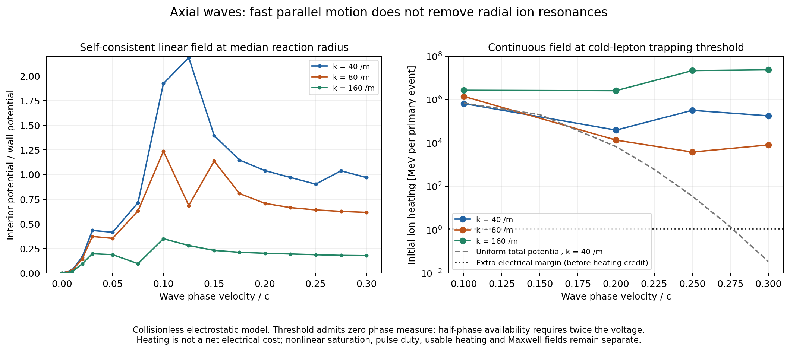

# Axial particle capture and collective ion response ✨

This checkpoint examines a specified candidate: segmented cylindrical electrodes create an axisymmetric axial traveling wave along an electron-poor H/Ti source. The potential varies as `Re[Phi(r) exp(i k z - i omega t)]`. Its initial purpose is to trap slow leptons in moving potential wells, after which a chirped accelerator would carry them through the end barriers. The ion source is the existing 1.6 MeV, 137.149 T equilibrium with a 20.732 mm wall radius.

The result is a useful restriction on that design. A wave faster than the ions' parallel thermal motion can still heat them through their radial motion. Continuous operation at amplitudes sufficient to trap initially slow leptons is incompatible with the reference energy budget **if the modeled Maxwellian state and its linear response are maintained**. Low-amplitude staged capture, brief chirps, different spatial fields, modified ion distributions and periodic whole-plasma resets remain open alternatives. This work does not supply a complete selective collector.

## Separate three physical questions

1. **Penetration and absorption.** The driven wall field induces ion charge. The linear calculation solves that charge and the total interior field together.
2. **Capture.** A lepton must lie within the moving well's separatrix. A field that penetrates the core does not automatically capture its particles.
3. **Removal and recovery.** A captured positron must still acquire sufficient energy to cross the approximately 40 MV positive ion-end barrier. Electrode power, phase control, collection and recovery must be included. Electrons and positrons need their own final collectors.

The positive end potentials attract electrons and repel positrons. A wave moving at 0.1c gives a synchronous lepton only about 2.6 keV of axial kinetic energy. The injection-stage results below therefore cannot be described as final positron extraction.

## Relativistic fixed-wave capture bound

For a prescribed electrostatic wave of potential amplitude `Phi`, the wave-frame invariant of a lepton is

`H/(m_e c^2) = sqrt(1 + u_perp^2 + u_z^2) - beta_phi u_z + q Phi cos(psi)/(m_e c^2)`.

Here `u=p/(m_e c)`. At fixed perpendicular momentum the kinetic part has its minimum at the synchronous axial velocity, with value `sqrt(1+u_perp^2)/gamma_phi`. A particle can lie inside some part of a sinusoidal bucket only if

`2 e Phi >= m_e c^2 [sqrt(1+u_perp^2+u_z^2) - beta_phi u_z - sqrt(1+u_perp^2)/gamma_phi]`.

For initially cold axial and perpendicular motion, the minimum interior amplitudes are:

| Phase speed | Minimum interior amplitude | Ti charge × amplitude / 1.6 MeV |
| --- | ---: | ---: |
| 0.1c | 1.281 kV | 0.0176 |
| 0.2c | 5.162 kV | 0.0710 |
| 0.25c | 8.113 kV | 0.1116 |
| 0.3c | 11.769 kV | 0.1618 |

At the minimum itself, the initially trapped phase interval has zero measure. With random initial phase, half the particles lie inside a fixed bucket at twice this amplitude; 90% requires about 40.86 times the minimum. Charge sign shifts the stable phase. Perpendicular energy increases the relevant effective mass and threshold. These are separatrix and phase-availability results, not measured capture efficiencies or a simulation of adiabatic capture.

A bucket can instead start at low phase velocity and accelerate particles already captured. The fixed-wave bound does not rule that out. At a prescribed 1 kV amplitude, `k=40/m`, and synchronous force one half of the peak force, the kinematic acceleration from 0.1c to 40 MeV takes approximately 2.0 km and 6.75 microseconds. Maintaining capture as the bucket shrinks, the radial field, finite channel ends and the actual electromagnetic slow-wave structure remain uncalculated.

## Passive kinetic response with induced fields

The source's radial motion is integrable in its static axisymmetric equilibrium. We sample the canonical distribution of protons and titanium, integrate their actual nonlinear orbits in the common rotating frame, and resolve each complete radial period into a finite-element potential basis. A radial orbit has basis Fourier coefficients `f_a,l` and frequency `Omega_r`. Free axial Maxwellian motion supplies an analytic Gaussian decorrelation factor.

With axial wave number k and drive angular frequency omega, the projected charge susceptibility is

`chi_ab = -N_line q^2/T sum_l <f_a,l f_b,l*> [1 + omega/(sqrt(2) k v_th) Z((omega+l Omega_r)/(sqrt(2) k v_th))]`.

`Z` is the plasma dispersion function. Both signs of each nonzero radial harmonic are included. The numerator contains the **drive** frequency omega. This expression follows from the canonical linear-response correlation relation; it reduces to the usual parallel Maxwellian result when the total radial potential is uniform. Since this is an `m=0` perturbation, laboratory and rotating frequencies are equal, and there is no canonical azimuthal torque. Axial momentum transfer remains `F_z=P_abs/(omega/k)`.

The self-consistent finite-element equation is

`(K_Poisson - chi) Phi = 0` on interior nodes, with the wall potential prescribed.

`K_ab = epsilon0 integral [grad(f_a).grad(f_b) + k^2 f_a f_b] dA`.

The ion absorption per unit length is

`P_abs/L = -omega/2 Im(Phi† chi Phi)`.

For positive omega, the dissipative matrix is a sum of positive semidefinite orbital dyads. It cannot produce artificial negative absorption. An earlier single-time-origin estimator did produce negative weak-band values from ensemble noise and was rejected. No results from it enter the retained response outputs.

The main run uses 4096 orbits per species, 33 radial nodes, 2 ps integration steps, 4 ps stored samples, 512 samples per radial period and 64 radial harmonics. An independent Sobol ensemble uses seed 917; a spatial refinement uses 49 nodes. The covariance remains collisionless: it excludes Coulomb collisions, finite ends, trace-lepton collective response, nonlinear saturation and a changing equilibrium.

## What changes when radial ion motion is included

A radially uniform total-potential diagnostic predicts declining proton Landau damping at high phase velocity. At `k=40/m`, it gives only 0.034 MeV per primary event at the 0.3c cold-lepton threshold. That uniform profile cannot be assigned to the actual wall-driven column.

The self-consistent radial calculation instead gives:

| k | Phase speed | Median-radius amplitude / wall amplitude | Wall voltage at median cold-lepton threshold | Linear ion heating at that voltage, MeV per primary event |
| --- | ---: | ---: | ---: | ---: |
| 40/m | 0.1c | 1.923 | 666 V | 663,000 |
| 40/m | 0.2c | 1.041 | 4.96 kV | 39,300 |
| 40/m | 0.25c | 0.903 | 8.99 kV | 323,000 |
| 40/m | 0.3c | 0.970 | 12.13 kV | 180,000 |

At 0.1c, proton parallel absorption dominates. At 0.25–0.3c, titanium radial harmonics dominate. A finite axial wavelength shifts the resonance condition to `omega - k v_z = l Omega_r`; outrunning the parallel thermal distribution does not remove this channel. The `k=80/m` and `160/m` cases show additional bands and are retained as model diagnostics.

These scaled values are initial linear-response extrapolations. Sustained illumination would change the resonant distribution and eventually invalidate linear heating at a fixed Maxwellian state. A flattened distribution, nonlinear trapping or a different drive might reduce the absorption, but would need a new confinement, reaction-rate and energy calculation. The data do not establish a universal lower bound for every possible waveform.

Poisson-only propagation also needs an electromagnetic limit. Vacuum transverse variation depends on `sqrt(k^2-omega^2/c^2)`, rather than k, for a TM slow wave. At `k=40/m`, `omega R/c` is 0.083 at 0.1c and 0.249 at 0.3c; the high-k rows approach order-unity values. They must not be used as validated relativistic accelerator fields. A full Maxwell response and actual electrode geometry are required for the final stage near c.

## Finite bursts and the power ledger

A 1 kV wall wave at `k=40/m`, `beta_phi=0.1` produces an interior amplitude of about 1.923 kV at the median reaction radius. The fixed-wave phase-availability fraction there is 39.2%. This is only an injection-stage test.

Its calculated ion absorption is 51.5 kW per active metre. A one-microsecond pulse therefore deposits 0.0515 J/m. The main source contains about 600 J/m of ion thermal energy, so that short pulse is a small perturbation to the total thermal inventory. The corresponding peak absorption across a 20.24 km reference channel is approximately 1.04 GW. Reactive field power, circuit loss and hardware have not been assigned.

At one pulse per second, the absorption averages 1.496 MeV per primary event. That is **heat**, not automatically 1.496 MeV of additional net electricity. Some compatible heating could replace the main stage's existing 8.669 MeV/event thermal preparation. If H is absorbed ion energy and h is the useful fraction that actually replaces planned heating, a simple conversion ledger is

`extra electricity = H/eta_RF - h/eta_heater - eta_heat*(H-h)`,

before electrode losses, cooling, axial momentum management and equipment. The useful credit is bounded by the actual species/distribution needs and existing heating demand. It cannot be granted to every joule without an operating solution. Peak-rated RF equipment must be accounted separately from average power. An intermittent scheme could have a tolerable average heat load while requiring excessive peak power, poor capture or long downtime.

The slowly moving starting bucket has a different problem. At zero drive frequency and `k=40/m`, the converged linear median transfer is about 0.001197, and the axis transfer is 1.824e-5. Holding 1 kV at the median radius would require roughly 0.835 MV on the wall. The field further out would produce large titanium perturbations. A low-amplitude starting bucket followed by a carefully phased ramp remains more plausible than maintaining a large interior bucket from rest, but has not been solved here.

## Conservative experimental deployment interpretation

An in-universe experimental installation could operate confined-ion shots, separately test RF capture and energy recovery, then dump and reload the plasma between shots. This removes the requirement to claim a successful continuous selective positron collector. It should be described as experimental operation, with measured shot-to-shot clearing, recovery and downtime specified as invented engineering outcomes.

For scale, a 10 m length at the reference radial state has 2.148e12 primary Ti49 pn reactions per second; a 1 ms shot produces approximately 2.148e9 primary neutrons and vanadium daughters. Its eventual full recycling network could release at most about 0.00557 J in this comparison, while its initial thermal inventory is about 6001 J. Losing 5% of that inventory on each reset costs approximately 300 J, already about 54,000 times the credited nuclear energy. Such short shots are diagnostic and strongly energy-consuming. This is an illustrative length and duration; its magnets, end effects and measured confinement have not been validated.

Longer burn intervals with efficient periodic resets deserve their own inventory, lepton-growth and downtime optimization. Another phase-two checkpoint handles that calculation. The current result does not justify declaring all reset operation unprofitable or all chirped selective clearing impossible.

## Validation, sources and reproduction

All **98 checks** pass. They include independent Gaussian response quadrature, vacuum modified-Bessel transfer, static Poisson–Boltzmann screening, partition of unity, the exact uniform parallel susceptibility, Hamiltonian orbit accuracy, harmonic truncation, passivity and relativistic separatrix phase measure. Static screening on the coarsest production mesh is less accurate near the axis; independent refinement to 193 nodes reduces the static axis discrepancy to 0.43% and median discrepancy to 0.11%.

Across the reported dynamic points, the finer production mesh changes heating by less than 0.84%. Independent ensemble changes are below 2.75% in the stronger bands and approximately 15–25% in selected weak harmonic bands. Those weak values support order-of-magnitude discrimination, not percent-level predictions. Numerical checks validate this mathematical model, not a built reactor.

Primary references:

- Ryogo Kubo, [Statistical-Mechanical Theory of Irreversible Processes I](https://doi.org/10.1143/JPSJ.12.570), 1957, classical response/correlation relations. The explicit orbital response here is derived for the saved rotating source.
- E. Esarey et al., [Thermal effects in plasma-based accelerators](https://doi.org/10.1063/1.2714022), 2007, single-particle relativistic trapping and the distinction between a separatrix and capture from a distribution. Its accelerator parameters are not transferred to this source.
- Existing source equilibria and inputs are documented in [NETWORK-PLANT.md](../../NETWORK-PLANT.md), [ELECTRON-CONTROL.md](../../ELECTRON-CONTROL.md) and [TRANSVERSE-CLEARING.md](../../TRANSVERSE-CLEARING.md).

`axial_capture.py` regenerates the analytic capture screen. `axial_spectral.py kernel` regenerates an orbit kernel in a scratch directory; `response` produces the installed JSON-sized response output. Use `--n 4096 --nphase 512` for the main kernel, add `--seed 917` for the independent one, and use `--ncore 36 --nouter 12` for the radial refinement. The kernels are 47–65 MB each and are retained as reproducible scratch files with hashes in `kernel-manifest.json`; the repository saves their inputs, metadata and response outputs. Each kernel takes about 10–15 seconds and each response sweep roughly 20–80 seconds on the present shared machine.

Run `validate_axial.py` with the main kernel and the three response JSON paths, then `plot_axial.py`. The runtime is the existing `/tmp/protium-python` dependency environment; add `docs/protium-fusion` to `PYTHONPATH`, set `NUMBA_CACHE_DIR=/tmp/protium-numba` and `MPLCONFIGDIR=/tmp/protium-mpl`, and use one or two numerical threads when sharing the machine. No full PIC calculation or experimental result is asserted.
