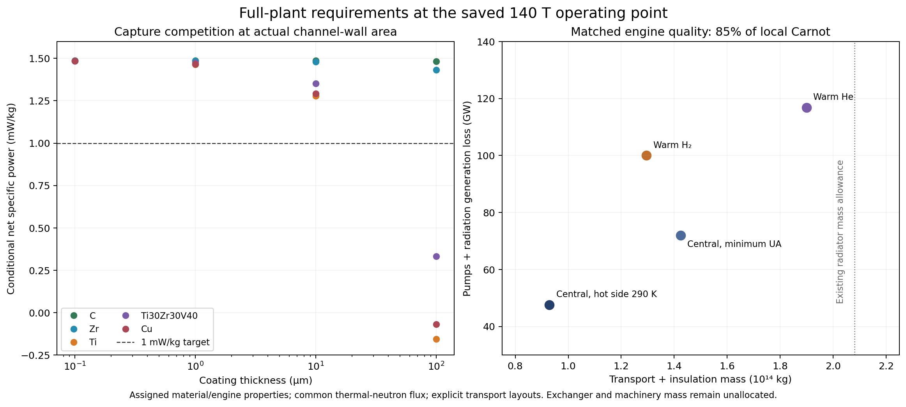

# Full-plant capture and heat-transport audit ✨

This independent audit adds two requirements to the saved 140 T protium plant: parasitic thermal-neutron capture in its channel walls and coatings, and explicit heat distribution between a roughly 30 km magnet and a radiator whose equivalent enclosing radius is 4,069 km. The calculations use the unchanged source profiles and nuclear ledger. They identify conditional engineering allocations; they do not establish a complete reactor or a deployment date.

The reference produces 2.15982 TW from 1.46565×10^15 kg, or 1.47363 mW/kg. It assigns 2.08053×10^14 kg to radiators and 291.584 GW to other auxiliaries. Hardware already covered by those allowances must be credited before any additional costs are charged.

## Neutron capture in walls, coatings and impurities

The saved geometry contains 6.07174×10^12 kg of carbon channel walls, 1.83150×10^10 m³ of water, and 4.21614×10^12 m² of channel inner surface. At that area, a micron coating is an industrial inventory, rather than a negligible surface treatment.

`capture_competition.py` computes material absorption inventories from the actual channel geometry and the [NIST NCNR 2200 m/s cross-section compilation](https://www.ncnr.nist.gov/resources/n-lengths/list.html). Each material sees a common equivalent thermal scalar flux. Catalyst-bank capture rates are held at the required network rates; the remaining light-fuel neutrons compete between hydrogen and parasitic absorbers. Carbon backing moves outward and thickens with the added coating to preserve its original thickness/radius buckling ratio; coating and added backing displace water. The calculation then closes the capture-stock, processing, D-plant, refrigerator, radiator and maintenance budgets again.

Bare carbon plus water oxygen consumes **0.2893%** of the available light-fuel neutrons. The original 99.5% capture assumption therefore has only about **0.2107 percentage points** left for all other losses in this common-flux screen. This is a constraint on the assumed capture efficiency, not a measured efficiency improvement.

| Surface material | Total loss with 1 μm | Total loss with 10 μm | Thickness preserving 99.5% capture | Thickness reducing this plant to 1 mW/kg |
|---|---:|---:|---:|---:|
| Carbon, 2,200 kg/m³ | 0.2898% | 0.2943% | 391.4 μm | Not reached within the geometric screen |
| Zirconium | 0.2975% | 0.3720% | 25.41 μm | 799.2 μm |
| Titanium | 0.6430% | 3.7247% | 0.5950 μm | 24.29 μm |
| Vanadium | 0.6650% | 3.9315% | 0.5600 μm | 22.87 μm |
| Copper | 0.6186% | 3.4951% | 0.6391 μm | 26.06 μm |
| Ti30Zr30V40, atomic proportions | 0.5147% | 2.5040% | 0.9345 μm | 37.99 μm |

The alloy is a specified example, with density calculated from additive elemental volumes. It is not a claim that every practical getter has this composition. Near zero thickness, the effective additional loss per micron is approximately 0.355 percentage points for Ti, 0.378 for V, 0.330 for Cu, 0.226 for the specified Ti/Zr/V alloy, and 0.0083 for Zr. These derivatives are specific to this wall area and water inventory.

The same calculation limits natural-boron contamination to **1.106 mass ppm in the water** or **3.335 mass ppm through the entire carbon wall** if 99.5% capture is to remain available. The corresponding 1 mW/kg thresholds are 45.46 and 137.1 ppm. Boron dopants therefore require an isotope specification: the NIST thermal absorption values are 3,835 b for B-10 and 0.0055 b for B-11. Enriched B-11 can greatly change this result. Conductive carbon, doped diamond, getter capacity, electrical resistivity, radiation damage and mechanical properties still have to be satisfied together.

The capture screen resolves the magnitude of a previously unallocated material term. It cannot decide a final coating thickness. Its flux ratios of 0.5, 1 and 2 show direct sensitivity to spatial flux. A neutron-transport model must include the actual coolant passages, moderator composition, structural material, catalyst arrangement, resonances, energy-dependent reactions and leakage. The specified shield transmissions remain unverified by this calculation. Parasitic-capture heat gets no credit, consistent with the old capture penalty; a final transport ledger should account for that heat and its gamma deposition explicitly.

The parent investigation's gas calculation also finds substantial proton ionization before a neutral molecule returns to a getter-coated wall. Thus a getter that fits the neutron budget does not by itself eliminate electron birth. Surface cleanliness, pumping, conductivity and neutron economy are a coupled materials problem.

## Heat-engine and central cold-loop requirements

The actual equations credit **14.1291 TW** of heat input to the nominal 70% heat engine, generating 9.89036 TW and rejecting 4.23873 TW. This exceeds the net nuclear output because circulation losses return through the thermal engine. A finite-difference calculation of the original plant independently verifies this heat input.

A 300 K source and 30 K radiator have a 90% Carnot ceiling. Finite heat exchangers reduce the available temperature difference. Let φ be an assigned fraction of the engine's *internal* Carnot efficiency, so η = φ(1−Tc/Tx). At η = 0.7, φ must exceed 0.77778 to leave any finite hot- and cold-side approaches. This φ is a thermodynamic performance assumption, rather than an ordinary turbine isentropic efficiency.

For a chosen φ, the code analytically minimizes the sum of hot and cold conductances. At φ = 0.8, the internal temperatures are 276.46 and 34.56 K and total conductance is **1.530×10^12 W/K**. At φ = 0.85, they are 243.57 and 42.98 K and total conductance is **5.769×10^11 W/K**. A central design can increase conductance to improve the cold-pipe temperature span; minimum conductance is not minimum plant mass.

The central-loop screen assumes helium at 0.1 MPa, Darcy friction factor 0.005, 80% pump efficiency, 1 GPa pipe working hoop stress and 1,600 kg/m³ pressure-wall density. Its total supply/return path is 8,138 km. The coolant uses half the cold-side temperature approach, leaving the rest for finite heat transfer. Fluid dissipation is included in the heat transported. Velocity is selected to minimize the combination of electrical demand, replacement energy and mass at the user's 1 mW/kg target.

| Engine assumption | Transport inventory + pressure-wall mass | Pump electricity |
|---|---:|---:|
| φ = 0.8, minimum total exchanger conductance | 3.613×10^14 kg | 172.3 GW |
| φ = 0.85, minimum total exchanger conductance | 1.424×10^14 kg | 72.0 GW |
| φ = 0.85, internal hot temperature 290 K | 9.292×10^13 kg | 47.6 GW |

The last row requires total conductance 1.613×10^12 W/K. These are explicit architectures, not universal mass lower bounds. The 0.8 case consumes 174% of the existing radiator mass allowance before panel, manifold and exchanger equipment. If its entire transport burden is additional, the recalculated plant falls to **1.0198 mW/kg**. Better engine quality or different distribution can materially change that result.

## Warm gas to radiator-local engines

`warm_distribution.py` explicitly distributes warm heat to engines located at radiator sectors. It uses [CoolProp 8.0.0's hydrogen equations of state](https://coolprop.org/fluid_properties/fluids/Hydrogen.html), based on Leachman et al., [JPCRD 38, 721–748 (2009)](https://doi.org/10.1063/1.3160306), and its helium implementation. Enthalpy and entropy differences determine the finite hot-stream efficiency. The two warm pipe legs retain separate bulk temperatures, densities, velocities and radiative losses.

The finite stream supplies distributed engines whose hot working temperature is 98% of the local gas temperature. For matched 70% conversion and φ = 0.85, a sampled hydrogen design uses **290→180 K** gas, a **40.007 K** engine sink, **256 radiator sectors**, and 0.1 MPa pressure. Each sector has a local cold-helium loop. The equivalent sector radius is 508.6 km.

The nominal warm-pipe Darcy factor is **0.01**, while local cold loops retain 0.005. Earlier 0.005 warm-pipe results were overoptimistic relative to their own ordinary smooth-pipe estimates. The code now evaluates the smooth Colebrook relation from the EOS viscosity and flags those sensitivity cases. The [NASA GFSSP manual](https://ntrs.nasa.gov/api/citations/20110015474/downloads/20110015474.pdf), equation 18, documents the relation. Nominal pipes remain subsonic with small fractional pressure drops. Actual joint losses and surface roughness still require a physical layout.

Warm pipes have an assigned effective emissivity 10^-4 and insulation mass 10 kg/m². Their 1 GPa pressure walls use the same density as the central case. At equal engine quality:

| Transport architecture | Allocated transport + insulation mass | Pump electricity + lost generation from pipe radiation |
|---|---:|---:|
| Central cold helium, minimum exchanger conductance | 1.424×10^14 kg | 72.0 GW |
| Central cold helium, 290 K internal hot temperature | 9.292×10^13 kg | 47.6 GW |
| Warm hydrogen, 256 sectors, 290→180 K | **1.295×10^14 kg** | **99.98 GW** |
| Warm helium, 64 sectors, 290→180 K | 1.899×10^14 kg | 116.79 GW |

The warm route demonstrates that reactor-to-radiator heat need not travel at 30–40 K. It does not establish that distributed engines minimize total plant mass. The warm hydrogen route also requires roughly 3.05×10^12 W/K of hot-side conductance and 4.24×10^11 W/K of cold-side conductance. A central design can trade larger exchangers for lower pipe mass and pump power.

The reported warm allocations include gas inventory, pressure walls and insulation. They do not yet include full turbines, heat exchangers, manifolds, junctions, installation, electric transmission or sector view-factor geometry. Radiation is calculated from the two leg temperatures and charged as lost generation; escaped radiation is removed from the 30 K radiator load to avoid counting it twice. Pump heat receives no recovered-electricity credit. Warm radiative temperature changes in the selected cases are below a kelvin, supporting their use as perturbations. Spin-isomer cases test para/ortho hydrogen thermodynamics, but do not model conversion kinetics or catalyst heating.

If all warm hydrogen transport is additional, the recalculated plant delivers **1.26305 mW/kg**. If half of the original radiator and auxiliary allowances are available for it, the result is **1.44401 mW/kg**.

The saved budget scenarios make available 0%, 50% or 100% of the original radiator mass and auxiliary power allocations before charging any deficit. They are alternative bookkeeping assumptions, not three independent hardware designs. Selecting 100% leaves the remaining radiator and auxiliary functions to fit whatever hardware allocation remains. A commissioning narrative can choose distributed engines for modularity, isolation and maintainability, but these calculations do not support claiming a necessary wholesale abandonment of central engines.

## Opaque-reactor construction constraint

The independent opaque candidate has total mass 6.789×10^25 kg, approximately 11.4 Earth masses. Using the existing economic report's 1.772 GJ/kg ideal Jupiter escape work, lifting that entire mass in 15 years would require approximately 2.54×10^26 W, or 0.66 solar luminosities, before manufacturing and transfer. This does not exclude a civilization already controlling a substantial fraction of stellar power. It does require a specified material source and construction system. A hydrogen or rubble absorber with specialized surfaces has a different industrial history from eleven Earth masses of manufactured carbon.

The prior pulse thermal screen remains the relevant local transient calculation. This audit adds no independent confirmation of its 32% cadence increase. A candidate exactly at 1 mW/kg requires any further heat transport, conversion and structural mass to be included in its stated budget or offset by an explicitly recalculated operating point.

## What computation can settle next

An actual material and channel layout would permit a neutron/photon transport calculation with confidence bounds on useful capture, leakage, coil heating and damage. It would replace the shared-flux capture approximation and prescribed shield transmission. The present results establish why coating composition and trace impurities belong in that model.

A radiator layout and specified engine cycle would permit coupled thermodynamic, hydraulic, heat-exchanger and structural optimization. The present calculations resolve the distinction between Carnot headroom, finite conductance and long-distance coolant inventory, and provide two explicit architectures. Tests remain necessary for achievable irradiated coating properties, superconducting field/stress performance, surface gas yields, exchanger fabrication and long-life machinery. The calculations do not establish that one material simultaneously supplies the assumed compression modulus, strength, conductivity, low absorption and radiation lifetime.

## Reproduction and validation

Use Python 3.10 with numpy, scipy, pynucastro and CoolProp 8.0.0. The parent scripts are imported from `docs/protium-fusion/`; the temporary runtime for this audit is `/tmp/protium-python`. Run each of the three calculation scripts, followed by its `validate_*.py` script. Inputs and outputs are hashed in `manifest.json`.

- Capture validation: **267/267**, including independent annular geometry, mixture atom counts, the original plant at changed capture efficiencies, ledger closure and threshold roots.
- Central heat validation: **305/305**, including the original plant's heat derivative, numerical exchanger optimization, independent hydraulic roots and mass/energy closure.
- Warm distribution validation: **1,330/1,330**. It independently integrates EOS heat capacity and cp/T, checks the separate pipe legs, solves flow roots, reconstructs accounting and tests optimizer neighborhoods.

The implementations deliberately expose assigned coefficients and unresolved geometry. Passing these checks verifies the stated mathematics and accounting, rather than proving that the equipment can be built.
