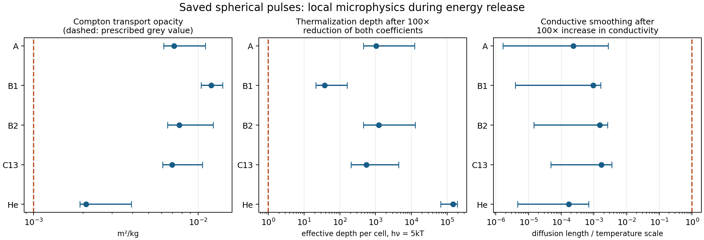

# Opaque-pulse transport and EOS checkpoint ✨

The saved spherical pulses have large local photon-thermalization margins during their energy release. Electron conduction is too slow to smooth their resolved temperature profiles appreciably in this diagnostic. The more consequential microphysical gap occurs earlier: extrapolating the fully ionized ideal equation of state into dense, relatively cold fuel contact gives unreliable pressure and entropy. A physical driver calculation needs a partially ionized, nonideal EOS before its initial state can be matched to these pulses.

This checkpoint postprocesses existing trajectories. It calculates no new hydrodynamic solution, corrected gain, practical reactor output or deployment date. Numerical results belong to the research record; future article events require their own worldbuilding decisions.

## Inputs and weighting

The main sample contains the 128-cell A, B1 and B2 compression pulses and the 64-cell C13 and helium-factory pulses. Their full spatial traces are in `/tmp/protium-research`; SHA-256 identities match `compression-traces.json`. The physical durations are respectively 684, 4,114, 631, 233 and 29.2 microseconds. Sampled peak temperatures are 1.38, 0.456, 1.54, 1.50 and 1.59 GK. Sampled peak densities are 1.48e8, 1.04e6, 1.38e8, 9.91e7 and 9.93e9 kg/m³. Metadata can retain slightly higher peaks between saved outputs.

Quantiles below weight each cell and saved time by positive nuclear mass-defect changes between checkpoints, with half each interval's increment assigned to each endpoint. They characterize where and when sampled energy release occurs. They are not reaction-resolved rate integrals. Initial-state quantiles instead weight shell mass. Abundances with tiny negative integration residuals are clipped and baryon-normalized for this diagnostic.



Points show medians; bars span the 1st–99th weighted percentiles. The middle and right panels deliberately change coefficients by factors of 100. Those sensitivity factors are not established error bars or rigorous bounds. The dashed unit lines mark optical depth one and a conduction length equal to the resolved temperature scale.

## Scattering and true absorption

A relativistic Fermi integral independently solves charge neutrality, including thermal pairs. The [Poutanen Compton transport fit](SOURCES.md#compton-scattering) then supplies a temperature- and degeneracy-dependent scattering opacity. Its published wide fit covers 2–300 keV and electron degeneracy parameter −10 to 7. Less than 1e−12 of sampled positive nuclear-energy weight lies outside that domain in any main run. Total electron-plus-positron density is used as a pair-scattering approximation; an exact pair kernel would refine the hotter C13 tail.

| Stage | Compton opacity, median [1st–99th percentile], m²/kg | Free-free absorption at hν=5kT, median, m⁻¹ | Effective cell thermalization depth, 1st percentile | Absorption relaxation time, 99th percentile |
|---|---:|---:|---:|---:|
| A | 0.00713 [0.00618–0.0111] | 1,784 | 45,575 | 26.6 ps |
| B1 | 0.0120 [0.0105–0.0141] | 6.79 | 2,153 | 2.91 ns |
| B2 | 0.00771 [0.00651–0.0124] | 1,984 | 45,515 | 34.0 ps |
| C13 | 0.00696 [0.00608–0.0106] | 956 | 20,640 | 60.0 ps |
| He | 0.00208 [0.00191–0.00394] | 9.75e6 | 6.64e6 | 3.73 fs |

The old grey transport parameter is 0.001 m²/kg. The calculated scattering values suggest that this parameter permits faster diffusion than Compton scattering alone in the energy-releasing material. Separate Rosseland means cannot simply be added to obtain an exact total Rosseland mean; a replacement transport calculation must combine frequency-dependent processes consistently.

[True absorption](SOURCES.md#free-free-emission-and-absorption) is evaluated independently from the classical free-free coefficient with Gaunt factor 1.2. At photon energy 5kT, the diagnostic uses

`τ_eff = Δr sqrt[3 α_ff (α_ff + ρ κ_sc)]`, and `t_abs = 1/(c α_ff)`.

Kirchhoff's law is checked by integrating the frequency-dependent absorption against the Planck spectrum and recovering the frequency-integrated emissivity. Scattering opacity has never been substituted for absorption. The free-free estimate needs relativistic, degeneracy and collective-plasma corrections for precision: the helium factory has median Fermi energy/kT ≈4.71, while its 99th-percentile plasma-frequency energy/kT ≈0.645. The CNO runs are much less degenerate but reach mildly relativistic electron temperatures. These limitations prevent treating the classical coefficient as a certified lower bound.

Nevertheless, reducing **both** absorption and scattering coefficients by 100 leaves the 1st-percentile cell thermalization depth above 21 in every case. The 99th-percentile absorption-time/local-variation-time ratio remains below 0.012. A stronger reduction by 10,000 ceases to support rapid relaxation in the B1 tail; that stress test is recorded rather than described as passing. The local variation time comes from the saved density and temperature histories, capped by the pulse duration. Narrow shock structure and faster changes between outputs remain unresolved.

Radiation carries median fractions 0.675, 0.893, 0.666 and 0.717 of internal energy in A/B1/B2/C13, but only 0.00725 in the degenerate helium factory. The original radiation pressure and energy therefore matter greatly in CNO pulses. These trapping checks support their local LTE treatment in the sampled hot interiors. They do not validate the expanding photosphere, a spectral escape calculation, irradiation of incoming fuel, or a different driver geometry. Those require transfer through the actual surrounding material.

## Electron conduction and temperature equilibration

The [conductivity sensitivity model](SOURCES.md#conductivity) takes the larger of classical Lorentz-gas conductivity and a degenerate electron–ion conductivity, using Coulomb logarithm one and omitting electron–electron resistance. This is a deliberately conductive comparison, not a physical interpolation or a proven upper bound. A second sensitivity multiplies it by 100.

The base median diffusion lengths over the local variation time are 2.41, 6.48, 1.52, 0.920 and 1.44 mm for A/B1/B2/C13/He. The 99th-percentile ratio to the resolved temperature-gradient length is below 3.5e−4 in every run. Multiplying conductivity by 100 multiplies diffusion lengths by ten, leaving these bulk-gradient ratios below 0.0035.

Frozen-profile conductive luminosities integrated across each internal interface give maximum single-interface transfer fractions of nuclear energy of 5.10e−9, 4.71e−9, 5.43e−9, 1.26e−8 and 5.52e−7. Summing the absolute transfer over all interfaces overcounts energy that crosses several faces and depends on resolution. That sum is 2.3–3.1e−7 for the CNO cases and 4.6e−6 for helium. It is not escaped energy. The summed interface transfer and the absolute-divergence redistribution measure roughly double from 64 to 128 cells, while maximum single-interface values change by 9–25%; no converged conductive correction is claimed. Even 100-fold coefficient sensitivities remain small on these saved profiles. A very thin reaction front, an external hot contact or fuel that enters with a different gradient needs its own calculation.

A separate classical equal-temperature electron–ion exchange estimate with Coulomb logarithm one gives 99th-percentile equilibration-time/variation-time ratios below 4.9e−6 for CNO and 9.1e−9 for helium. Its normalization matches the NRL formula within the rounding tolerance. Degenerate, strongly coupled and relativistic corrections still belong in a production operator; these numbers chiefly identify a large time-scale separation in the bulk plasma.

## Coulomb terms, screening and the incoming fuel

The [ion–ion free-energy correction](SOURCES.md#coulomb-free-energy-and-screening) uses the published one-component-plasma fit with linear mixing and a rigid electron background. Electron polarization and mixing corrections remain omitted. During sampled burning, median pressure corrections are below 0.1% for CNO and 0.19% for helium. At the saved initial inflow they are larger:

| Stage | Initial median ion–ion pressure reduction | Initial 99th-percentile reduction | Initial ion–ion energy correction / prepared input |
|---|---:|---:|---:|
| A | 4.95% | 23.6% | 0.673% |
| B1 | 0.547% | 2.85% | 0.0861% |
| B2 | 3.56% | 17.5% | 0.484% |
| C13 | 4.03% | 15.4% | 0.550% |
| He | 0.824% | 3.63% | 0.116% |

Screening factors from the Chugunov–DeWitt model have CNO medians around 1.007–1.014 and 99th percentiles around 1.017–1.062 for the important proton captures. The helium sequential alpha-capture factors are larger: medians 1.049 and 1.090 for alpha+alpha and alpha+Be8. A complete triple-alpha treatment uses their joint product with the appropriate reaction convention. Faster ignition changes convergence and can reduce peak compression; multiplying an old yield by a screening factor would be unjustified. Forward and reverse rates must remain thermodynamically consistent with the EOS.

The driver agent's fully ionized isentropic backmap reaches approximately 0.252–0.256 MK at 2,000 kg/m³ for A/B2/C13. At those hypothetical states the fully stripped ion coupling parameters are 18–23, and the same ion–ion model produces pressure corrections of 44–58% of the ideal pressure. Hydrogenic K-shell binding energies are 22–30 kT, with K-orbital radii only 5–7% of the ion-sphere radius. These are strong warnings that bound electrons and nonideal thermodynamics cannot be omitted. They are not corrected ionization fractions or an alternate pressure solution.

An isolated-atom hydrogenic upper estimate, omitting electron–electron repulsion, places total ionization energy at 10–14 GJ/kg. This is less than 0.5% of whole prepared input energy but 3.7–5.8 times the ideal internal energy at contact for A/B2/C13. Thus a modest whole-pulse energy correction can radically alter the inferred contact entropy. The B1 continuation is warmer, 9.08 MK, with coupling parameter 0.642 and a 1.08% pressure correction. The helium continuation reaches the existing 100,001 K table floor before 2,000 kg/m³ and is not extrapolated.

## Recommended next calculation

1. Establish the driver contact and shock history using a partially ionized free-energy EOS, with degeneracy, Coulomb contributions and ionization represented consistently. Compare its Hugoniots and entropy changes with the ideal backmap. This is the highest-priority microphysical change for the current candidate.
2. Once a physically specified inflow exists, evolve the hot phase with the same nonideal free energy, consistent screening/reverse rates, and temperature/composition-dependent transport. Keep radiation thermalization distinct from momentum scattering. A multigroup treatment is most valuable where hot pulse radiation meets cold incoming material and near the photosphere.
3. Resolve shock-front and mixing scales before using the small bulk conduction diagnostic to omit interface transport. Retain separate electron/ion temperatures if the actual driver creates a nonthermal or collisionless interface.

No new large hydrodynamic jobs were launched for this checkpoint.

## Reproduction and verification

`microphysics.py` contains the coefficients; `audit.py` extracts trajectories; `contact_screen.py` consumes the driver table. `checkpoint.py` creates the compact resolution comparison and figure. The compact JSON files retain the output tables and input identities. Regenerated spatial arrays remain in scratch because they duplicate existing traces.

From this directory, with the installed research dependencies available:

```bash
PYTHONDONTWRITEBYTECODE=1 OPENBLAS_NUM_THREADS=1 NUMBA_CACHE_DIR=/tmp/protium-numba MPLCONFIGDIR=/tmp/protium-mpl PYTHONPATH=/tmp/protium-python python3 audit.py --trace-dir /tmp/protium-research --out /tmp/protium-pulse-transport
PYTHONDONTWRITEBYTECODE=1 OPENBLAS_NUM_THREADS=1 NUMBA_CACHE_DIR=/tmp/protium-numba MPLCONFIGDIR=/tmp/protium-mpl PYTHONPATH=/tmp/protium-python python3 contact_screen.py --out /tmp/protium-pulse-transport
PYTHONDONTWRITEBYTECODE=1 OPENBLAS_NUM_THREADS=1 NUMBA_CACHE_DIR=/tmp/protium-numba MPLCONFIGDIR=/tmp/protium-mpl PYTHONPATH=/tmp/protium-python python3 validate.py --trace-dir /tmp/protium-research --out /tmp/protium-pulse-transport
```

`--repo` can override the default parent research directory. Repeating the resolution check uses `audit.py --stems compression-A-64-full-burning compression-B1-64-burning compression-B2-64-burning --out /tmp/protium-pulse-transport/resolution`; copy its JSON to `resolution-audit.json` before running `checkpoint.py --out /tmp/protium-pulse-transport`.

All **87 checks pass**: relativistic Maxwell–Jüttner and Fermi-integral controls; independent source-EOS comparisons; 128→256 quadrature refinement including real sampled states; charge neutrality; Kirchhoff normalization; published Compton-fit comparison; free-energy derivative and weak-coupling limits; independent conductivity and exchange normalizations; trace identity and physical ordering. This establishes mathematical and input consistency. It provides no experimental validation of a reactor.

## Smaller open compression range: selected 2048 history

The independently extracted `small-pulse-check.json` identifies the driver's completed 64-cell scaled A trace and metadata by SHA-256. This prescribed-hot-inflow calculation contains **1.13097e13 kg**, delivers **3.49316e25 J**, and runs for **68.4 microseconds**. It gives capture-stage nuclear/input gain **8.182**, conversion **53.84%**, peak temperature **1.149 GK**, and sampled peak density **1.879e8 kg/m³**. Its initial outer radius is 170.9 m and minimum sampled outer radius 71.4 m; the 30 m input parameter is a reference scale. Reduced-network, spherical, prescribed-inflow qualifications remain in force.

The actual smaller trajectory retains strong local opacity. During energy release, median Compton transport opacity is **0.00720 m²/kg**. Its 1st-percentile effective cell thermalization depth is **17,007**. Dividing both scattering and absorption coefficients by 100 leaves that depth at **170** and the 99th-percentile absorption-time/local-variation-time ratio at **2.95e−4**. These checks use the same qualified diagnostic coefficients as the main audit. The opaque burning material supplies this trapping independently of an external collector shell. Prompt 7.297 MeV capture photons also have a short scattering scale: the stationary-electron Klein–Nishina estimate gives about 0.00205 m²/kg for the initial mixture. [NIST nitrogen data](https://physics.nist.gov/PhysRefData/XrayMassCoef/ElemTab/z07.html) at 6–8 MeV provide a compatible material attenuation scale; neither substitutes for full dense-plasma gamma transport.

The chosen fictional measurement **Q=2.6** means **9.082e25 J** of capture-stage nuclear release at the same delivered input, corresponding to approximately **17.1%** conversion. It fits below this simplified calculation's result. Merger shocks depositing entropy before maximum compression, uneven shock arrival and premature expansion provide a physically sensible explanation for reduced conversion. The numerical work has not calculated that reduction or demonstrated an apparatus capable of achieving it. The cold-driver surrogate remains unresolved: coarse runs burn poorly, the 64-cell run fails numerically, and 128-cell runs reach a temperature guard with strong viscosity sensitivity. Their stopped gains cannot be used as completed physical experiments.

An open range can use partial collectors and avoid the old full enclosing plant. Its collector and sunlight view factors still determine incoming-fuel preheat, and the accelerator, pellet material, focusing, merger uniformity and isotope recovery remain engineering requirements. At this selected gain, input plus nuclear energy is 1.258e26 J: isotropic-equivalent total energy fluence is about 10.0 MJ/m² at 1e9 m or 0.100 MJ/m² at 1e10 m. These are combined matter-plus-radiation energy budgets, not prompt photon fluences. At illustrative driver efficiency 30% and heat conversion 40%, even full collection returns only **43.2%** of source electricity; partial collection returns less. Thus the chosen event establishes a capture-stage target gain. Hydrogen-to-helium cycle closure, recycled catalyst and plant electricity remain separate milestones.

Reproduce this extraction with `python3 small_pulse_check.py --out /tmp/protium-pulse-transport` under the same dependency environment as the main audit. Its JSON contains the input identities, coefficient/extractor hashes, physical-ordering checks, computed trajectory diagnostics, and separately identified fictional choice with its conservation requirements.
