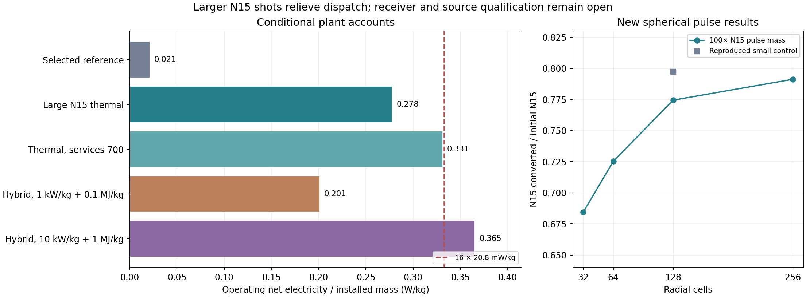

# Second-generation staged CNO reactor assessment ✨

Research run: 7–8 November 2026. **A higher-throughput candidate is worth developing, but a physically qualified 16× improvement has not been established.** The useful starting point is the newer delivered-source, recovery, assembly and stability research. The 20.784 mW/kg selected plant supplies a reproducible comparison.

The strongest scheduling change tested here is a **100×-mass N15 pulse**, retaining the existing N15 composition, density and velocity profile while scaling its linear dimensions by 4.642. Completed 128/256-zone spherical calculations convert 77.45%/79.13% of initial N15, compared with 79.74% in the reproduced 128-zone small-pulse control. This replaces thousands of small shots with hundreds of larger shots. A 16× helium-throughput account then gives **about 0.278 W/kg**, or **13.4×** the selected reference, with 1600 K useful heat pickup, 400 K radiators and the retained 1000 kg/m² service allocation. These remain apparatus requirements conditional on source formation, heat capture and completed component designs.

Approximately 16× specific power means 0.333 W/kg. A 700 kg/m² service allocation gives about 0.331 W/kg in the same comparison. A high-performance hybrid can exceed that target in the allocation model, provided it attains both 10 kW/kg complete input-peak conversion hardware and 1 MJ/kg usable electrical storage. Those equipment requirements, surface life and cold-packet survival remain open. The report therefore recommends a **large-N15, locally buffered thermal candidate**, with direct conversion retained as a competing development branch. It leaves the Infinite Wiki article and accepted plant point unchanged.



## Evidence used and the newer designs

Read the [mixture account](../mixture-design/README.md), [selected point](../mixture-design/selected-plant/point.json), [final family](../component-design/final-family/README.md), [chronological dispatch](../component-design/final-family-dispatch/README.md), [receiver](../component-design/final-receiver.md), [direct recovery](../cold-sink-redesign/direct-recovery.md), and the later [catcher/recovery account](../component-design/catcher-followup/README.md), including its gas, heat-spreading, barrier and complete-plant studies.

The active local work is pinned in [newer-research-snapshot.json](newer-research-snapshot.json), including source paths and SHA-256 hashes:

- The 2 November larger-radius N14 controls give prompt gains 8.97, 9.50 and 10.21 at 45, 60 and 90 m reference radius. They use an earlier N14 mixture and increased prepared energy. They provide no demonstrated reduction of driver work.
- The second-generation tamper note prioritizes source geometry, a following fuel layer and lower-speed inflows. It explicitly records that its proposed tampered and selected-mixture lower-energy configurations had not been simulated.
- The 3 November B1 radial preparation continuations retain 97.75%, 92.14% and 84.69% of the prescribed output for the reference-entropy, quarter-contact-heat and full-contact-heat cases. Preparation entropy affects the result materially.
- The 5 November reactive-B1 work tests a joint launcher budget: 0.5 µs independent timing RMS, 0.15 µs coherent hemispheric timing, 1.5 nrad pointing RMS per axis, 1.5 ppb speed RMS, 1% group loading RMS and 5 V charge RMS, with separately stated coherent limits. Its AMR comparisons pass their stated matched-model checks. For example, fixed/adaptive nominal 2 m calculations retain 90.409/90.428% of the stated reference. These are prepared-fluid calculations with a restricted reaction model, rather than a completed cold source or a qualification of the enlarged pulse.
- The [Stage A instability study](../../protium-stability-study/README.md) retains its own 90%-of-smooth-yield criterion and distinguishes timing, angular direction count and earlier merger entropy. Its launcher deadline belongs to that historical campaign; this run uses new, bounded spherical calculations.

`origin/main` was refreshed on this run. Relevant newer guidance was read alongside the local instructions. Existing unrelated changes were preserved. The external source/output directories above were read without modification.

## Actual new pulse calculations

[pulse_probe.py](pulse_probe.py) uses the delivered B1 hot profile and current carbon median rates, with the existing compression-cap viscosity, gray opacity 0.001 m²/kg, electron/positron EOS and 27-isotope hydrodynamic network. Radius is scaled at fixed density, temperature, composition and velocity. Prepared energy scales with mass; velocity reductions apply to kinetic energy only. The source assembly of the scaled profile remains a qualification.

| N15 mass multiplier | Velocity multiplier | Radial cells | N15 conversion | Prompt deposited nuclear / prepared energy |
| --- | --- | --- | --- | --- |
| 1 | 1 | 32 | 0.67592 | 6.60472 |
| 1 | 1 | 128 | 0.79738 | 7.95640 |
| 100 | 1 | 32 | 0.68453 | 6.69094 |
| 100 | 1 | 64 | 0.72528 | 7.22142 |
| 100 | 1 | 128 | 0.77451 | 7.72926 |
| 100 | 1 | 256 | 0.79128 | 7.89773 |
| 100 | 0.8 | 128 | 0.02531 | 0.37685 |

Every listed calculation reached its requested physical final time. The 128-cell small control reproduces the archived selected conversion to about 7×10⁻⁹ absolute. The large-pulse 64→128 difference is substantial; the subsequent 128→256 change is 2.165%. This supports useful burn in the larger spherical profile while leaving a converged yield and matched 256-cell small control open. The 256-cell integrated cycle uses 1.94135 MeV preparation/He and gives 0.2781 W/kg under the same plant allocations; the principal 128-cell account below is slightly more conservative. See [validation](validation.json).

Doubling the large 128-cell run duration from 381.9 to 763.8 µs leaves nuclear conversion unchanged. Outgoing kinetic energy rises from 2.498×10²⁶ to 2.618×10²⁶ J, while escaping radiation rises from 8.916×10²⁴ to 1.342×10²⁵ J and advected internal energy falls. A stable nuclear yield does not establish an already terminal kinetic/photon partition. Those transport differences must be carried into the final receiver design.

The 80%-speed case fails to retain useful N15 burn despite its reduced preparation. Its integrated quartet needs about 14.50 MeV of preparation per net helium, versus 1.94 MeV in the selected family. A slower arrival window is a scheduling option only when a completed pulse preserves useful gain. The fixed-temperature time-stretch network controls are distinct from this actual slower hydrodynamic calculation.

[integrate_probe.py](integrate_probe.py) closes the full quartet for each successful probe using actual outgoing composition and cold decay. The 128-cell large pulse requires 1.29070 N15 attempts per net helium and 1.95507 MeV total preparation. Its non-neutrino nuclear energy remains 24.71593 MeV/He. The quartet boundary supplies fresh C:H = 0.0003370, principally retained oxygen. A separate linear precursor-radiation increment is included once; new cold preparation is still to design. [Complete cycle records](probe-cycles.json).

## Dispatch, geometry and buffers

The original 99.9%-mass serialized occupancy is 0.683806: N15 alone uses 0.673103. Thus unchanged pulses permit at most 1.462× continuous throughput in one chamber. At 16× the load is 10.94 chamber-years per year. Merely overlapping incoming and outgoing legs still requires 7.72 chamber-years, even before resolving counterstream interactions.

With a 100× N15 mass and frozen per-attempt yield, 16× throughput occupies 27.89% of the calendar. The actual integrated large-pulse composition raises this slightly; its separate chronology is saved in [plant-results.json](plant-results.json) and [spherical-large-n15-16x-events.csv](spherical-large-n15-16x-events.csv). The frozen-family control has 1859 shots in 370 days, maximum delay 8951 s, and minimum focus separation 4145 s. N15's nominal interval becomes 13.37 hours. The corresponding 30×-mass scheduling comparison occupies 53.0%; its burn and receiver response have not been simulated here.

This large-pulse candidate uses one reaction centre and keeps the main incoming/outgoing windows serialized. Slow tails remain inside the material account. Their interaction with later packets and the separately delivered seed still need a coupled source/chamber calculation.

Parallel centres supply another geometry, with real costs. Eleven independent serialized lanes make the old 16× pulse count schedulable at 99.46% mean lane occupancy. Identical independent receiver spheres duplicate their surface plant. Packing equal-volume subchambers within a fixed volume increases total enclosing area by N^(1/3), about 2.22 for eleven. Source lengths, shields, radiator view and collision boundaries must then be rebuilt. Multiple off-centre foci inside one receiver create intersecting plumes and nonuniform fluence; local geometric fluence scales as inverse distance squared. The lane schedule is a kinematic comparison, not evidence that these shared volumes work.

For counterstreaming, a shell's mass column is M/(4πr²). A large 1.13×10¹³ kg pulse gives about 9×10⁻⁷ kg/m² at 10⁹ m and 0.9 kg/m² at 10⁶ m. Incoming packets crossing the latter encounter an energetic material layer. Centre timing, solid-grain stopping and gas/plasma collisions must decide whether an overlap can survive. No output gain is credited for unqualified overlap.

## Whole-plant energy and mass

[plant.py](plant.py) records explicit source, converter, storage, radiator, maintenance, support and reserve terms. Its constructive six-group regenerative Brayton comparison has a 1500 K turbine inlet, 450 K compressor inlet, 93% compressor/turbine stage efficiencies, 95% recuperation, 98% generator efficiency and 3% pressure loss. After its separately declared pump and mechanical losses, package electrical efficiency is **54.57%**. The stronger 97% stage / 98% recuperation case gives **60.54%** and requires a larger exchanger package. Both are future component specifications. External Carnot efficiency at 1600/400 K is 75%.

The 128-cell large-N15 thermal row, before oxygen-return work, has:

| Whole plant at 16× reference helium rate | Value |
| --- | --- |
| Non-neutrino nuclear supply | 2.630×10²² W |
| Prepared pulse input | 2.080×10²¹ W |
| Driver electricity | 3.467×10²¹ W |
| Useful engine heat | 2.646×10²² W |
| Package thermal electricity | 1.444×10²² W |
| Net export | **9.873×10²¹ W** |
| Installed mass | **3.555×10²² kg** |
| Net / installed mass | **0.2777 W/kg** |
| Cold radiator coverage at 400 K | **83.5%** |

The 350 kg/m² receiver, 100 kg/m² insulation, 1000 kg/m² services, about 188 kg/m² input-peak driver hardware and 89 kg/m² two-pulse driver storage dominate the unreserved fixed mass. Thermal converters add about 95 kg/m², average driver conditioning 23 and heat exchangers 6, before local loop-interface additions within services. Radiator panels require about 17 kg/m² of shell area. Installed reserve is 20% of the solved total, with spares, throughput-based refurbishment machinery and support added explicitly.

The source's largest electrical rating remains about 2.86×10²³ W at the original 100 W/kg input-peak allocation. Average driver electricity is about 3.47×10²¹ W. The separately booked driver store is 1.358×10²⁶ J at 100 kJ/kg. Increasing throughput does not automatically multiply pulse-peak hardware or this store; duty, recharge, switching and life must nevertheless be qualified. A doubled source-hardware mass lowers the frozen-family thermal comparison from 0.278 to 0.253 W/kg.

At 400 K a gray ε=0.9 face emits 1306.45 W/m², sixteen times the 200 K emission. This is a cooling opportunity, rather than a direct sixteenfold plant-power result. The 20× thermal-throughput row reaches 0.342 W/kg but requires 104% radiator coverage and fails the 90% exterior-area constraint.

### Direct and combined conversion

The selected family carries 19.57 MeV/He of outgoing bulk kinetic energy, including returned preparation energy. The ledger is:

`Eexport = D − Lstorage + ηh[eligible(H + U) − D − bypass] − U/ηdriver − auxiliaries − maintenance − support`.

`D` is gross directly converted kinetic energy. It is subtracted from the thermal source. Driver electricity is charged once regardless of whether direct output supplies the driver. Storage and auxiliary heat enter their stated cold channels. This identity closes against non-neutrino nuclear supply.

For the actual final source family, the largest reconstructed kinetic peak is approximately **0.955 MW/m²**, or **1.45×10²⁵ W** over the receiver. This supersedes using the older 64-zone C13 source's 0.636 MW/m² without checking its family. At 70% direct recovery, 90% output-storage round trip, 1 kW/kg complete input-peak collector rating and 100 kJ/kg storage, the conservative hybrid comparison gives about **0.201 W/kg**. Converter mass is about 955 kg/m², with about 919 kg/m² output storage including the bounded dispatch-delay allowance. The driver store remains separate.

Improving only the converter to 10 kW/kg gives 0.260 W/kg; improving only usable output storage to 1 MJ/kg gives 0.258. Improving both gives a conditional **0.365 W/kg**, above 16× the reference. The exact storage waveform/export-sharing design can reduce a conservative sum-of-stage-pulses allocation, but any credit must follow the joint calendar and respect charge/discharge peak ratings. Pulsed export transfers that obligation to the receiving grid and loads.

Electrostatic recovery has useful arrival-time/velocity ordering, but needs local electron diversion, species/charge routing, secondary-electron suppression, neutral control and roughly MV retarding potentials. The [primary experimental evidence](sources.md) establishes the mechanism at much smaller systems. Inductive recovery preserves quasi-neutrality but needs time-dependent currents and load-coupled electric fields. The older plume screen's kilometre-scale ion inertial length and hundreds-of-metres gyroradii matter to coil geometry. A small magnetic-pressure field estimate alone supplies no compact converter. Both branches must include electrodes/coils, return circuits, fields, switching, protection and storage in their complete peak rating.

## Receiver, source survival and operating costs

[thermal.py](thermal.py) reconstructs ballistic kinetic/internal and delayed-decay arrival waveforms from the actual profiles and applies the verified finite-depth graphite conduction kernel. With 350 kg/m² and cp=1800 J/(kg K), the sum of periodic pulse-energy storage ranges is about 243 K. The stated dispatch-delay allowance adds about 26 K. Isolated nonuniform extrema plus these storage bounds give material-phase screens of approximately 2717, 2222 and 2049 K at backing conductivities 50, 200 and 500 W/(m K). These are intentionally conservative sums, rather than an observed new-calendar maximum. The 150 µm damaged skin, posts and contacts add further resistance.

The large N15 prompt fluence is 0.586 MJ/m² at its first endpoint, versus 0.01445 MJ/m² for small N15. Holding the old spectrum/deposition profile and widening the emission time in proportion to source radius gives a **1032 K flash-rise proxy** from the previous 54.81 K small-pulse result. Later radiation changes the full partition, and a new spectral/depth calculation must replace this proxy. It does not establish an exact surface temperature or failure probability.

**Receiver service life is the immediate gate on claiming a 1600 K design.** The previous 1000 K damaged-surface, gas retention, carbon-emission and heat-pipe accounts cannot be transferred unchanged. Carbon vapor/redeposition can spoil incoming packets even when little receiver mass is removed. Creep, joints, irradiation conductivity, channel leakage and emitter morphology need their actual new histories.

[equipment.py](equipment.py) finds useful local transport scales. At 2 MPa helium, a selected 100 MPa wall allowable and 20 K loop temperature spans, 30 m hot/cold territories need about 71 kg/m² of header wall and helium, with 7.94 W/m² pumping. At 100 m the header inventory is 236 kg/m²; at 1 km it is 2364 kg/m². The 700 kg/m² service comparison therefore requires genuinely local loops, plus qualified 1570 K pressure walls, interfaces, pumps and joints. Exchangers are sized at 10 W/(K kg); a heat-transfer coefficient without compatible pressure drop is insufficient.

Cold equipment needs a separate temperature design. Scaling the newer warm-buffer collection account to 16× throughput and sixteen times the He-sorber area gives about **378 W/m²** of named electrical loads when its cold surfaces directly view a 400 K environment. The re-solved export falls to 0.146 W/kg and radiator coverage rises to 107%, failing the area constraint. Keeping the original sorber area is a different capacity requirement; its unguarded comparison still consumes about 84 W/m².

An actively cooled **200 K radiation intercept** around the guide and He collector is more promising. The 65 K guide and 5 K refrigerators reject directly to 400 K; their electrical dissipation is not sent through the 200 K refrigerator. With the retained 15%-of-Carnot guide COP, a 30%-of-Carnot He refrigerator, explicit guard cooling and warm motors/repair, the sixteen-area case requires **70.18 W/m²**, just inside the main row's approximately 72.15 W/m² ordinary-auxiliary allowance. This electricity is booked within that allowance once. Header pumping fits inside the engine's separate 1%-of-heat pump allocation. The remaining electrical margin is only about 2 W/m². Halving the assumed He refrigerator quality gives about 0.271 W/kg after re-solving. Guard geometry, extra equipment mass, cold-bank cycling and new-temperature leakage remain qualifications.

Gross fuel preparation/capture rises to roughly 6.6×10⁸ kg/s, circulating CNO to 5.6×10⁸ kg/s and returned hydrogen to 5.2×10⁷ kg/s. Thirty days of CNO hold requires roughly 1.5×10¹⁵ kg, small relative to installed plant mass but requiring an actual stock/transport design. Even a declared 10 GJ/kg circulation process consumes less than 0.1% of export in the reference scaling. Processing receiver bulk rather than fuel can cost much more; treated depth and frequency must be stated.

At the 100,000-outlet reference, 1 cm, 1000 kg/m³ grains require about **1.6 million grains/s per outlet on average**. A 700 s large-shot supply comparison requires about **39 million grains/s per outlet** and 429 A of charged-grain current during that supply. The 6.55 cm equal-radiative-dose alternative reduces those counts to about 5600/s average and 138,000/s during supply, with about 65 A, while increasing the reference acceleration length to approximately 6.75×10⁸ m at 10 MV/m. These source-rate comparisons remain separate from the exact profile's larger peak electrical rating. Grain manufacture, measurement, steering and neutralization need apparatus capable of that actual pulse duty.

The existing cap's NRT scaling becomes about 56 proxy dpa/year at 16× particle throughput. This counts damage opportunities, rather than surviving defects or a lifetime. Renewing an entire 100 nm face after every new shot costs about 0.023 W/m² at 2 MJ/kg and 1.16 kg/m² of factory capacity at the inherited coefficient. Monthly 150 µm rework costs 0.228 W/m² and 11.4 kg/m². More frequent deep rework, electrical regeneration, gas extraction and lost operating time need explicit entries. At 90% availability, a 0.278 W/kg operating point averages about 0.250 W/kg over the calendar.

The guide polymer's old dose proxy also scales to about **0.695 MGy/year**. Selecting 1 MGy between service operations would require about 14.4 kg/m²/year of polymer rework, 46 kg/m² of processing capacity and 0.91 W/m² at the declared 2 MJ/kg process cost. Selecting 0.1 MGy makes these terms ten times larger and exceeds the narrow electrical margin. These are service-trigger scenarios, with no measured radiation lifetime or mandatory fresh-polymer loss assigned.

At 1600 K, gray full-flight capsule dose rises by 6.55× relative to 1000 K. Equal-dose alternatives include increasing a 1 cm grain radius to 6.55 cm, reducing exposed flight to about 1.68×10⁸ m, or reducing the assumed absorptivity from 0.022 to 0.00336. These are dose scalings. Larger grains lengthen electrostatic acceleration, longer protected tubes intercept outgoing energy, and actual 1600 K reflectors/neutralizer coatings need new thermal-mechanical calculations. None receives a free source-mass credit.

That gray comparison assumes a 1600 K cavity. The hotter transient receiver faces and the new emission spectrum can add capsule dose and must enter the final flight history.

## Oxygen, uncertainty and the decision

The [extended-network account](oxygen-network.md) treats CNO-II/III material as useful catalyst inventory and calculates its return costs. With the frozen rate set, actual oxygen production can be balanced by approximately 1.4% O16 admixture across the host pulse attempts, or modest dedicated large-shot occupancy. A new oxygen stream equal to 1% of catalyst throughput is hundreds of times the plant's own production; its cost is correspondingly different. Quarantined nuclear breakout is tiny in this model, whereas eventual material escape/export can dominate catalyst makeup.

Consequential engineering judgments are kept separate from simulation intervals:

| Conditional parameter | Central judgment | Subjective 80% interval | Meaning / acceptance |
| --- | --- | --- | --- |
| Thermal package efficiency at 1600/400 K | 0.546 | 0.47–0.61 | Conditional on a regenerative gas cycle and finite approaches. Component maps, recuperator losses and life determine achievement; the two constructive cycles anchor this judgment. |
| O16 advancement in an N14-like host exposure | 0.0056/pass | 0.001–0.02/pass | Conditional on delivering a comparable temperature/density/proton history with a small admixture. Broad judgment includes altered mixture hydro, EOS and exposure; it is not a published nuclear-rate interval. |
| Useful direct recovery of all incident bulk kinetic energy | 0.50 | 0.25–0.75 | Development judgment conditional on a functioning charged-plume module, electron closure and auxiliary accounting. Acceptance requires measured net module input/output, peak rating and return streams. It is not a probability that the module can be built. |
| He refrigeration fraction of Carnot | 0.30 | 0.15–0.50 | Carries forward the newer catcher study's conditional machinery judgment; actual 5 K loads, guard radiation and 400 K rejection must close together. |

Service mass, damaged-surface emission, capsule survival and lifetime have no defensible whole-design probability distribution here. Their named scenarios are acceptance budgets. Radial mesh comparisons, trajectory quadrature and transport Monte Carlo sampling each constrain only their stated numerical calculation. No total-reactor 80% interval or probability of achieving 16× is assigned.

The next decision-changing work is: qualify an enlarged N15 pulse in three dimensions from cold preparation; solve its spectral prompt deposition and a finite receiver cassette near 1600 K; close the protected capsule flight and neutralization path; and complete a 30–100 m thermal/recovery module mass bill. Mixed oxygen return can then be coupled into that source family. These gates explain why the present result is a documented candidate and performance frontier, rather than a new accepted reactor specification.

## Reproduction and files

The compact rates, source trajectories, newer research snapshots, actual probe records, code and output ledgers are retained here. Raw pulse traces and pretrace records are preserved in the persistent workspace at `/home/tkwa/src/website/output/protium-second-generation-2026-11-08`, with paths and hashes in each record. The source probe's input profile is embedded in `probe-input.json`. Run scripts with the project's scientific dependencies (pynucastro 3.1.0 for source export and pulse/cycle integration, NumPy/SciPy, numba 0.61.2). The isolated dependency install used `/var/tmp/tkwa-chatgpt/cno-python`; it does not change the user's main Python environment.

```sh
python3 export_inputs.py
python3 pulse_probe.py --mass-factor 1 --zones 128
python3 pulse_probe.py --mass-factor 100 --zones 128
python3 integrate_probe.py
python3 network.py --bins 32
python3 network.py --bins 16 --bulk
python3 oxygen.py --return-probes
python3 plant.py
python3 equipment.py
python3 thermal.py
python3 validate.py
```

Run from this directory with dependencies available. Export and raw pulse reruns read the named persistent source research; compact-network and plant calculations use repository inputs. [Validation](validation.json), [primary sources](sources.md), and [oxygen ledger](oxygen-results.json) retain the scope of the checks. Rejected unrestricted-step network outputs remain labeled separately. No article, published number or original research packet was changed.
